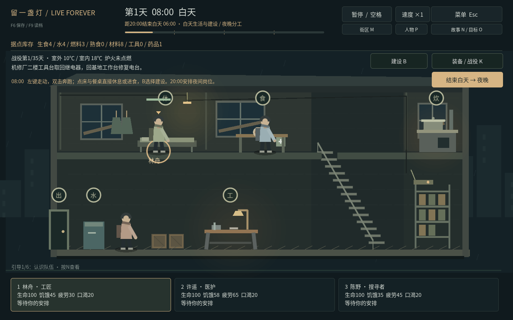
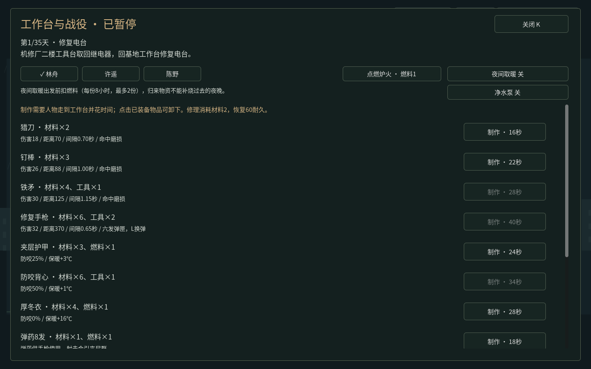
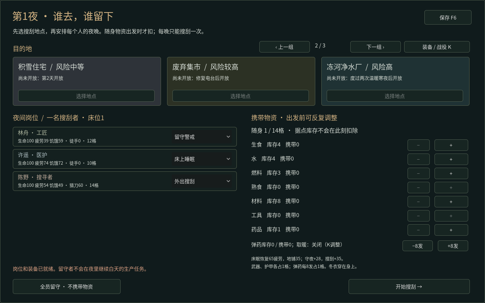

# Live Forever · 留一盏灯 v1.1

单人末日生存游戏：白天直接控制幸存者生活、制作和建设；夜间安排一人搜刮、其他人警戒或睡眠。亲自带回补给和战役零件，在35日窗口内完成撤离，也可以继续无尽生存。敌人为僵尸，暂不新增复杂剧情NPC。人物与房屋采用简陋的原创几何画面。

## 下载后直接玩

| 用途 | GitHub直接下载 | 使用方法 |
| --- | --- | --- |
| Windows 64位游戏 | [live_forever_v11_windows_x64.zip](https://github.com/hypetia/live_forever/raw/refs/heads/downloads-v1.1.0/live_forever_v11_windows_x64.zip) | 完整解压，双击 `LiveForever.exe` |
| Linux x86_64游戏 | [live_forever_v11_linux_x64.zip](https://github.com/hypetia/live_forever/raw/refs/heads/downloads-v1.1.0/live_forever_v11_linux_x64.zip) | 完整解压，运行 `LiveForever.x86_64` |
| Windows一键验收工具 | [live_forever_v11_windows_acceptance.zip](https://github.com/hypetia/live_forever/raw/refs/heads/downloads-v1.1.0/live_forever_v11_windows_acceptance.zip) | 主动运行 `windows_acceptance.cmd`，默认约30分钟 |
| v1.1完整源码 | [live_forever_shelter_m11.zip](https://github.com/hypetia/live_forever/raw/refs/heads/downloads-v1.1.0/live_forever_shelter_m11.zip) | Godot **4.6.3标准版**导入 `project.godot`，按F5 |

普通游戏不需要Godot、Python、登录、服务器或持续联网。验收工具是单独的程序，不会在正常游戏中替你操作。Windows包按官方模板导出；**尚未在Windows真实设备完成验收**。

[全部文件及校验](https://github.com/hypetia/live_forever/tree/downloads-v1.1.0) · [最新main源码ZIP](https://github.com/hypetia/live_forever/archive/refs/heads/main.zip)

运行包、验收包、版本源码ZIP托管在`downloads-v1.1.0`分支，开发源码在`main`。当前环境不能使用GitHub Releases接口，下载分支中的文件**不是Release附件**；打开上面的直接链接即可下载。旧版分支保留。



## 怎么操作

- 点击人物或底部卡片选人；左键地面行走，双击奔跑，右键取消。跨楼层沿楼梯走。点击头顶设施图标可避免点到人物。
- 点床休息、点餐桌吃饭、点水桶后走过去喝水。点灶台／工作台选择基础配方和批数，再确认。新命令替换旧命令，Shift追加，最多三项。
- **R是选中者给自己用药**；P页可由医护帮助别人，界面标明施治者与接受者。饥饿80以上先吃饭，药品可以治伤、感染与疾病，不能代替食物回血。
- **B建设**：简易床、雨水收集器、加固隔断、取暖炉。选择后点绿色建设位置，人物走过去施工，完成才生效。未完成任务取消或日落退料。
- **K装备／战役**：制作武器、防具、冬衣、弹药，分配或卸下装备，修理耐久，制作战役项目，点燃炉火或预留夜间燃料。制作需要实际工时；该界面明确暂停时间。
- 20:00自动进入夜间分工，也可点击“结束白天”。每晚最多一人搜刮、只能往返一次；床位来自建好的床。地图有三页，未开放地点显示条件。
- 夜间左键走动，点容器走近搜索；也可A/D移动、W/S爬梯、Ctrl潜行、Shift奔跑。打开容器后逐份拿取／放回，F尽量全拿，Esc关闭；整理时仍走时间，空格可暂停。专属零件需要单独拿取。
- **J攻击，L手枪换弹，I背包，T在最左入口撤退**。点击僵尸会靠近并攻击一次；后续攻击由玩家继续下令。红条为生命、金条为警觉。徒手只推开，工具用于破锁和制作。
- F6保存，F9确认读取，F11全屏。切换到其他应用自动暂停；重新打开存档保持暂停，无离线消耗。



## 新系统怎样影响游玩

**装备与僵尸。** 猎刀、钉棒、铁矛、手枪具有不同的伤害、距离、前摇、间隔和耐久。护甲减少扑咬与据点袭击伤害，冬衣提高有效温度。武器、护甲各占一格，弹药每8发占一格；射空也耗弹。未使用的弹药须活着返回才入库，外出死亡丢失装备。普通行尸、迅捷尸、重型尸有不同生命、速度和扑咬前摇。

**寒冷与疾病。** 战役前期温和，随后转冷，第13–27天进入严寒。界面显示室外／室温、人物疾病与寒冷；疾病与僵尸感染分别计算。长时间受冷积累疾病，重病损伤生命并降低效率；温暖且吃饱的休息、药品可以恢复。炉火消耗燃料1持续8游戏小时、室内升温18℃；夜间燃料在出发前扣除，不能拿归来补给补烧过去的夜晚。

**九个地点与35日战役。** 旧街、诊所、机修厂、住宅、集市、净水厂、货运站、广播站、撤离码头各有独立容器、楼梯位置、掩体和僵尸组合。电台继电器→寒潮准备→净水滤芯→电池与信标组件→第28天撤离航路；必须实际搜索、携带回入口，再在基地施工。撤离需要为每位活人准备熟食1、水2，以及燃料2。窗口结束会给出未撤离结果，幸存者仍可继续生存。

**资源循环。** 每天仅两处容器补货，其余保持消耗状态；战役零件不随补货复制。雨水收集器仅雨天产水，修好的净水泵需明确开启，燃料1换水3／日。武器修理、取暖、做饭、医疗争夺同一批实际资源。



## 存档与验证

schema8保存装备归属／耐久、弹匣与换弹进度、疾病／寒冷、炉火、工作台在制项目、地图和战役进度，兼容schema1–7。旧版在途物资继续保留，新增战役从导入当天计日；不会因读取旧档反复发装备。系统用户目录和旧版本一致，首次写入保留备份。建议解压到新文件夹，不覆盖正在运行的旧程序。

[本版机制与验证记录](docs/EXPANSION_V11.md) · [Windows检查方法](docs/WINDOWS_ACCEPTANCE.md) · [下载索引](downloads/README.md) · [许可](licenses/README.md)

```sh
git clone --single-branch --branch main https://github.com/hypetia/live_forever.git
python tests/run_checks.py --graphics --artifacts /tmp/live-forever-checks
python tools/build_desktop.py --acceptance --output builds --logs builds/logs
```

开发需要Godot4.6.3、Python3；图形检查需要显示环境。普通玩家不需要这些工具。默认入口为`scenes/campaign.tscn`，`shelter.tscn`是底层回归测试场景。

当前环境访问原作官网、商店、Wiki与说明资料被代理403拦截，未运行或观看原作实机。这版实现按明确的游玩需求独立设计，不声称与《这是我的战争》具有相同的整体成熟度；地图仍以两层横向场景为主，缺少其多样建筑、事件量和多年打磨。
