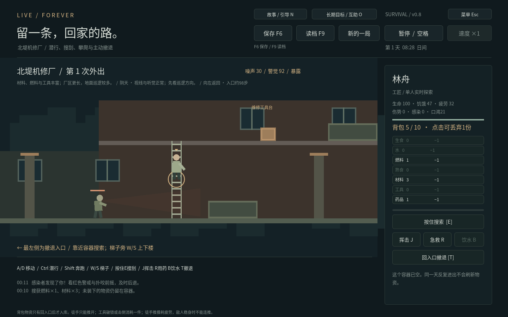

# Live Forever · 留一盏灯 v0.8

原创横版末日生存游戏。从三位幸存者开始，管理最多五人的小队，在庇护所做饭、休息、治疗和修缮，再亲自进入街区搜刮。补给有限，感染者会巡逻、听声调查与追击；必须带着物资走回入口，才能交给留守的人。没有固定天数结局。



[长期目标](docs/goals-preview.png) · [受击反馈](docs/combat-feedback.png) · [正常游玩说明](docs/PLAYING.md) · [同伴故事](docs/story-preview.png) · [新手引导](docs/guide-preview.png) · [30／60天压力报告](docs/ENDURANCE_REPORT.md) · [人物档案](docs/people-preview.png) · [扩充队伍](docs/crew-preview.png) · [14天平衡报告](docs/BALANCE_REPORT.md) · [三处地点](docs/locations-preview.png) · [据点与升级](docs/upkeep-preview.png) · [旧街探索](docs/expedition-preview.png) · [基地](docs/shelter-preview.png) · [独立运行包实测](docs/native-release-preview.png)

## 直接开始玩

本轮另提供两个独立运行包，无需安装 Godot：

- **Windows 64位：** 解压 `live_forever_v08_windows_x64.zip`，双击 `LiveForever.exe`。
- **Linux x86_64：** 解压 `live_forever_v08_linux_x64.zip`，运行 `LiveForever.x86_64`。若解压工具没有保留权限，先执行 `chmod +x LiveForever.x86_64`。

也可打开源码工程：安装 **Godot 4.6.3 标准版**，导入根目录 `project.godot`，等待资源导入后按 **F5**。不需要账号、.NET、收费插件、联网服务或在线 AI。

Linux 已实际导入、运行与交互验证。Windows 使用匹配的官方 4.6.3 模板导出，**尚未在 Windows 真机运行验证**。软件没有自动更新、在线遥测或云存档。另有Windows一键验收包，运行方式、真实结果与人工检查见[Windows验收说明](docs/WINDOWS_ACCEPTANCE.md)；普通游戏不包含自动验收控制。

有存档会自动恢复并保持暂停；先检查状态，再按空格继续。v0.3 / v0.4 / v0.5 / v0.6 / v0.7 的旧进度会迁移，不要求重开。

## 第一次往返

1. 按 **P** 查看人物，可逐人授权自动饮水 / 进食 / 休息（默认关闭，会使用基础物资）；也可手动 **F → G → H** 排“做饭 → 吃饭 → 睡觉”。没有熟食也能预排，开工仍会检查库存。
2. 按 **3** 选陈野，再按 **V**。初次选“河湾旧街”；工具、药品可选携带，各占背包一格。
3. **A/D** 移动，到街口箱子旁**按住 E**搜索。物资先留在背包，不会远程进入基地。
4. 走回最左侧入口，按 **T** 撤退。第一趟可以少拿一些，先熟悉路线。
5. 归来暂停，检查伤势 / 感染，安排吃饭、睡觉或 **R** 治疗。按 **M** 查看地图、据点和事件，**F1** 打开游戏内完整指南。

按 **N** 打开六项新手目标：认识队伍、进食、饮水、休息、带回补给、维护据点。目标由实际行动记录，顺序不限，可隐藏提示；完成后仍可重看。

## 同伴的故事

六位固定角色各有一章个人事件，另有低信任与压力触发的争执、伤亡后的纪念，共八章。事件根据实际工作、归来、加入日期与关系出现；按 **N** 阅读并选择。每章只发生一次，开出的谈话可一直保留，不自动花物资、不自动暂停，也没有倒计时惩罚。

界面提前说明费用和双方情绪／信任变化；可以支付物资，也能选择保留物资的完整分支。谈话不代替吃饭、饮水或睡觉，外出时需要先回基地。选择、结果、参与者和引导进度随存档保留。详见[故事与引导](docs/STORIES.md) · [长期目标](docs/GOALS.md) · [桌面验收](docs/DESKTOP_ACCEPTANCE.md)。

## 可选长期目标与互助

按 **O** 选择恢复通讯、建立救护点或连接补给线，共九个阶段。实际搜索指定容器，并带回净补给，才能提交勘查；建设阶段列出完整费用、日期和据点条件，完成后仍可继续生存。

第4天起、至少一级据点，可以用药品2换生食3／水2，或材料4换水3／燃料1；完成补给线后另有接应配方。所有互助共用两日间隔，付费后才得到物资，外出时不能远程使用。详见[目标规则](docs/GOALS.md)。

## 三处街区，各有取舍

| 地点 | 物资侧重 | 路线与危险 |
| --- | --- | --- |
| 河湾旧街 | 食物、水，深处有燃料 | 初始3名感染者；适合首次往返，深处锁柜搜索较慢 |
| 雨杉诊所 | 药品、水 | 梯子较近，药品集中二楼；走廊巡逻密集 |
| 北堤机修厂 | 材料、燃料、工具 | 厂区更长，初始4名感染者；补给能支撑维修与升级 |

每处6个容器，路线、梯子、掩体、巡逻和配色不同。**各地点独立保存余量与击倒状态**，换地图不刷新；新一天在下一趟出发前，仅两处容器轮换补充并公告感染者迁入。每三天多一名感染者，最多5名，生命始终40，不无限叠血；活动中不突然刷新。

阴天视听正常；细雨减少听觉范围，浓雾缩短视距，大风略掩盖声音并加快基地磨损。准备界面显示本趟天气与说明，探索中的预测保持到归来。贴得很近仍会被看见，天气不保证安全。

## 操作表

| 操作 | 基地 | 外出 |
| --- | --- | --- |
| 选人 | 点击人物 / 头像，1—6 / Tab（含已故记录） | 固定控制出发者 |
| 移动 | 派工后自动沿路行走 | A/D 或 ←/→ |
| 潜行 / 奔跑 | — | 按住 Ctrl / Shift |
| 攀梯 | 自动经过楼梯 | 梯子旁 W/S 或 ↑/↓ |
| E | 追加所选任务 | 按住搜索；也可按住搜索按钮 |
| F / G / H / C | 做饭 / 吃饭 / 睡觉 / 制工具 | — |
| R | 安排治疗 | 消耗背包药品急救，3秒冷却 |
| J | — | 挥击：工具击倒，徒手推开；会消耗疲劳 |
| B | P人物页可饮水 | 使用背包中的水，口渴−60 |
| Q | 取消此人全部任务 | — |
| V | 选择地点、装备并准备出发 | — |
| T | — | 必须回到左侧入口才可撤退 |
| 丢弃 | — | 点击背包行，丢1份，无法拾回 |
| N | 故事、选择结果与新手目标 | 查看引导；谈话需回基地才能处理 |
| O | 长期目标、阶段建设与互助 | 查看条件；回基地后才能支付和提交 |
| F11 | 全屏／窗口切换 | 同样可用，设置复选框保持一致 |
| P / M / F1 / Esc | 人物 / 街区手册 / 指南 / 设置菜单 | 查看或设置；不允许远程升级、交易或换地图 |
| 空格 | 暂停 / 继续 | 同样冻结敌人、移动与搜索 |
| 速度 | 1x / 3x | 固定1x，归来恢复原速度并暂停 |
| F6 / F9 | 保存 / 确认读档 | 包括搜索、攀梯、战斗途中 |

外出时其余留守者继续原队列及事先授权的照料，不能远程重新派工。打开准备、手册或确认窗口暂停世界；取消恢复原暂停状态。窗口右上角可打开菜单，里面提供音量、提示音、原创风声、全屏和保存退出；偏好设置独立保存，不随新游戏清除。切换到其他应用会暂停并清除持续移动／搜索输入，返回后按空格继续；画面保持比例，帧率上限60。

## 背包与战斗

背包10格，每份资源各占一格，携带工具 / 药品也算。满了可以丢弃后继续搜；未拿走的东西留在容器。搜索需要站在同层容器旁按住，移动或松开暂停，换目标 / 攀梯 / 整理背包会清除该次搜索。

有工具开锁约3秒并消耗一件，无工具可慢慢撬开但更吵。J约0.2秒前摇，有工具时成功命中消耗一件、击倒近处一个目标；空挥不耗工具，徒手仅推开1.6秒；挥击耗疲劳1.2，成功推开再耗2.8。感染者有3.6秒稳身期，不能续推，头顶会显示“稳”；这段时间需要躲避或使用工具。

敌人有巡逻、调查、追击和约0.8秒扑咬前摇。可观察方向、警觉条和范围，拉开距离或及时推开。咬中损失14生命、增加12伤势与8感染，有短暂受击保护。死亡永久失去此人和本次背包。受击有短暂色彩、伤害数字和生命条反馈；入口距离会显示，楼上撤退会提示先下楼。

## 人物、成长与补员

按 **P** 打开人物页。工艺、照护、探索每项0—3级，30 / 90 / 180经验升级，每级进度速率+5%，最多15%。经验来自实际工作、搜索和净补给归来；取消、空箱和只带原装备回来不获完成奖励。

心境、压力和创伤影响效率与恢复，队友死亡会留下悲伤和长期记录。食物、睡眠、治疗、安全归来和同伴支持能缓解；不随机拒绝命令或离队。人物间有独立信任，共餐消耗熟食1、缓解双方压力并增加信任，每人180秒冷却。

医护可在P页援助受伤同伴：药品1，生命+20至26、伤势−40、感染−35，获得照护经验；每人180秒冷却。餐桌治疗仍可排队，恢复更充分。两者都不能复活已故成员。

第3、6、9天分别可遇到**沈禾（厨师）／顾苒（医护）／唐弥（搜寻者）**，需要一级据点、生食2、水2、药品1，每人仅一次，最多五位存活者。旧成员的死亡保留，加入者需要额外照料；六条记录包含可能的已故成员。

各人都有明确差异：林舟工艺经验较快，许遥承受丧失的压力较低，陈野善于搜索；厨师做饭快但易饿，新医护学照护快但易疲劳，新搜寻者受伤时更易紧张。完整规则见[人物系统](docs/PEOPLE.md)。

口渴每秒+0.045，80降效、95起慢慢伤生命。饮水消耗水1、降低60口渴；基地P页、外出B键。自动照料需逐人授权，不自动花药品或工具，不打断已有工作；新成员默认关闭。

## 基地、修缮与升级

初始库存：生食4、水4、燃料3、熟食0、材料8、工具0、药品1。每人最多排三项，设施分别先进先出；修整 / 制作共用工作台，吃饭 / 治疗共用餐桌。

| 任务 | 基础耗时 | 成本与效果 |
| --- | --- | --- |
| 做饭 | 6秒 | 生食1 + 水1 + 燃料1 → 熟食2 |
| 吃饭 | 4秒 | 熟食1 → 完成时饥饿−55 |
| 睡觉 | 20秒 | 每秒疲劳−3，中断保留已有休息 |
| 制工具 | 工匠6秒 / 其他8秒 | 材料2 → 工具1 |
| 治疗 | 医护6秒 / 其他8秒 | 药品1 → 完成时生命+25、伤势−50、感染−40 |
| 修整 | 工匠4.5秒 / 其他6秒 | **材料1 → 完成时庇护所结构+18** |

开工整份扣料，完成才产出 / 恢复；手动取消退回用料，不提前获得修缮、饱腹或治疗。缺料跳过该项并提示，死亡不退未完成用料。

结构初始82%，随模拟时间磨损；大风日更快。低于40%生产降速，低于20%进一步降速，恢复任务不受影响。按M进入“庇护所”安排修整，或支付升级：

| 等级 | 升级费用 | 持续效果 |
| --- | --- | --- |
| 1 | 材料4、工具1 | 生产速度+8%，磨损−12% |
| 2 | 材料6、工具1、燃料2 | 累计生产+16%，磨损−24% |
| 3 | 材料8、工具2、药品1 | 累计生产+24%，磨损−36% |

保鲜容量为生食12、熟食6，每级增加生食4 / 熟食2；每清晨对超额部分损耗15% / 25%，向上取整，人物页显示当前预计损耗。少量现做能减少浪费。

每次升级结构+12，最多3级；食物、药品和燃料仍要外出寻找，没有永久安全或无限自产。

## 事件与生存记录

新一天会出现一次待处理选择，在M“庇护所”页面查看。未处理的选择保留，不会暗中替你支付：

- 接雨水：材料2换水6。
- 换物者：材料4换生食4、燃料2。
- 风前加固：材料2、结构+8；选择不加固则明确扣结构8，不直接伤人。
- 邻街求助：药品1换工具2、水3。

选择先检查全份费用，缺料不扣部分资源，接受后不能重复领取。“生存记录”显示净补给、维修 / 事件记录和六项可选里程碑，**带着原装备出去再回来不算搜到补给**。抵达第七天或达成里程碑都不强制结束。

饥饿、疲劳、伤势、感染越低越好。1x每秒两游戏分钟，一天720秒；严重饥饿 / 疲劳影响效率并缓慢伤生命。感染大于0会发展，30预警、60起损害健康；重伤50起降效。途中急救每份药品恢复生命25、伤势40、感染35，基地治疗略好。全员死亡才结束当前局，没有离线消耗。

## 保存与旧版兼容

手动F6、每60模拟秒和正常关窗保存。强制杀进程 / 编辑器停止不保证保存。读档后暂停；存档包含三处地点、人物 / 设施任务、已扣用料、需求、背包、搜索 / 攀梯 / 双方攻击状态、结构 / 等级、事件与记录、同伴故事选择、新手目标、长期项目、勘查及互助账目。

内部格式为 **schema 6**，仍使用旧路径 `user://shelter_v1.json`，避免升级找不到旧进度。顶栏保存状态悬停可看实际位置。v0.3 schema 1、v0.4 schema 2、v0.5 schema 3、v0.6 schema 4、v0.7 schema 5 均可迁移；不重扣原工作用料、不赠送新版药品。旧版已经开工的免费“修整练习”按原语义结束或取消，不会凭空退材料或获得新版修缮收益。

整体验证后统一恢复；临时文件回读后替换主档，保留上一有效文件为备份。主档损坏尝试备份，两份都坏则保留文件并停用自动保存。SHA-256用于发现损坏，不是加密或反作弊。迁移照料默认关闭，按原完成记录折算有限经验，保留既有工作进度。偏好设置另存 `user://preferences.cfg`。

## 开发验证与导出

Godot4.6.3，Python3仅用于可选测试运行器，无第三方Python包依赖：

```sh
python tests/run_checks.py
# 有图形环境时，加上真实键鼠与截图检查
python tests/run_checks.py --graphics
```

运行器复制到干净临时目录和独立用户目录，执行十二套逻辑检查（含14天对照、三人30天、五人60天与逆境恢复）、主场景启动和17个持久化进程，不改玩家存档。也可直接执行单套：

```sh
godot --headless --editor --import --quit
godot --headless --path . --script res://tests/test_long_term.gd
```

Linux独立程序另有系统级输入探针（需要专用X显示、libX11、libXtst与ImageMagick）：

```sh
python tests/native_release_smoke.py builds/linux/LiveForever.x86_64 --display :98 --artifacts /tmp/live_forever_native_check
```

云容器可参考 `tests/support/xorg-dummy.conf` 配置虚拟显示；正常玩家无需这些开发工具。

安装匹配的Godot官方导出模板后，可在干净副本中导出两种桌面包并生成校验记录：

```sh
python tools/build_desktop.py --acceptance --output builds --logs builds/logs
```

也可直接使用项目内预设：

```sh
mkdir -p builds/windows builds/linux
godot --headless --path . --export-release "Windows Desktop" builds/windows/LiveForever.exe
godot --headless --path . --export-release "Linux Desktop" builds/linux/LiveForever.x86_64
```

发行包嵌入游戏数据，排除测试、需求文档与开发截图；源代码包保留它们。环境目录只读时，设置可写的 `XDG_CONFIG_HOME`、`XDG_CACHE_HOME`、`XDG_DATA_HOME`。普通Windows运行包不需要。

[真实进度 / 验证](docs/PROGRESS.md) · [探索机制](docs/EXPEDITIONS.md) · [长期规则](docs/LONG_TERM.md) · [人物](docs/PEOPLE.md) · [实测平衡](docs/BALANCE_REPORT.md) · [长期目标与互助](docs/GOALS.md) · [桌面检查](docs/DESKTOP_ACCEPTANCE.md) · [长程与恢复](docs/ENDURANCE_REPORT.md) · [故事与引导](docs/STORIES.md) · [架构](docs/ARCHITECTURE.md) · [存档](docs/SAVES.md) · [设计决策](docs/DECISIONS.md)

当前采用原创几何画面与基础AI；三位初始成员、三位固定来访者，最多五人存活在队。没有多人、枪械、跳跃、复杂墙体视线、多槽存档或剧情战役。长期平衡已通过熟悉地图的三人 / 五人确定性策略连续30／60天验证，更多操作水平与策略仍需人工试玩。字体使用Noto Sans CJK SC子集，许可见[OFL.txt](assets/fonts/OFL.txt)；运行时组件许可见[第三方许可](licenses/README.md)。
