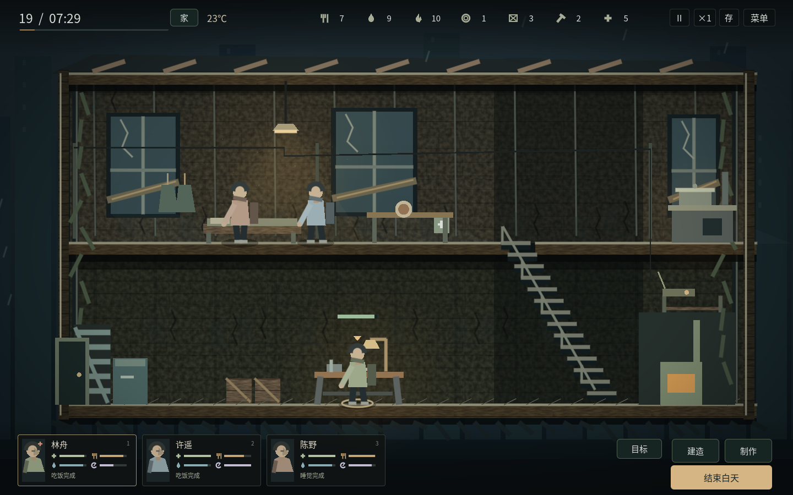
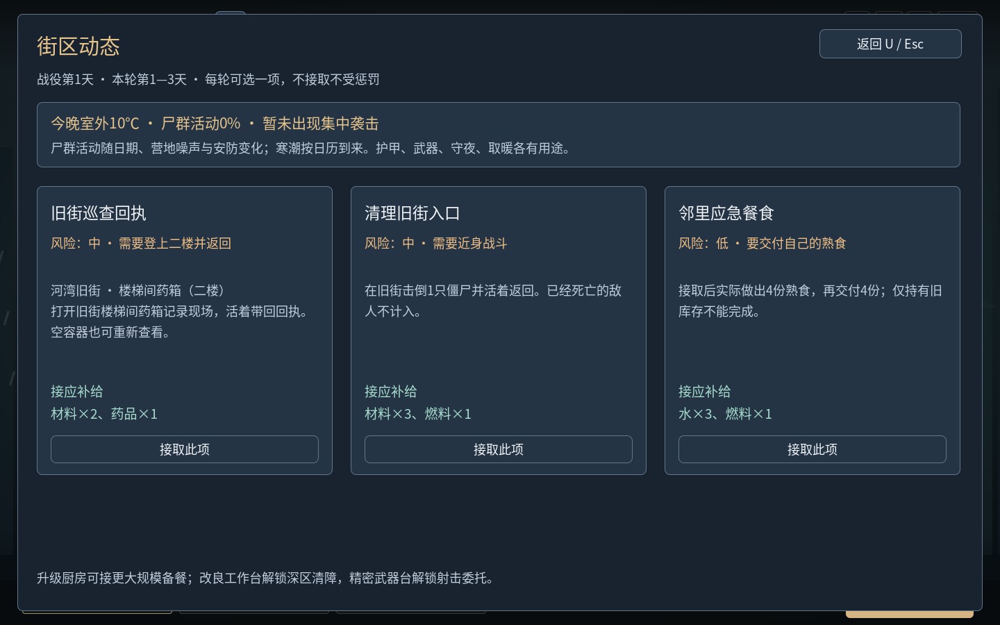

# Live Forever · 留一盏灯 v1.6.0

单人末日生存游戏：白天直接控制幸存者生活、制作和建设；夜间安排一人搜刮、其他人警戒或睡眠。亲自带回补给和战役零件，在35日窗口内完成撤离，也可以继续无尽生存。敌人为僵尸，暂不新增复杂剧情NPC。人物与房屋采用原创的简化画面。v1.6.0补齐按感知追踪、跨层攀爬、家具遮挡与扑咬落点判定，以及Z安防贡献检查与清晨复盘；v1.5.0新增三日街区委托、风险预报，统一面板对比度与字号，补上命中血迹、受击动作、倒地尸体和三类敌人轮廓；v1.4.0增加厨房／工作台三级升级、配方解锁与效率，并把修缮避难所和设施升级分开；v1.3.3补齐双侧边缘离场确认、夜间持械外观和随身装备查看；v1.3.2补齐白天键盘移动；v1.3.1修复搜索进度、空箱外观和返程操作；v1.3补充影响实际操作的角色专长、有准备成本的迁居，以及门窗加固、预警、拒马和安防维护。主画面仍以场景、图标和人物卡为主。

## 下载后直接玩

| 用途 | GitHub直接下载 | 使用方法 |
| --- | --- | --- |
| Windows 64位游戏 | [live_forever_v16_windows_x64.zip](https://github.com/hypetia/live_forever/raw/refs/heads/downloads-v1.6.0/live_forever_v16_windows_x64.zip) | 完整解压，双击 `LiveForever.exe` |
| Linux x86_64游戏 | [live_forever_v16_linux_x64.zip](https://github.com/hypetia/live_forever/raw/refs/heads/downloads-v1.6.0/live_forever_v16_linux_x64.zip) | 完整解压，运行 `LiveForever.x86_64` |
| Windows一键验收工具 | [live_forever_v16_windows_acceptance.zip](https://github.com/hypetia/live_forever/raw/refs/heads/downloads-v1.6.0/live_forever_v16_windows_acceptance.zip) | 主动运行 `windows_acceptance.cmd`，默认约30分钟 |
| v1.6.0完整源码 | [live_forever_shelter_m16.zip](https://github.com/hypetia/live_forever/raw/refs/heads/downloads-v1.6.0/live_forever_shelter_m16.zip) | Godot **4.6.3标准版**导入 `project.godot`，按F5 |

普通游戏不需要Godot、Python、登录、服务器或持续联网。验收工具是单独的程序，不会在正常游戏中替你操作。Windows包按官方模板导出；**尚未在Windows真实设备完成验收**。

[全部文件及校验](https://github.com/hypetia/live_forever/tree/downloads-v1.6.0) · [最新main源码ZIP](https://github.com/hypetia/live_forever/archive/refs/heads/main.zip)

运行包、验收包、版本源码ZIP托管在`downloads-v1.6.0`分支，开发源码在`main`。当前环境不能使用GitHub Releases接口，下载分支中的文件**不是Release附件**；打开上面的直接链接即可下载。旧版分支保留。

## 四项状态都以100为最佳

**生命、饱腹、水分、精神：越满越好，满分100。**吃饭补饱腹，喝水补水分，睡眠补精神。人物小卡以四个图标和状态条显示；悬停看准确数值，双击打开人物详情。伤病用状态提示区分，不和四项核心状态混在一起。

夜间手持实际武器，身上显示护甲与冬衣；人物卡右侧三个装备图标带耐久条，点击暂停查看详情。搜索在对象旁显示进度环和进度条；交互以轮廓、小图标及行走目标反馈，空箱实时变灰，不添加“可交互／已搜空”文字。主画面保留时钟、温度、资源图标和人物卡；设施提示在悬停时出现，制作与规则按需打开。拾取改为图标格子，清晨先显示人物与简短结果，详细纪要可展开。



## 怎么操作

- 点击人物或底部小卡选人，悬停查看生命／饱腹／水分／精神，双击小卡打开人物详情；白天和夜间均可A/D或方向键左右移动，Shift奔跑；白天在楼梯口W/S上下楼。也可左键地面行走、双击奔跑、右键取消，跨楼层沿楼梯走。点击头顶设施图标可避免点到人物。
- 点床休息、点餐桌吃饭、点水桶后走过去喝水。点灶台／工作台选择基础配方和批数，再确认。新命令替换旧命令，Shift追加，最多三项。
- **R是选中者给自己用药**；P页可由医护帮助别人，界面标明施治者与接受者。饱腹20以下先吃饭，药品可以治伤、感染与疾病，不能代替食物回血。
- **B建设**：简易床、雨水收集器、加固隔断、取暖炉。选择后点绿色建设位置，人物走过去施工，完成才生效。未完成任务取消或日落退料。
- **H家园／迁居**：门窗、预警、拒马、维护、吉他，以及勘察后准备新址和打包迁居。详细项目按需打开，不常驻主场景。
- **K设施／装备**：分为工作台、厨房、装备仓库和战役设备。点击场景中的灶台或工作台也能进入对应页；升级需要材料和施工时间，解锁新配方并提高效率。手枪和弹药需三级工作台。修缮避难所仅恢复房屋结构，装备维修仅恢复装备耐久；两者都不是设施升级。
- 20:00自动进入夜间分工，也可点击“结束白天”。每晚最多一人搜刮、只能往返一次；床位来自建好的床。地图有三页，未开放地点显示条件。
- 夜间左键走动，点容器走近搜索；也可A/D移动、W/S爬梯、Ctrl潜行、Shift奔跑。打开容器后逐份拿取／放回，F尽量全拿，Esc关闭；整理时仍走时间，空格可暂停。专属零件需要单独拿取。
- **J攻击，L手枪换弹，I背包，T返程**。T或返程按钮从当前位置安排实际回程，拾取窗口中也可用；到左侧出口后确认才入库，也可走到地图右侧边缘确认离开；点击其他目标或再次按T可取消可选回程。点击僵尸会靠近并攻击一次；后续攻击由玩家继续下令。红条为生命、金条为警觉。徒手只推开，工具用于破锁和制作。
- **Z安防检查**：查看设施、各守夜者和预警的实际贡献；清晨复盘耐久、损失及护甲／窗网减伤。按需打开，Esc返回。
- **U街区动态**：每三天可接取一项巡查、清障／射击或餐食委托；现场进度须活着返回才计入，餐食需要接取后实际烹饪并交付。窗口中显示风险和补给，夜间也可只读查看。
- F6保存，F9确认读取，F11全屏。切换到其他应用自动暂停；重新打开存档保持暂停，无离线消耗。



## 新系统怎样影响游玩

**装备与僵尸。** 猎刀、钉棒、铁矛、手枪具有不同的伤害、距离、前摇、间隔和耐久。护甲减少扑咬与据点袭击伤害，冬衣提高有效温度。武器、护甲各占一格，弹药每8发占一格；射空也耗弹。未使用的弹药须活着返回才入库，外出死亡丢失装备。普通行尸、迅捷尸、重型尸有不同生命、速度和扑咬前摇。敌人沿楼梯追击，丢失感知后调查最后位置再返回巡逻。近战、扑咬与低弹道会受可见家具遮挡，站立抬枪可越过矮家具；扑咬落下时重新检查距离与方向。

**寒冷与疾病。** 战役前期温和，随后转冷，第13–27天进入严寒。界面显示室外／室温、人物疾病与寒冷；疾病与僵尸感染分别计算。长时间受冷积累疾病，重病损伤生命并降低效率；温暖且吃饱的休息、药品可以恢复。炉火消耗燃料1持续8游戏小时、室内升温18℃；夜间燃料在出发前扣除，不能拿归来补给补烧过去的夜晚。

**九个地点与35日战役。** 旧街、诊所、机修厂、住宅、集市、净水厂、货运站、广播站、撤离码头各有独立容器、楼梯位置、掩体和僵尸组合。电台继电器→寒潮准备→净水滤芯→电池与信标组件→第28天撤离航路；必须实际搜索、携带回入口，再在基地施工。撤离需要为每位活人准备熟食1、水2，以及燃料2。窗口结束会给出未撤离结果，幸存者仍可继续生存。

**资源循环。** 每天仅两处容器补货，其余保持消耗状态；战役零件不随补货复制。雨水收集器仅雨天产水，修好的净水泵需明确开启，燃料1换水3／日。武器修理、取暖、做饭、医疗争夺同一批实际资源。


## 角色、安防与迁居

人物具有独立专长：陈野近战+40%和低脚步声，沈禾同料做3份饭，许遥医疗援助与演奏更好，顾苒处理伤病更彻底，唐弥恢复更快、邻里交换得到更多物资。P页显示实际效果；现有工艺／照护／探索成长和情绪、关系机制继续保留。

家园不是随意切换的菜单：先深入住宅或货运站勘察、活着返回；在H准备清理工具，再去新址消灭附近上下层感染者、确认并带回记录；最早第5天打包运输补给，整夜全员转移，途中消耗精神、受冷并可能遇袭。迁居后至少休整5天。内巷更暖且隐蔽，货场更坚固但更冷、更易吸引尸群。旧址固定设施拆解回收部分材料，新址等级和安防重新建设；库存、装备和战役设备随队转移。

门、窗、预警铃、拒马与守夜共同影响实际袭击。设施有安防耐久，受损降低保护，维护要材料和工时；白天制造与音乐的噪声影响尸群注意。袭击和迁居行军仍采用清晨统一结算。

## 存档与验证

旧档无需重开。schema13增加敌人的原巡逻楼层、目标记忆和攀爬进度，兼容schema1–12；schema10保留家园、迁居、安防、勘察与演奏记录，增加可恢复的返程安排，继续保存装备归属／耐久、弹匣与换弹进度、疾病／寒冷、炉火、工作台在制项目、地图和战役进度，兼容schema1–9。旧版在途物资继续保留，新增战役从导入当天计日；不会因读取旧档反复发装备。系统用户目录和旧版本一致，首次写入保留备份。建议解压到新文件夹，不覆盖正在运行的旧程序。

[v1.6敌人AI、攻击与安防](docs/AI_SECURITY_V16.md) · [v1.5事件、界面与战斗](docs/DIRECTOR_UI_COMBAT_V15.md) · [v1.4设施升级](docs/FACILITIES_V14.md) · [v1.3.3离场与装备](docs/DEPARTURE_EQUIPMENT_V133.md) · [v1.3.2白天键盘修复](docs/KEYBOARD_V132.md) · [v1.3.1交互修复与验证](docs/INTERACTIONS_V131.md) · [v1.3角色、家园与验证](docs/HOMES_V13.md) · [v1.2界面说明](docs/PRESENTATION_V12.md) · [装备、气候、九地图和战役规则](docs/EXPANSION_V11.md) · [Windows检查方法](docs/WINDOWS_ACCEPTANCE.md) · [下载索引](downloads/README.md) · [许可](licenses/README.md)

```sh
git clone --single-branch --branch main https://github.com/hypetia/live_forever.git
python tests/run_checks.py --graphics --artifacts /tmp/live-forever-checks
python tools/build_desktop.py --acceptance --output builds --logs builds/logs
```

开发需要Godot4.6.3、Python3；图形检查需要显示环境。普通玩家不需要这些工具。默认入口为`scenes/campaign.tscn`，`shelter.tscn`是底层回归测试场景。

当前环境访问原作官网、商店、Wiki与说明资料被代理403拦截，未运行或观看原作实机。这版实现按明确的游玩需求独立设计，不声称与《这是我的战争》具有相同的整体成熟度；地图仍以两层横向场景为主，缺少其多样建筑、事件量和多年打磨。
