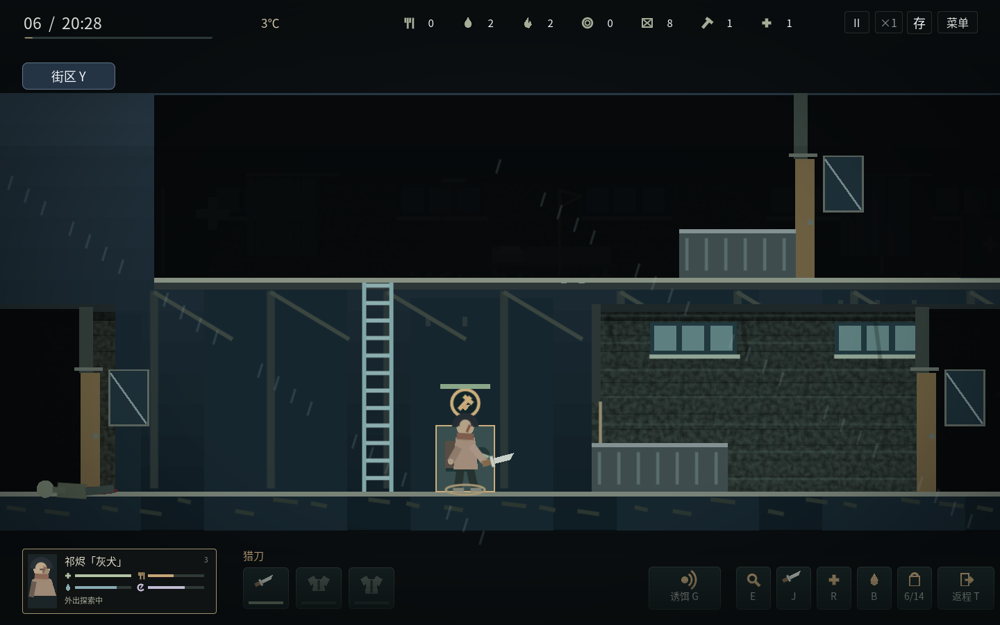
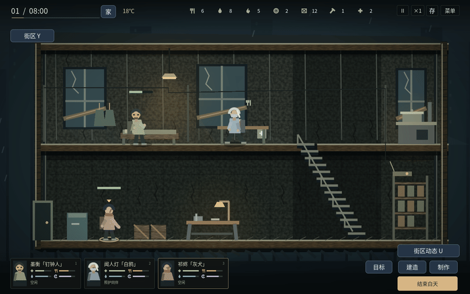
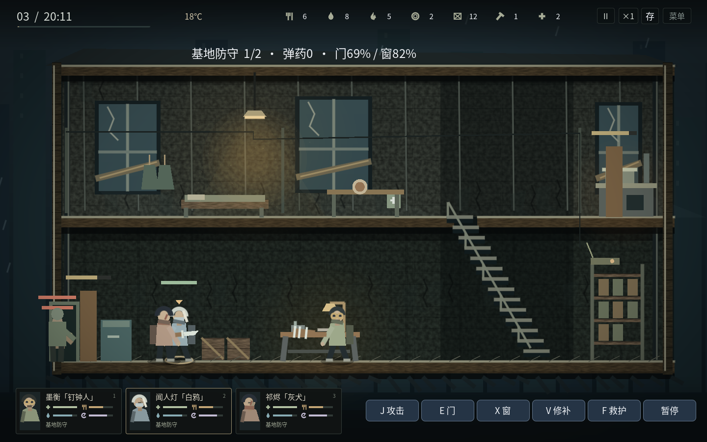
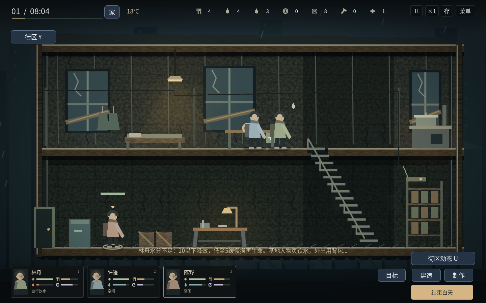
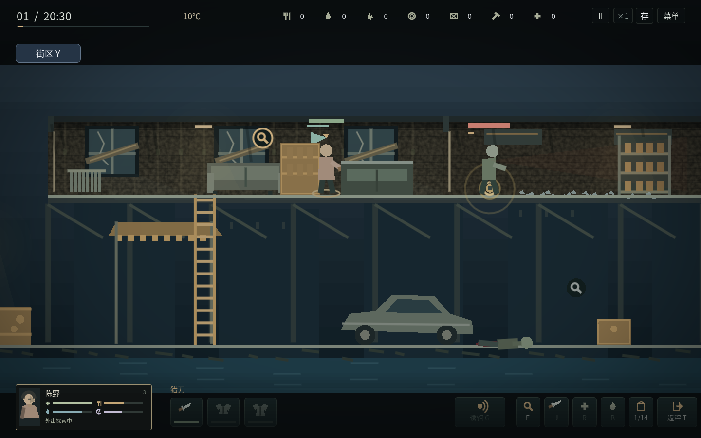
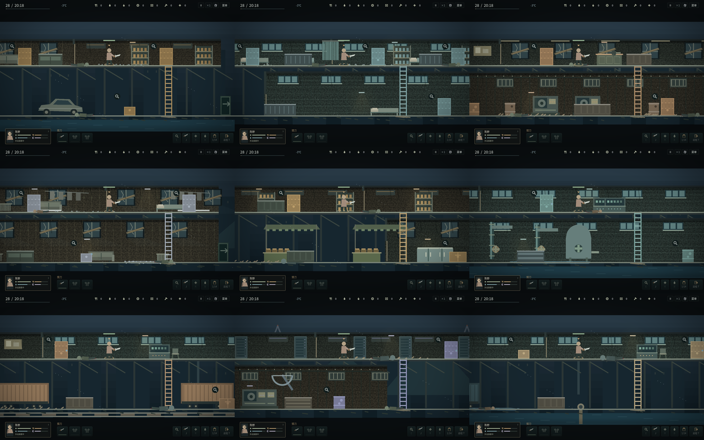

# Live Forever · 封锁区：余生 v1.14.1

单人僵尸生存游戏：白天经营、制作、改造并照顾同伴，夜间亲自潜入搜刮、抵御尸群。v1.13把诊所、供水站与基地连成持续变化的街区：保全或拆取冷链、持续供水与分流、背负救援及共同经历。保留同伴协作、记忆搜索和关节动画。保留九地图、三个开局、六名人物及个人线、35日撤离战役、无尽生存、迁居和前哨。采用原创简化画面。

## 下载后直接玩

v1.14.1 根据试玩偏好更换三位原型，现为斯塔克、白求恩、里昂、小当家、华佗、杰克船长，人物页显示参照来源，外观与能力同步调整；同时更新游戏标题和餐饮动作。肉类、蔬菜、饮料仍未拆分为独立物品；后续将继续完善。一键验收包已同步至 v1.14.1，Windows 真机仍待验收。

| 用途 | GitHub直接下载 | 使用方法 |
| --- | --- | --- |
| Windows 64位游戏 | [live_forever_v1.14.1_windows_x64.zip](https://github.com/hypetia/live_forever/raw/refs/heads/downloads-v1.14.1/live_forever_v1.14.1_windows_x64.zip) | 完整解压，双击 `LiveForever.exe` |
| Linux x86_64游戏 | [live_forever_v1.14.1_linux_x64.zip](https://github.com/hypetia/live_forever/raw/refs/heads/downloads-v1.14.1/live_forever_v1.14.1_linux_x64.zip) | 完整解压，运行 `LiveForever.x86_64` |
| Windows一键验收工具 | [live_forever_v1.14.1_windows_acceptance.zip](https://github.com/hypetia/live_forever/raw/refs/heads/downloads-v1.14.1/live_forever_v1.14.1_windows_acceptance.zip) | 主动运行 `windows_acceptance.cmd`，默认约30分钟 |
| v1.14.1完整源码 | [live_forever_v1.14.1_source.zip](https://github.com/hypetia/live_forever/raw/refs/heads/downloads-v1.14.1/live_forever_v1.14.1_source.zip) | Godot **4.6.3标准版**导入 `project.godot`，按F5 |

普通游戏不需要Godot、Python、登录、服务器或持续联网。验收工具是单独的程序，不会在正常游戏中替你操作。Windows包按官方模板导出；**尚未在Windows真实设备完成验收**。

[全部文件及校验](https://github.com/hypetia/live_forever/tree/downloads-v1.14.1) · [最新main源码ZIP](https://github.com/hypetia/live_forever/archive/refs/heads/main.zip)

v1.14.1 运行包和对应源码托管在 `downloads-v1.14.1`；同版验收包在 `downloads-v1.14.1`，开发源码在 `main`。当前环境不能使用GitHub Releases接口，下载分支中的文件**不是Release附件**；打开上面的直接链接即可下载。旧版分支保留。

[本版角色与验证范围](docs/CHARACTER_REFERENCES_V25.md)

## 新版怎样玩

**诊所与水厂会记住行动。** 点击现场设备或靠近按E，选择保全、拆取、持续生产与分流；施工有进度，完成才扣料。普通容器在这两张地图搜空后保持空。水厂可把水送回基地，也可支持诊所制作护理用品。

**救人需要带人回来。** 第6天起可在诊所遇到被困同伴；背负占2格、移动慢20%，实际抵达出口才入队。获救医护在伤情接近时记得救援者，急重伤优先，仍需F4授权。

[本轮玩法与边界](docs/NEIGHBORHOOD_V23.md) · [验证记录](docs/v23-validation.json)



**F4安排同伴协作。** 可单独授权替饥饿同伴备餐，或让医护空闲时走近伤员护理。两项默认关闭，优先自身需要与玩家命令；备餐真实消耗原料，护理需到场工作4秒，完成才扣药1。伤员离开、医护受伤、缺药或日落会中止，不会远程回血。基本自理仍默认开启。

**动作有明确阶段。** 行走／奔跑／潜行、爬梯、搜刮、开门拆窗与翻越、吃喝烹饪、护理、近战／射击／换弹、受击与倒地均有对应动作。武器在准备→接触→恢复间连续变化，命中与血迹由真实判定触发；爬梯、翻窗、搜刮时会收拢武器。

[新规则、动作与验证范围](docs/COOPERATION_MOTION_V22.md)




**F2选开局，F3看人物志与感染档案。** 三个开局分别是残灯旅社、断桥最后一餐、白霜救护站，具有不同队伍、库存、装备、初始建设与气候。替换战役须确认；读档不会再次发放初始物资。六名人物各有原有技能、行为偏好、两种个人信念和需要实地勘查的专属工程；完成才解锁相应能力。

**门窗是真实路线。** 靠门按住E开关，Alt窥视邻近房间，X静拆窗口（完成消耗工具1），Shift+X砸窗制造响声，再按X翻越。鼠标也可点击门和窗自动走近操作。关闭的门遮挡视线与近战，敌人只能调查听见的方向、沿路破门；翻窗不等于瞬移。T返程会实际处理沿路的关门。

**夜袭可以自己打。** 第3夜起按现有风险规则触发；开始暂停，空格开战。A/D、W/S或鼠标移动，J攻击，E入口门，X二层窗，V就近修补，医护F救同伴，R自己用药；点击人物卡接管。守夜同伴会协战，门窗、护甲、武器磨损、弹药、受伤及物资损失都真实结算。F2可在白天选择原有战术结算。

[完整新规则与验证范围](docs/TACTICS_CHARACTERS_V21.md)



**角色会自行照顾基本需要。** 空闲时饱腹或水分≤35、精神≤30，会走到真实餐桌、水桶或空床。手动工作、移动和取消优先；缺物资会等待。P页可逐人关闭基本自理，“缺饭时自行做饭”单独选择，默认关闭，避免擅自消耗燃料。旧档升级后也会开启基本自理。

[自理规则与验证](docs/AUTONOMY_V20.md)



**Y看街区，G投发声诱饵。** 枪声与大动静会留下地区压力，影响下一次进入的敌人组合；可以换区、整治，或用诱饵引开敌人。到小旗标记的现场投入材料和工具、花时间建成前哨，再选人整夜轮值。轮值会占用守夜和休息人手，提前消耗燃料，枪械还需弹药；前哨会损耗，失修后要亲自维修。

[完整规则与实际流程](docs/DISTRICTS_V19.md) · [本作的设计目标](docs/DESIGN_DIRECTION.md)



## 四项状态都以100为最佳

**生命、饱腹、水分、精神：越满越好，满分100。**吃饭补饱腹，喝水补水分，睡眠补精神。人物小卡以四个图标和状态条显示；悬停看准确数值，双击打开人物详情。伤病用状态提示区分，不和四项核心状态混在一起。

夜间手持实际武器，身上显示护甲与冬衣；人物卡右侧三个装备图标带耐久条，点击暂停查看详情。搜索在对象旁显示进度环和进度条；交互以轮廓、小图标及行走目标反馈，空箱实时变灰，不添加“可交互／已搜空”文字。主画面保留时钟、温度、资源图标和人物卡；设施提示在悬停时出现，制作与规则按需打开。拾取改为图标格子，清晨先显示人物与简短结果，详细纪要可展开。



九个地点分别包含街边商铺、病房、车间、住宅、露天摊区、管廊、货场、天线机房与码头；地面会影响速度和脚步噪声。点击封堵通路的小扳手标记，或靠近按住E清障：工具1件可缩短工时，不带工具也能慢慢清理。打通后人物与感染者都可使用，状态长期保留。详见[地图与路线](docs/MAP_ENVIRONMENTS_V18.md)。

## 怎么操作

- 点击人物或底部小卡选人，悬停查看生命／饱腹／水分／精神，双击小卡打开人物详情；白天和夜间均可A/D或方向键左右移动，Shift奔跑；白天在楼梯口W/S上下楼。也可左键地面行走、双击奔跑、右键取消，跨楼层沿楼梯走。点击头顶设施图标可避免点到人物。
- 点床休息、点餐桌吃饭、点水桶后走过去喝水。点灶台／工作台选择基础配方和批数，再确认。新命令替换旧命令，Shift追加，最多三项。
- **R是选中者给自己用药**；P页可由医护帮助别人，界面标明施治者与接受者。饱腹20以下先吃饭，药品可以治伤、感染与疾病，不能代替食物回血。
- **B建设**：简易床、雨水收集器、加固隔断、取暖炉。选择后点绿色建设位置，人物走过去施工，完成才生效。未完成任务取消或日落退料。
- **H家园／迁居**：门窗、预警、拒马、维护、吉他，以及勘察后准备新址和打包迁居。详细项目按需打开，不常驻主场景。
- **K设施／装备**：分为工作台、厨房、装备仓库和战役设备。点击场景中的灶台或工作台也能进入对应页；升级需要材料和施工时间，解锁新配方并提高效率。手枪和弹药需三级工作台。修缮避难所仅恢复房屋结构，装备维修仅恢复装备耐久；两者都不是设施升级。
- 20:00自动进入夜间分工，也可点击“结束白天”。每晚最多一人搜刮、只能往返一次；床位来自建好的床。地图有三页，未开放地点显示条件。
- 夜间左键走动，点容器走近搜索；也可A/D移动、W/S爬梯、Ctrl潜行、Shift奔跑。打开容器后逐份拿取／放回，Shift点击转移本格，F尽量全拿，Esc关闭；整理时仍走时间，空格可暂停。专属零件需要单独拿取。
- **J攻击，L手枪换弹，I背包，T返程**。T或返程按钮从当前位置安排实际回程，拾取窗口中也可用；到左侧出口后确认才入库，也可走到地图右侧边缘确认离开；点击其他目标或再次按T可取消可选回程。点击僵尸会靠近并攻击一次；后续攻击由玩家继续下令。红条为生命、金条为警觉。徒手只推开，工具用于破锁、清障和制作。
- **Z安防检查**：查看设施、各守夜者和预警的实际贡献；清晨复盘耐久、损失及护甲／窗网减伤。按需打开，Esc返回。
- **U街区动态**：每三天可接取一项巡查、清障／射击或餐食委托；现场进度须活着返回才计入，餐食需要接取后实际烹饪并交付。窗口中显示风险和补给，夜间也可只读查看。
- F6保存，F9确认读取，F11全屏。切换到其他应用自动暂停；重新打开存档保持暂停，无离线消耗。


## 新系统怎样影响游玩

**装备与僵尸。** 猎刀、钉棒、铁矛、手枪具有不同的伤害、距离、前摇、间隔和耐久。护甲减少扑咬与据点袭击伤害，冬衣提高有效温度。武器、护甲各占一格，弹药每8发占一格；射空也耗弹。未使用的弹药须活着返回才入库，外出死亡丢失装备。普通行尸、迅捷尸、重型尸有不同生命、速度和扑咬前摇。敌人沿楼梯追击，丢失感知后调查最后位置再返回巡逻。近战、扑咬与低弹道会受可见家具遮挡，站立抬枪可越过矮家具；扑咬落下时重新检查距离与方向。

**寒冷与疾病。** 战役前期温和，随后转冷，第13–27天进入严寒。界面显示室外／室温、人物疾病与寒冷；疾病与僵尸感染分别计算。长时间受冷积累疾病，重病损伤生命并降低效率；温暖且吃饱的休息、药品可以恢复。炉火消耗燃料1持续8游戏小时、室内升温18℃；夜间燃料在出发前扣除，不能拿归来补给补烧过去的夜晚。

**九个地点与35日战役。** 旧街、诊所、机修厂、住宅、集市、净水厂、货运站、广播站、撤离码头各有独立容器、楼梯位置、掩体和僵尸组合。电台继电器→寒潮准备→净水滤芯→电池与信标组件→第28天撤离航路；必须实际搜索、携带回入口，再在基地施工。撤离需要为每位活人准备熟食1、水2，以及燃料2。窗口结束会给出未撤离结果，幸存者仍可继续生存。

**资源循环。** 每天仅两处容器补货，其余保持消耗状态；战役零件不随补货复制。雨水收集器仅雨天产水，修好的净水泵需明确开启，燃料1换水3／日。武器修理、取暖、做饭、医疗争夺同一批实际资源。


## 角色、安防与迁居

人物具有独立专长：里昂近战+40%和低脚步声，小当家同料做3份饭，白求恩医疗援助与演奏更好，华佗处理伤病更彻底，杰克船长恢复更快、邻里交换得到更多物资。P页显示实际效果；现有工艺／照护／探索成长和情绪、关系机制继续保留。

家园不是随意切换的菜单：先深入住宅或货运站勘察、活着返回；在H准备清理工具，再去新址消灭附近上下层感染者、确认并带回记录；最早第5天打包运输补给，整夜全员转移，途中消耗精神、受冷并可能遇袭。迁居后至少休整5天。内巷更暖且隐蔽，货场更坚固但更冷、更易吸引尸群。旧址固定设施拆解回收部分材料，新址等级和安防重新建设；库存、装备和战役设备随队转移。

门、窗、预警铃、拒马与守夜共同影响实际袭击。设施有安防耐久，受损降低保护，维护要材料和工时；白天制造与音乐的噪声影响尸群注意。夜袭默认亲自防守，清晨展示实际战果；F2可选择原有战术结算。迁居行军保留其既有风险结算。

## 存档与验证

新版本使用新的存档目录，旧版存档不会自动载入，建议新开一局。schema20保存街区项目、现场生产与分流、在途救援、共同经历和独立的敌人迁入日期，兼容schema1–19；schema19保存协作授权、未完成现场护理与敌人搜索计划，兼容schema1–18；schema18增加房间、感染者行为、人物志与实时防守，兼容schema1–17；schema17增加基本自理，兼容schema1–16，保留实际任务和物资；schema16加入街区经营、声源与轮值预留，兼容schema1–15；schema15增加地点状况、持久通路与清障，兼容schema1–14；schema14加入堆叠规则，兼容schema1–13，保留实际件数、装备与敌人AI；schema13增加敌人的原巡逻楼层、目标记忆和攀爬进度，兼容schema1–12；schema10保留家园、迁居、安防、勘察与演奏记录，增加可恢复的返程安排，继续保存装备归属／耐久、弹匣与换弹进度、疾病／寒冷、炉火、工作台在制项目、地图和战役进度，兼容schema1–9。旧版在途物资继续保留，新增战役从导入当天计日；不会因读取旧档反复发装备。正常存档使用新游戏名对应的用户目录，写入保留备份。建议解压到新文件夹，不覆盖正在运行的旧程序。

[v1.11战术与角色](docs/TACTICS_CHARACTERS_V21.md) · [v1.10人物自理](docs/AUTONOMY_V20.md) · [v1.9街区、前哨与诱饵](docs/DISTRICTS_V19.md) · [v1.8地图与路线](docs/MAP_ENVIRONMENTS_V18.md) · [v1.7背包堆叠](docs/BACKPACK_STACKS_V17.md) · [原作文件静态研究](docs/TWOM_BINARY_REFERENCE_20261028.md) · [REA工具验证](docs/REA_RESEARCH_V17.md) · [原作公开资料研究](docs/TWOM_PUBLIC_RESEARCH.md) · [v1.6敌人AI、攻击与安防](docs/AI_SECURITY_V16.md) · [v1.5事件、界面与战斗](docs/DIRECTOR_UI_COMBAT_V15.md) · [v1.4设施升级](docs/FACILITIES_V14.md) · [v1.3.3离场与装备](docs/DEPARTURE_EQUIPMENT_V133.md) · [v1.3.2白天键盘修复](docs/KEYBOARD_V132.md) · [v1.3.1交互修复与验证](docs/INTERACTIONS_V131.md) · [v1.3角色、家园与验证](docs/HOMES_V13.md) · [v1.2界面说明](docs/PRESENTATION_V12.md) · [装备、气候、九地图和战役规则](docs/EXPANSION_V11.md) · [Windows检查方法](docs/WINDOWS_ACCEPTANCE.md) · [下载索引](downloads/README.md) · [许可](licenses/README.md)

```sh
git clone --single-branch --branch main https://github.com/hypetia/live_forever.git
python tests/run_checks.py --graphics --artifacts /tmp/live-forever-checks
python tools/build_desktop.py --acceptance --output builds --logs builds/logs
```

本轮检查范围见[v1.13报告](docs/v23-validation.json)，包含新街区的项目、救援、持续供水、存档与交互。此前[v1.12报告](docs/v22-validation.json)中的60天结果属于上一版本，不能代替本版所有长期策略的验证。历史核心场景失败策略仍保留，可用`--legacy-prototype-long-runs`显式复现，默认检查当前完整战役。

开发需要Godot4.6.3、Python3；图形检查需要显示环境。普通玩家不需要这些工具。默认入口为`scenes/campaign.tscn`，`shelter.tscn`是底层回归测试场景。

已阅读可访问的公开资料，并对用户提供的Windows Steam原作EXE／DLL完成REA静态检查，识别到房间可见性、行为树、敌人记忆、战斗与库存配置入口；尚未完成原生反编译或原作实机验证，准确数值仍待资源数据与观察交叉核对。本版加入九地图的独立场景与通路规则，地图仍以两层横向空间为主，不声称已经达到《这是我的战争》的整体成熟度。
