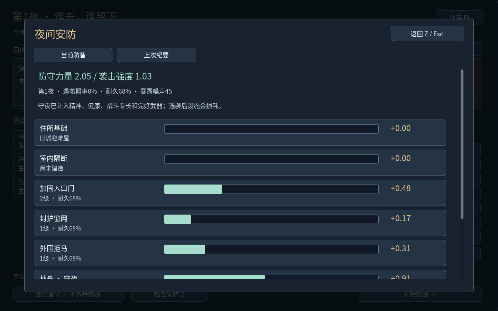
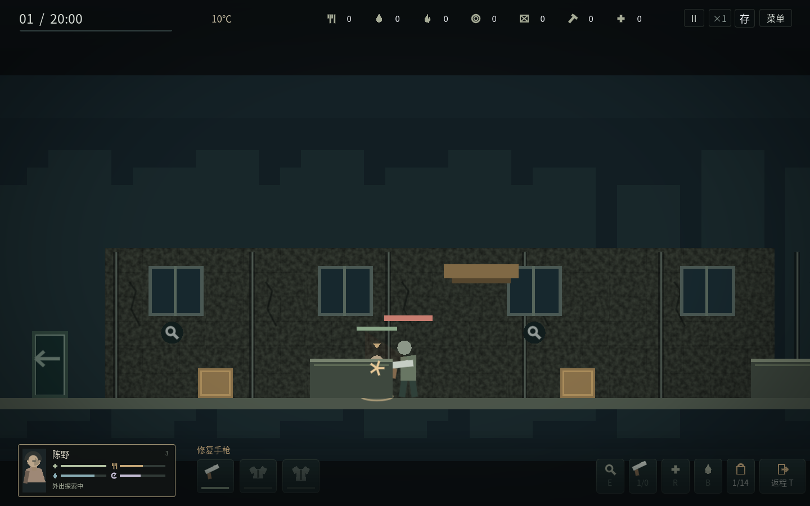
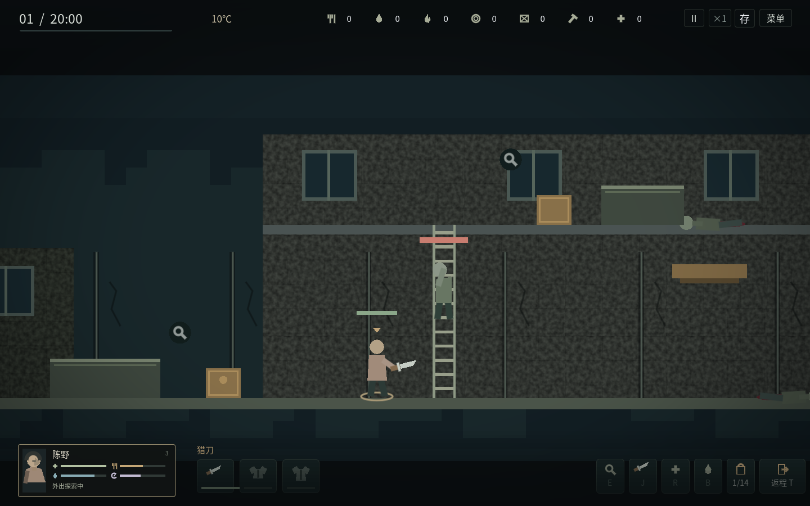
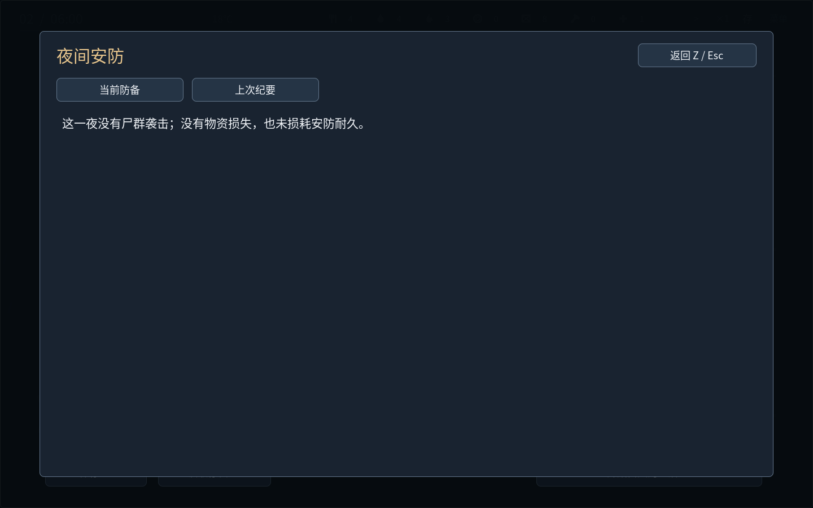

# v1.6 敌人追踪、攻击判定与安防复盘

## 玩起来有什么变化

感染者只记住真正看见或听见的位置。失去联系后会调查该处，记忆消退后沿原路回到原楼层巡逻，不再隔着视野盲区追踪玩家的实时坐标。大声响可以经地图中的楼梯传到另一层；远处不同楼层的小动静不会自动暴露位置。

敌人走到真实楼梯才开始攀爬，不会瞬移换层。迅捷尸、普通行尸、重型尸分别需要1.4、2.2、3.2秒爬完楼梯；追踪记忆分别为8、6、5秒。楼梯中段不能隔层攻击，靠近平台时才进入实际攻击范围；受击失衡暂停攀爬，平台边被击杀的尸体落在该平台。保存并重新进入会接着原位置、原攀爬进度和原追踪记忆继续。

扑咬有原有的蓄力和恢复间隔。真正落下时再检查同层、距离、方向、家具遮挡和受伤保护时间。及时后退、绕到背后、上楼或把家具挡在双方之间，可以让蓄力落空；已开始的扑咬不会自动转身命中身后玩家。

所有判断仍使用三类敌人原有生命、伤害、追击速度和蓄力时间。制造高级武器不会自动给敌人加血。

## 家具怎样影响攻击

地图中已有的矮家具是可见的低掩体，背景墙面仍是布景。角色可以从家具后经过，矮家具不是阻止行走的墙。

- 蹲伏时身体藏在家具前沿之后，家具可以挡住视线和低弹道。
- 站立时抬高手枪，能从矮家具上方射击；蹲着把弹道打进家具会被挡住。
- 近战和扑咬不穿过家具前沿；绕近到同侧、或双方都在同一家具后面，可以正常交战。
- 鼠标点敌人时，会先走近到真正有攻击通路的位置，再攻击一次；J仍可直接攻击。
- 木石落点出现短暂火星或碰撞弧，不出现假血或敌人扣血；被挡住或射空仍消耗子弹与射击耐久。没有目标的射击也显示弹道，弹道遇家具截止。
- 血迹、受击动作和街区射击委托只来自实际伤害；被阻挡的最近目标不会被跳过、凭空命中后面的敌人。

## Z检查安防

Z打开暂停检查窗口，Esc或Z返回。H家园页、U街区动态、夜间分工和清晨结算也有入口。窗口按需打开，主场景不增加说明文字。

“当前防备”显示住所基础、室内隔断、入户门、窗网、拒马、各守夜者、预警协同的贡献条；总值与实际结算使用同一个计算入口。守夜包含健康、精神、战斗专长与完好武器的15%加成。预警只增强实际守夜者，没人守夜时不凭空增加防守。设施耐久降低时，门窗、拒马和预警的效果随之下降。

白天尚未分配夜岗，先看固定设施；黄昏分工后才能按当晚岗位查看完整预估。预报是当前状态估算：夜间伤病、饥渴或死亡仍可能改变最终结果。天亮后的“当前防备”使用现存设施和上次岗位做参考，下次黄昏需要重新安排。

“上次纪要”读取真正保存的当夜记录：

- 未遇袭：明确没有袭击损失，也不扣安防耐久。
- 挡住袭击：实际防守与威胁、各项贡献、遇袭前后耐久，明确无人受伤或丢失物资。
- 防线被突破：防守缺口、实际丢失的物资、实际受伤者，以及护甲与窗网各减少多少伤害、护甲损耗。
- 整夜迁居：显示各成员的护送贡献和路线威胁；固定营地设施不参与路上的护送。

历史贡献使用遇袭前的设施耐久；窗网受伤减免使用受袭磨损后的耐久，与真正扣血一致。之后更换装备、修理设施不会重算历史。旧档原本只有简短纪要，不伪造旧夜晚的详细贡献；下一次结算开始记录。

袭击和迁居仍在清晨统一结算，目前没有新增即时守城场景或可操控的车队地图。

## 存档与检查范围

存档schema13增加感染者的原巡逻楼层、目标楼层、有限追踪记忆和攀爬进度。兼容schema1–12，使用原存档目录，迁移写入保留旧原件备份。不会重置物资、装备、任务或已经击杀的敌人。

自动检查包括失去视野后的目标记忆、跨层声响与攀爬、返回巡逻、近战/枪械/扑咬遮挡、扑咬落空、鼠标靠近、攻击落点、旧档迁移、异常路径拒绝、真实磁盘跨进程恢复、安防贡献与损耗、窗网/护甲减伤、无袭击/成功防守/突破/迁居、结算不可重复。图形检查覆盖窗口打开关闭、按键、鼠标穿透拦截、四种分辨率与全屏，并保留截图。

具体计数、独立运行包校验和桌面启动检查见[v16-validation.json](v16-validation.json)。Windows包由官方模板导出，仍未在Windows真实设备运行；Linux图形检查不能代替Windows真机验收。

