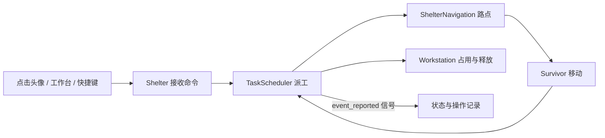

> v1.0已改为独立昼夜循环、手动整理物资与schema7。本文保留底层模型或历史说明，当前玩家操作和新规则以[新版玩法](PLAYING.md)及[机制记录](CAMPAIGN_V1.md)为准。

# 基地与实时探索如何协作

v0.7增加`StoryCatalog`与`StorySystem`，分别定义八章内容／六项引导，以及真实资格、待处理选择、一次性结算、历史与目标进度。根节点在统一子步中推进故事时钟；完成工作、实际饮水、净补给归来和打开人物页提供引导事实。`CommandCenter`第7页只展示状态并调用模型，不自行扣库存。

故事状态与人物、工作、地图统一捕获、验证和恢复，存档schema6（兼容1—5）。自动生存策略属于测试目录，不进入发行包；自动照料的授权仍由玩家逐人决定。

## 玩家操作对应什么

点击“林舟”，再点击工作台打开该设施的行动抽屉，确认修整后，程序没有把人瞬间挪过去。它先创建一个 `repair` 任务，再算出“楼梯上端 → 楼梯下端 → 工作台”的路点，角色逐段行走，到达且轮到自己时才开始工作。任务完成后释放工作台，通知界面显示结果。

现在有六种任务：修整、做饭、吃饭、睡觉、制作工具和治疗，使用四处设施。它们复用同一套移动 / 排队 / 占用机制；有材料的任务统一开工扣料，完成后按定义产出或恢复状态。吃饭与治疗共用餐桌，分别排队。

按 V 选择三处地点之一并准备出发后，只有确认才转移携带装备、取消出发者基地任务并退料；其他留守者继续工作。玩家直接控制外出者，必须回到地图入口才可将补给带回。基地与探索使用同一份角色健康数据和同一个时间入口。

## 实际场景树

入口为 `scenes/shelter.tscn`，子节点在 `scripts/shelter.gd` 的 `_ready()` 中创建：

```text
Shelter (Node2D, shelter.gd)
├── WorldRoot (Node2D，呈现缩放与偏移，保持原有存档坐标)
│   ├── Workstation 工作台 / 灶台 / 餐桌 / 床位
│   ├── Workstation 水桶 / 门口（直接交互，不参与工作占用）
│   └── Survivor × 3起始 / 最多6条身份记录 (Node2D, survivor.gd)
├── ExpeditionView (Node2D, expedition_view.gd)
│   └── CanvasLayer 探索 HUD
├── CommandCenter (AcceptDialog, 街区 / 据点 / 记录 / 指南 / 设置 / 人物 / 故事)
├── GameAudio (Node, 原创合成音与独立偏好)
├── CanvasLayer
    └── Control
        ├── 角色卡片 × 实际身份数
        ├── 时钟、昼夜进度、暂停、速度与菜单
        ├── 按需行动抽屉（设施费用、对象、确认、队列）
        └── 状态、进度、队列与记录
└── ConfirmationDialog 出发准备 / 读档 / 新游戏 / 保存失败退出
```

`TaskScheduler`、`ShelterInventory`、`SaveSystem`、`ShelterNavigation` 和 `ExpeditionState` 是 `RefCounted` 对象，不是可见节点。它们随场景持有和释放，不使用全局单例。`TaskCatalog` 存放配方，`SurvivalRules` 存放生存规则；`LocationCatalog` 定义各地点，`ShelterProgress` 管理维护、升级和事件。入口集中组装场景，探索模拟与绘图已经分别放在 `expedition_state.gd` 和 `expedition_view.gd`。

| 文件 | 责任 | 不负责什么 |
| --- | --- | --- |
| `shelter.gd` | 组装场景、输入路由、统一时间、出发 / 归来、预警 / 失败、保存时机、基地 UI | 不自行判定任务完成、设施归属或敌人 AI |
| `survivor.gd` | 单个角色的数据、沿路点移动、绘制、点击选择 | 不自行抢占工作台 |
| `shelter_navigation.gd` | 两层连通关系、楼梯路点、不可达反馈 | 不执行任务、不绘制角色 |
| `task_scheduler.gd` | 排队、状态切换、设施占用、执行、完成、取消与错误信息 | 不处理窗口或按钮布局 |
| `inventory.gd` | 全部材料先校验再扣除、产出 / 退料入库、库存快照和最近 32 笔交易 | 不创建任务、不决定产量 |
| `task_catalog.gd` | 任务名、对应设施、消耗、产出、耗时；界面与执行规则共享同一份数据 | 不修改库存、不移动角色 |
| `survival_rules.gd` | 饥饿 / 疲劳 / 健康 / 感染变化和日历转换 | 不分配工作、不自动吃饭 |
| `expedition_state.gd` | 移动 / 攀梯 / 搜索、背包、敌人 AI / 战斗、地点余量与探索校验 | 不读取物理按键、不绘图、不直接给基地入库 |
| `expedition_view.gd` | 探索地图 / 跟随视野绘图、探索 HUD 与鼠标按钮 | 不推进模拟、不管理基地库存 |
| `save_system.gd` | 数据快照、整体验证、版本迁移、校验和 / 备份读写、恢复 | 不选择自动保存时机或弹窗 |
| `location_catalog.gd` | 三处地点布局、物资、巡逻与天气规则 | 不持有玩家进度 |
| `shelter_progress.gd` | 据点磨损 / 修缮 / 升级、事件交易、净补给与里程碑 | 不绘图、不强制结局 |
| `command_center.gd` | 暂停手册、地图准备、维护 / 事件操作、记录 / 指南 / 设置 | 不绕过模型扣料 |
| `game_audio.gd` | 原创合成音与偏好读写 | 不拥有生存时钟 |
| `workstation.gd` | 工作位置、唯一使用者、完成计数、绘图和点击信号 | 不选择谁先工作 |

## 数据流与信号



“信号”可以理解为通知：设施只发出“我被点了”，不用知道当前选中了谁。入口收到通知，用 `assign_task()` 选择设施对应任务，再调用 `assign_selected()` 把正确角色交给调度器。这样以后更换界面，不会改动派工规则。

## 任务状态机

状态机就是明确列出角色现在处于什么阶段，以及允许怎样变化：

```text
IDLE → MOVING → WAITING → WORKING
WORKING → 完成且还有任务 → MOVING
WORKING → 完成且没有任务 → RETURNING → IDLE
WORKING → 取消并退料 → RETURNING → IDLE
MOVING / WAITING / BLOCKED → 取消 → IDLE
无法到达 → BLOCKED
任意存活状态 → 生命为零 → DEAD
基地存活状态 → 确认出发、取消任务并退料 → AWAY
AWAY → 入口撤退、背包入库 → IDLE
AWAY → 生命为零、丢失背包 → DEAD
```

关键状态在 `Survivor.TaskState`。`orders` 是当前及后续任务队列，`route` 是空间中的路点，`work_elapsed` 是当前工作的已执行时间。这三个字段各管一件事，避免把“排队”和“在路上”混为一谈。

每处设施分别保存 `waiting_ids`。即使后来派工的人先到，也不能插队。等待者先走到各自位置，轮到自己再靠近设施。四处设施分别尝试开工，一处设施的等待或移动不能阻止另一处工作；修整与制作工具共用工作台。

执行阶段的关键代码在 `TaskScheduler.step()`：

```gdscript
station.occupant_id = actor.survivor_id
actor.state = Survivor.TaskState.WORKING
actor.work_elapsed = 0.0
```

这三个变化必须由同一个调度器完成：先明确设施归谁，再把此人切换为工作中，并重置进度。否则就可能出现两人同时使用同一处设施、显示工作却没人占用，或新任务沿用旧进度的问题。测试在每一帧检查每处设施最多一人工作，且占用者与工作者一致。

`_finish()` 完成时将配方产出入库，弹出当前任务、累加完成数、释放占用；有后续任务时重新入队。`cancel()` 则清空任务、路线和进度，移除等待编号、释放占用并退回当前已扣的用料；它不会增加完成次数。

## 新增：一次做饭怎样保证库存正确

配方集中放在 `TaskCatalog.TASKS["cook"]`：生食 1、水 1、燃料 1，产出熟食 2。界面直接读这份数据，避免显示“需要一份”而实际扣两份。

派工时先检查当前库存，不够时再预测此人的前置任务是否能够产出所需资源。这样没有熟食也能先排“做饭 → 吃饭”。预测不是预留，前置任务也可能失败，因此 `_try_start()` 在真正开工前仍必须整份检查：

```gdscript
if not inventory.try_take(definition["cost"], "%s开始%s" % [actor.display_name, definition["label"]]):
    _fail_current(actor, "缺料：%s" % inventory.missing_text(definition["cost"]))
    return
actor.held_cost = definition["cost"].duplicate()
```

这段代码来自 `_try_start()`。`try_take()` 内部分两遍循环：第一遍检查全部材料，第二遍才扣除。两遍之间没有 `await`、协程等待或先发信号；同一游戏线程中的另一个任务无法在中间抢料。这就是这里“原子操作”的含义：要么整份成功，要么一份也不扣。

`held_cost` 保存当前锅已经扣掉的用料副本。正常完成就清空它并产出；取消时先取出副本并清空，再退料，确保第二次取消找不到可重复退的材料。排队者的 `held_cost` 一直为空，因此取消排队不能把别人的用料退回来。

`RETURNING` 表示“让出工作位置”：工作结束后没有下一项任务，或取消了已经开工的任务，角色会走到该设施为自己安排的等待点。设施逻辑占用已经释放，这一步只是腾开画面中的交互位置；玩家随时可直接派新任务替换它。途中取消派工仍会停在原地，不会被强制走回去。

排队任务在开工时缺料，`_fail_current()` 会移除这一个任务、输出具体原因并继续下一项。没有引入无限等待材料的状态，玩家可以据缺料提示决定下一次派什么任务。执行中的任务若追加做饭被拒绝，当前任务、进度与队列保持不变。

库存只通过 `try_take()` / `deposit()` 修改；`snapshot()` 返回副本。每笔成功的非空变动都记录原因和数量，不记录失败扣除。交易历史留最近 32 笔，界面操作记录留最近 4 条，悬停可看完整文字。

## 为什么不用复杂寻路

目前只有两条水平走道和一段楼梯，显式路点图比导航网格更容易看清和验证。`route_between()` 保证跨层一定经过两端楼梯；角色在楼梯中途被取消再派工时，会先走到最近的平台，再继续路线，避免斜穿房间。

基地没有自由操控、跳跃或可破坏墙体，只自动沿固定路线移动。外出则直接控制水平行走，并在指定梯子上下楼；探索移动不复用基地自动寻路，也没有通用物理碰撞系统。以后扩建房间再扩展基地连通图。

## 暂停如何保持一致

`Shelter.advance_simulation()` 是唯一时间入口。暂停 / 全员死亡不推进；加速先将时间乘以速度，再以最大 1/60 秒的子步推进生存状态、基地移动 / 任务和探索。不同帧率和速度不能各自使用不同消耗规则。主窗口卡顿时也不补算很长一段失控时间。外出固定 1x，留守者照常完成已有任务，归来恢复原基地速度并暂停；不会因为打开两个可视层而计算两次时间。

基地界面在暂停时仍可排队或取消，但时间、行走、工作进度和状态不动；探索暂停时不执行攻击、急救、搜索或撤退。读档统一恢复原时间和进度，用户操作的读档之后额外暂停；内部恢复函数本身保持快照里的暂停设置，便于与不中断的过程对照测试。没有离线消耗。

## 为什么吃饭、睡眠的效果不能一样做

吃饭有可退回的食物成本。如果开工立即减饥饿，而取消又退食物，就能反复开工 / 取消刷出无限饱腹。因此吃饭扣料在开工，饱腹恢复只在完成时发生。

睡眠没有资源成本，合理的体验是睡了两秒就获得两秒的休息，而非必须整段完成才能恢复。它在 `SurvivalRules.tick()` 中仅对真正 WORKING 的 sleep 任务按时间恢复，等床和走路没有收益；中断保留已有恢复，不额外给完成奖励。

生产任务的工作进度乘以人物效率及据点结构 / 等级效率。吃饭 / 睡觉 / 治疗不降速，否则疲惫的人可能很难从疲劳中脱身。治疗同样完成才恢复，取消只退药。走路仍受疲劳和重伤影响，所以优先安排恢复有实际意义。

## 两种场景如何共用角色

外出状态 AWAY 不能接收基地派工，也不能留在设施队列中。`Survivor` 保留合法的基地位置并隐藏；`ExpeditionState` 单独保存探索坐标、楼层、背包与敌人状态，伤害直接作用于同一个 Survivor。返回时不复制健康数据，只恢复基地控制并结算本次背包。

根节点按模式隐藏基地人物 / 设施 / HUD，并路由按键；隐藏节点也拒绝点击，避免探索时误选基地人物。`ExpeditionView` 只读模型并绘图，不单独调用模拟。具体移动、搜索、敌人、有限工具和每日轮换见 [探索机制](EXPEDITIONS.md)。

## 生命、死亡与保存

严重饥饿 / 疲劳先触发可见预警，再按固定速率损害生命。感染持续发展，到阈值后也损害生命；咬伤另有可观察的前摇和短暂受击保护。状态达到零时，入口调用 `TaskScheduler.mark_dead()`，统一移除等待 / 占用、停止路线并丢失当前用料；外出死亡还丢失背包。所有人死亡才暂停并显示失败，日历没有固定结算日。

保存要持久化的不只是库存：还包括任务进度、已扣材料和设施登记，否则无法判断读档后是否应该再次扣料或产出。完整过程和真实测试见 [存档设计](SAVES.md)。


## 多地点和长期状态

根节点的 `regions` 保存三份独立 `ExpeditionState`，`expedition` 引用当前目的地那份；只能在基地更换引用，所有地点的信号各连接一次，读档恢复到原对象，不重复连接。其他地点不推进敌人动作，但保留消耗。

`ShelterProgress.tick()` 接入唯一模拟子步；修整完成由调度器触发结构恢复，升级 / 事件由手册显式操作。六项里程碑只读进度，不触发结局。`CommandCenter` 记住打开前暂停状态，外出只能查看 / 设置，不能远程交易或升级。

音效、风声与窗口设置在独立的 `preferences.cfg` 中保存，不随新局清除；不把声卡、全屏或窗口的状态塞进游戏快照。细节见 [长期规则](LONG_TERM.md)。


## v0.6：人物与多日循环

`PeopleCatalog` 保存六个固定身份与专长 / 弱点；`CharacterState` 保存每人有界经验、心境 / 压力 / 创伤 / 口渴、加入日期、照料授权、共餐 / 援助冷却。`PeopleSystem` 持有完整关系矩阵、伤亡账目、饮水与食物损耗统计、最多30条每日记录。

调度器只在真正完成任务、死亡时发 `task_finished` / `survivor_lost`，根节点将其接到人物系统；搜索按真正取出量发经验，归来按净补给奖励。技能改变执行速率，定义耗时不变，保护进行中存档。

同一时间子步推进基础需求、人物需求 / 照料、派工和探索；缺水死亡同样经过调度器统一清理，随后执行队友悲伤，不能只把生命写0而遗留设施占用。

招募先验证日期、据点、人数与整份资源，支付后创建独立Survivor并加入调度器、关系表与动态卡片。最多五位存活者，六条历史记录包含可能的伤亡。读档先验证全体，再按身份复用 / 创建 / 释放节点，恢复队列、人物和地图；新游戏真正移除额外节点，不留下幽灵角色。

根节点的自动照料每模拟秒检查一次，只使用逐人授权的基础物资，不替换已有工作；外出者不能远程动用基地库存。人物页的共餐和医护援助各有整份费用和参与者冷却，不能用取消 / 读档绕过。规则见[人物系统](PEOPLE.md)，实测见[平衡报告](BALANCE_REPORT.md)。

## v0.8：项目、互助与桌面验收

GoalCatalog定义三条路线、九个阶段、勘查来源与三种互助；GoalSystem保存阶段、追踪、随身／已送达记录、接应日期和精确投入。ExpeditionState仅在实际取得物资时发site_searched，根节点连接具体地点；返回时先用尚未清除的原装备账目判定净补给，再送达记录。

O页调用模型支付或提交，不自行修改库存。SaveSystem在角色、探索等验证完成后检查目标语义和精确用料总额，再整体验证／恢复。旧schema5添加空白项目状态；不假定历史搜索就已取得新版勘查。

受击色彩与伤害数字仅在ExpeditionView里按真实生命变化生成，加载时清除短暂反馈，不进入存档，也不改变战斗。应用失焦通过同一暂停变量冻结模拟并释放持续输入；F11与菜单共用全屏入口。

普通发行包排除tests。验收版有独立入口场景tests/desktop_acceptance.tscn和同一份实际游戏代码；使用独立槽位与帧驱动的测试策略，不注入物资／生命／位置。普通程序保持单文件内嵌数据，验收程序另外导出；官方模板禁用--main-pack路径覆盖，不能用普通exe的命令行覆盖假装运行验收代码。
