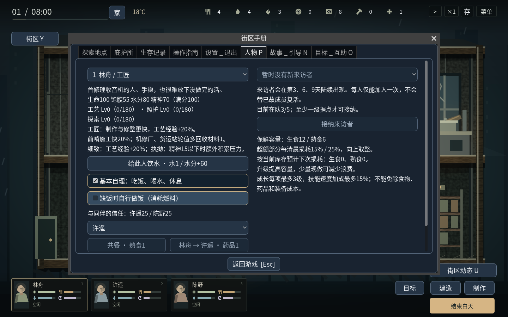

# v1.10：角色会照顾基本需要

基本自理默认开启，初始角色、新加入者和升级后的旧档都适用。在可操作的白天，空闲角色会按需要自行去吃饭、喝水或休息。选择别的角色不会阻止他们自理。

## 何时行动

| 状态 | 开始自理 | 实际行动 |
| --- | --- | --- |
| 饱腹 | 35或以下 | 走到餐桌，消耗熟食1，吃完恢复55饱腹 |
| 水分 | 35或以下 | 走到楼下水桶，实际取水2秒后消耗水1，恢复60水分 |
| 精神 | 30或以下 | 寻找可到达、未被预占的床位，走过去休息；睡到精神至少85后离床 |

多项需要同时出现时，按紧迫程度决定先后；同样紧迫时优先饮水。多人争最后一份熟食时，需求更重的人优先。原有床和后来建好的床都会使用，床位和水桶被占用时会等待。没有熟食、水或通路不通时，不会隔空恢复、产生免费物资或穿过楼板，会在人物卡和悬停信息中反馈并定期重试。危急缺粮、缺水时不会反复躺下又取消休息。

自理走动、任务排队、开始扣料、用餐进度和睡眠恢复都使用正常行动流程。小图标和人物卡显示“自行饮水／吃饭／休息”，主场景不增加解释文字。暂停、窗口失焦暂停和离线期间都不会继续行动。

## 手动命令优先

角色不会因为想吃饭而擅自取消你安排的制作、施工、修理、移动或任务队列。A/D、鼠标移动、重新安排任务和Q取消可以接管自理，未吃完的饭按原任务规则退回，已得到的睡眠恢复保留。接管后让出8秒模拟时间，避免刚取消就立即重做同一动作；持续移动期间不会自理。

自主选择的睡眠可以被严重饥饿、缺水打断，处理需要后再继续休息。手动安排的睡眠仍尊重你的命令。已为手动任务排队预留的饭食和配方物资会从自理可用量里扣除，避免抢走最后一份水使你安排的做饭失败；实际开工仍会再次核对库存。

日落前仍在进行的自理随其他白天行动一起中止；未完成饮水不扣水。主动结束白天只结算剩余时间的需要，不会偷偷安排自理、消耗物资或完成生产。夜间继续使用分工与清晨结算；搜刮者的现场饮水和治疗由玩家控制。

## 自动做饭单独选择

P人物页有两个独立选项：

- **基本自理**：默认开启，可逐人关闭；关闭会停止该人的自主行动，不取消他的手动工作。
- **缺饭时自行做饭**：默认关闭。开启后，这个人需要吃饭但没有熟食时，会走到灶台花生食1、水1、燃料1做一批基础饭食，然后去餐桌吃饭。已有一锅在做时会等待，不让多人重复开锅耗尽燃料。

不会自行吞服药品、使用工具或吃生食。人物页的手动饮水按钮也已改为下达实际走到水桶的命令。

## 旧档与验证范围

schema17兼容schema1–16。升级后为存活角色开启基本自理，保留原来的自动做饭选择、库存、装备、地图和任务。新版中逐人开关、手动让行时间、未完成自理和继续休息的意图都会保存；读档后保持暂停，继续游戏才行动，不重复扣物资。已死亡角色不会重新行动。

逻辑检查覆盖最后一份饭、水与手动做饭争用、缺料、空床与多床、路线阻断、紧急饮水、自理中断、永久死亡和旧档升级；图形检查使用实际鼠标与键盘，并检查四种窗口尺寸。三个独立进程检查中途饮水、已扣料进食、取消退款和个人开关的连续保存。

另有[从新局开始的四个白天／三个夜晚记录](v20-self-care-journey.json)：白天只手动安排最初两批做饭，没有发额外物资、传送、改状态或下达白天吃饭／喝水／睡觉命令，随后实际发生自理和缺粮等待。三个夜晚仍按正常分工明确安排守夜、床上睡眠和地铺睡眠。这是普通库存下的行为验证，不能证明不外出就能长期生存，也不能代替完整战役的平衡检验。

上方截图使用明确的需求与物资夹具，以展示真实界面和行动。完整检查记录见[v20-validation.json](v20-validation.json)。Windows包已导出，Windows真机和音频可闻性仍未验证。

完整回归并非全绿：旧核心测试场景的三人长期自动策略约9.10日全员死亡，未达到原有断言。已用上一版60个运行文件的原始哈希核对并复现同样结果，不能把它归为新自理造成的退化，也不能继续用旧记录声称长期平衡已经通过。失败断言保留在本轮验证报告中，长期经济与策略检验仍是后续工作。
