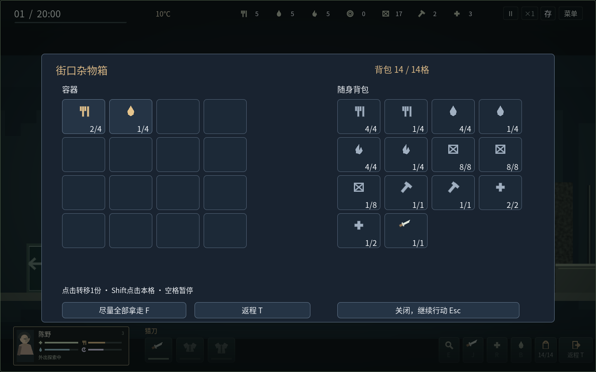
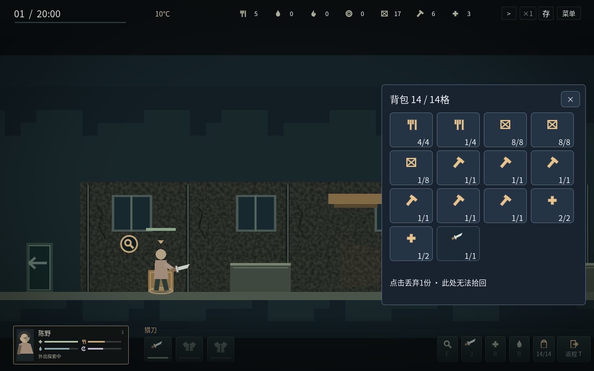

# v1.7 背包与容器堆叠

同种物品先补满已有堆叠；超过单格上限再占下一格。背包格数保持各角色原有差异，角色携带的是实际件数，制作、用药、饮水、丢弃和归来入库都按实际件数结算。

| 物品 | 每格上限 |
| --- | --- |
| 生食、熟食、水、燃料 | 4 |
| 材料 | 8 |
| 药品 | 2 |
| 工具 | 1 |
| 弹药，包括弹匣中的子弹 | 8 |
| 随身武器、护甲、每件战役零件 | 1 |

以上是本游戏的设计值，尚未通过原作文件分析确认为《这是我的战争》的数值。穿着的冬衣沿用独立穿戴位，不额外占背包格；武器和护甲沿用原有占格规则，据点库存仍按总件数管理。

例如材料17份显示为8/8、8/8、1/8三格；熟食5份显示为4/4、1/4两格。14格全部占用时，已有的1/4水堆仍能再装3份水；需要新增一格的物品会禁用拿取。吃掉、喝掉或丢弃堆内一份不会错误地释放整格，消耗该堆最后一份才释放。

搜索窗口左边是容器、右边是实际背包。物品图标右下角显示本格件数与上限，鼠标悬停看名称。单击转移1份，Shift单击转移本格，F尽量拿取普通物资。转移仍受来源件数、背包余量与原容器可接受物品／容量约束。独特战役零件需要单独选择；武器、护甲和弹药在背包中显示实际占格。

I打开随身背包时也显示同一套堆叠格；点击物资丢弃1份，无法在地上拾回，Shift不会把整堆意外丢掉。随身装备只读显示，可悬停查看耐久。主场景不增加常驻物品说明。

存档schema14记录堆叠容量规则，兼容schema1–13，不重置任何物资、装备、敌人或战役进度。物品堆叠位置由实际总件数生成，避免把格子和数量各保存一份而产生复制／丢失。首次迁移写入继续保留旧原件备份。

旧`shelter.tscn`仅用于历史回归，它保留明确声明的旧容量规则；正常入口`campaign.tscn`的九张地图统一启用堆叠，没有混用规则的产品选项。

已覆盖堆叠边界、满格补堆、异类物品拒绝、来源容量、装备／弹药占格、实际用药与射击、数量守恒、磁盘保存、跨进程恢复、旧档迁移、一次性归来入库，以及Shift点击、四种分辨率和全屏。完整验证范围见[v17-validation.json](v17-validation.json)。本轮没有重新证明自然35天的整体平衡；物资来源、每天补货容器数量和每晚一次出行规则保持原有设定。

REA研究准备、实测证据及仍缺少的原作文件，见[REA研究记录](REA_RESEARCH_V17.md)。
