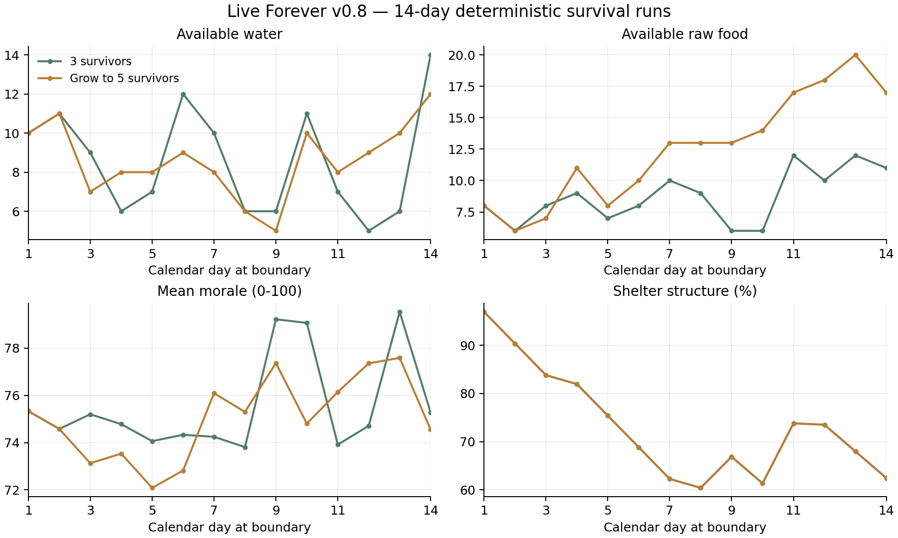

# v0.8 长期平衡验证报告

这些数据由当前真实场景、派工、移动、攀梯、搜索、战斗和库存系统运行产生。正向用例从新局初始资源出发，未注入库存、生命、坐标或经验。测试策略会开启明确的自动照料授权，通过正常费用接纳新成员。

模拟连续推进14×720秒，即从第1天08:00到第15天08:00，使用和实际游戏相同的1/60秒子步；在测试进程里加快计算，不等待实际168分钟。每日记录保留每个日历边界，第一天为16小时，最后一天08:00状态另外列出。

| 策略 | 实际经过天数 | 结束存活 | 真实往返 | 饮水份数 | 结构 / 等级 | 结局 |
| --- | ---: | ---: | ---: | ---: | --- | --- |
| 三人 / 补给与照料 | 14.00 | 3 | 35 | 21 | 60.6% / 3级 | 继续生存 |
| 逐步五人 / 补给与照料 | 14.00 | 5 | 48 | 32 | 60.6% / 3级 | 继续生存 |
| 照料但不外出 | 3.75 | 0 | 0 | 6 | 37.3% / 0级 | 失败 |
| 搜刮但不安排照料 | 1.82 | 0 | 6 | 0 | 89.1% / 2级 | 失败 |

## 14天后的实际可用库存

| 策略 | 生食 | 水 | 燃料 | 熟食 | 材料 | 工具 | 药品 |
| --- | ---: | ---: | ---: | ---: | ---: | ---: | ---: |
| 三人 / 补给与照料 | 14 | 13 | 22 | 0 | 11 | 2 | 7 |
| 逐步五人 / 补给与照料 | 19 | 10 | 9 | 1 | 9 | 3 | 6 |

## 本轮数值与约束

- 每人每天饥饿增加72；熟食1降低55，相当于约1.31份熟食 / 人 / 天。每锅2份，通常需要生食、水、燃料各约0.655份 / 人 / 天。
- 口渴每秒增加0.045，一天32.4；水1降低60，长期约需0.54份饮水 / 人 / 天。五人所需饮水与做饭用水都必须由搜刮或付费交换支持。
- 厨师较快但饥饿增长+10%，新医护较耐心但非睡眠疲劳增长+10%；招募还要付生食2、水2、药品1并增加后续照料。
- 技能每项0—3级，30 / 90 / 180经验升级，效率加成最多15%。不会免除资源成本或让人物不再饥渴。
- 默认保鲜容量生食12、熟食6，每级各增加4 / 2；每清晨只对超额部分损耗15% / 25%，向上取整。当前库存的预计损耗在人物页提前显示。
- 徒手挥击耗疲劳1.2，成功推开再耗2.8；失衡1.6秒，稳身3.6秒内不可续推。工具仍为每次成功破锁 / 击倒消耗一件。
- 每日补给仅轮换两处容器，感染者生命固定40、最多5名，不通过膨胀生命制造长期难度。

## 策略说明与解释范围

测试策略在需要时补充食物、水、燃料、维修材料、工具与药品；使用真实搜索，把装备装进有限背包，观察扑咬前摇并后退，药品只在需要时使用。出发者会取消当前工作并退料，留守者按事先授权照料；有余量才升级与招募。

成功案例说明这些配置下存在可持续、仍需外出的策略。对照案例分别证明基地不能自产补给、库存也不会自动照料未授权的人。这里采用熟悉地图并稳定躲避的确定性策略，不代表所有操作水平、所有策略或长期乐趣已经验证。

## 原始数据

[三人](balance-data/three.json) · [逐步五人](balance-data/five.json) · [不补给](balance-data/no_supply.json) · [不照料](balance-data/no_care.json) · [每日CSV](balance-daily.csv)

## 重现

```sh
godot --headless --editor --import --quit
godot --headless --path . --script res://tests/test_balance.gd -- /tmp/live_forever_balance
python tools/balance_report.py /tmp/live_forever_balance --output /tmp/live_forever_balance_report
```

完整项目检查可运行 `python tests/run_checks.py --graphics`。报告CSV为 `balance-daily.csv`，原始结果来自 `three.json`、`five.json`、`no_supply.json`、`no_care.json`。


