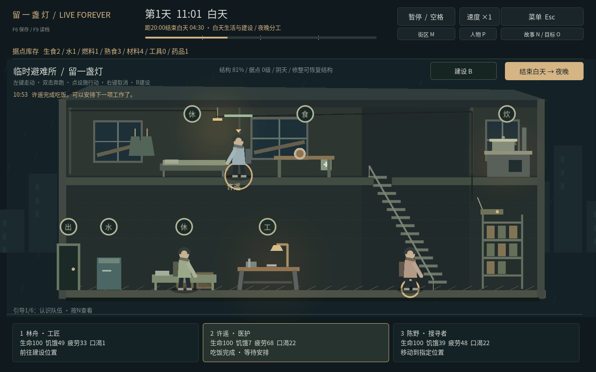
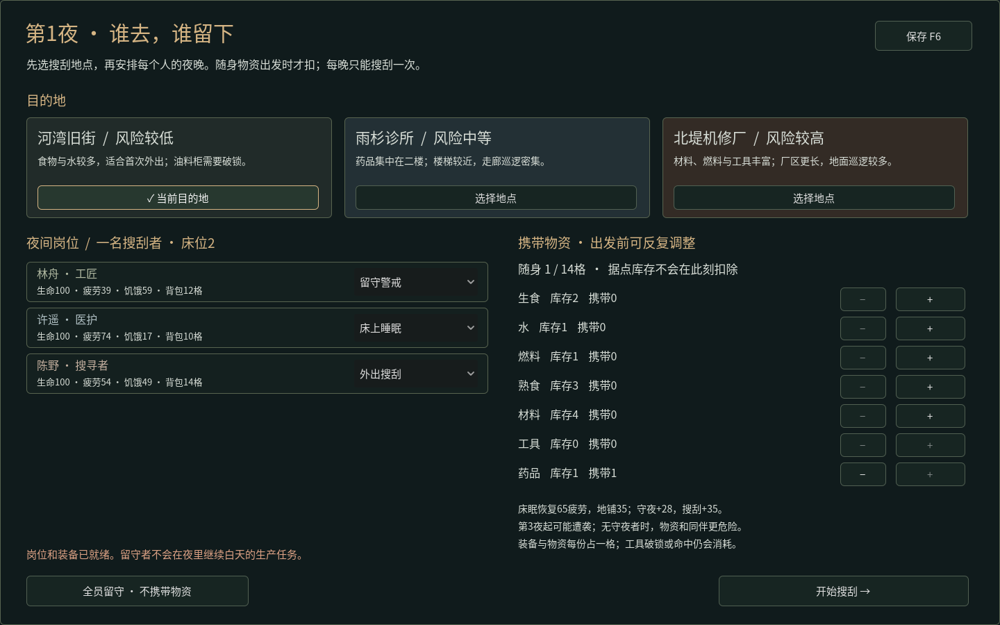
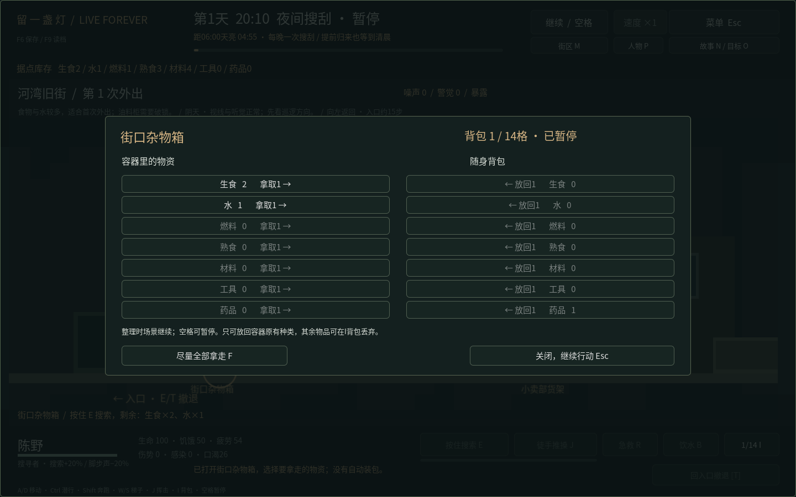

# v1.0 · 昼夜循环与直接操作

2026-10-25。目标是把白天生活、夜间分工、搜刮选择和清晨后果连成可玩的循环。美术保持原创几何画面，不把增加界面页数当作原作成熟度。

## 本轮实际实现

- 默认启动入口改为`campaign.tscn`，旧`shelter.tscn`作为共享底层模拟测试场景。白天20:00结束，后续清晨06:00开始；第一天08:00开局。
- 左键走动、双击奔跑、右键取消；点床或餐桌直接行动，饮水先走到水桶。生产有批数，Shift追加；缺料或不可达的替换命令保留原有有效工作。
- 三种场景建设：额外床位、雨水收集器、加固隔断，三个明确建设位置。消耗用料、前往现场、施工、完成生效分别处理。未完成取消退料，无重复退款。
- 日落停止并退回未完成白天任务，夜间选择每人的搜刮／守夜／床眠／地铺；床位不足不能确认。每晚最多一次搜刮，也可全员留守。
- 角色背包10／12／14格，携带草案可以调整，出发时统一扣料；一份物资占一格，尚未增加分类叠放或完整装备体系。
- 点击容器走近搜索，完成后两边整理库存；选拿和放回都守恒，不自动装满，不远程入库。已搜索容器保持可打开；反复拿取放回不刷经验。
- 点击敌人会靠近挥击，保留J快捷键和可选键盘移动。工具命中、徒手推开、挥空、被挡、伤害和倒地有区别。
- 提前回家结束当夜，余下夜间结算到清晨；天亮后关闭整理、沿真实路线撤离，不把远处背包瞬间转入库存。迟归有疲劳与压力代价。
- 守夜者的生命／疲劳、隔断、床位影响清晨结果；固定种子按夜晚保存，不因读档重抽。床眠／地铺／守夜／搜刮各自有不同疲劳后果。雨水收集器只在细雨清晨产水。
- 白天与外出用药均不能替代食物恢复重度饥饿者的生命；伤势与感染仍能处理。治疗对象、施治者与受助者分别写清。
- schema7保留阶段、岗位、装备草案、施工／场景行动、打开的容器和清晨账目，兼容旧版schema1–6。真实v0.9进程存档用作迁移样本。

## 验证证据与范围

底层回归787项，新增昼夜／建设／物资／防守／迟归／迁移／命令拒绝／医疗饥饿门槛85项。完整旧回归和新增用例分别执行；最终新增85项再次通过。图形交互共251项，其中47项为新的实际点按流程；最终新版47项另在发布副本再次通过。共20个持久化进程，含打开容器、带一份物资存档、重启归来、再次重启清晨不重复结算。

新图形流程从真实新局选人走路，饮水、建床、批量做饭、吃饭、结束白天、改目的地、携带药品、鼠标搜刮、拿取／放回、暂停、返程、保存／读档、开始新一天。鼠标战斗截图来自另一新局正常靠近首个巡逻者，不注入站位、生命或伤害。边界模型测试中另有明确夹具，不能把它们说成自然游玩。

最终Linux运行程序使用四种实际窗口尺寸（1024×768、1280×720、1440×900、1920×1080），分别验证白天时钟、人物卡、治疗按钮、夜间分工，并实际切换全屏／窗口。连续运行300.014秒、10042帧，完成3次搜刮往返，三人存活；共38项检查通过，再由系统关窗、用普通程序重启并核对库存、故事、目标、昼夜账目和暂停时间，结果一致。这是5分钟短测，没有标为30分钟验收通过。

源码／运行包校验记录与真实平台分别保存；Windows未连接实际设备，不能把Linux通过写成Windows真机通过。音频自动检查使用Dummy驱动，听感仍需要真实设备。

## 每晚一次的30昼夜结果

使用玩家可执行的结束白天、岗位和携带选择，按地图移动、搜索、选拿和返程；测试脚本不注入库存、生命、坐标或经验。授权照料和既有维护／升级／补员策略用于测试。以下为确定性模型推进，不是实际经过30天，也不是所有玩家操作水平都已平衡。

| 队伍 | 完整昼夜 | 期末存活 | 实际搜刮往返 | 期末库存 |
| --- | ---: | ---: | ---: | --- |
| 三人队伍 | 30 | 3 | 30 | 生食10 / 水17 / 燃料7 / 材料8 / 药品5 |
| 逐步五人队伍 | 30 | 5 | 30 | 生食9 / 水15 / 燃料7 / 材料8 / 药品5 |

三人和五人的30个夜晚都只完成30次搜刮，没有沿用旧版多次往返的平衡结论。五人队伍通过实际升级与付费补员，在第6／7天扩充到四／五人。期末仍有较高疲劳者，需要下一白天照料；存活不等于所有人始终处于舒适状态。

可复现命令：

```sh
python tests/run_checks.py --graphics --artifacts /tmp/live-forever-checks
godot --headless --path . --script res://tests/run_campaign_balance.gd -- /tmp/three.json
godot --headless --path . --script res://tests/run_campaign_balance.gd -- /tmp/five.json --recruit
```

## 与参考作品的实际差距

当前环境没有原作安装；访问维基、机制说明、官方商店和手册的请求被网络代理403阻止。本轮不是亲自玩过原作后的逐项复核，不声称“只有建模不同”。

已做的是核心循环、直接操作及其可验证后果。地图与事件数量、完整战役、NPC行为与道德选择、温度／生病体系、武器／耐久／装备深度、自由建设空间等仍有差距。当前只有三处搜刮地图、三种实体建设、八章同伴事件，装备仍采用消耗式工具规则；这些限制不应隐藏在“成品”二字后。








