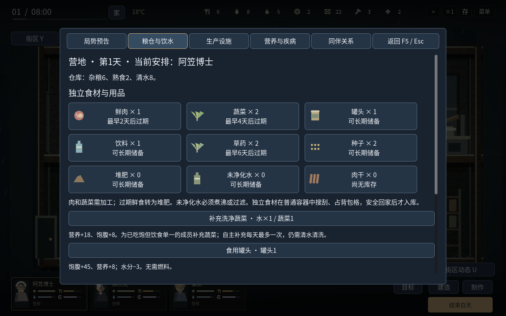
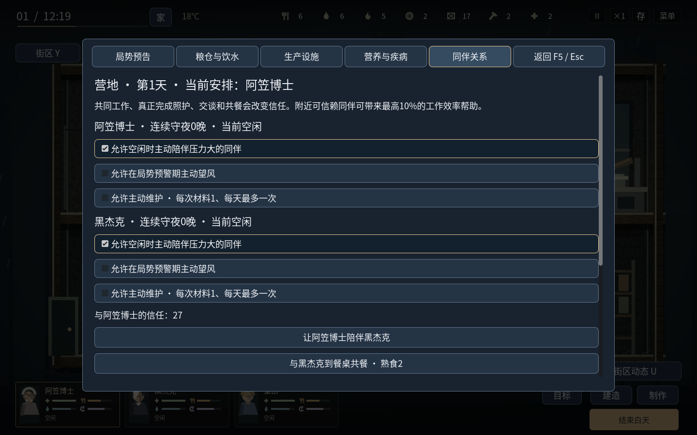

# 营地生存系统：局势、同伴、食物与疾病

本系统已整合进v1.17.0，下载与本版校验见[仓库首页](../README.md)。新开战役启用本系统。继续已有战役时不追加开局物资。

## 进入与操作

白天选中成员，按 **F5** 或点击“营地”，打开局势、粮仓、生产、疾病、关系五页。查看期间游戏暂停，关闭后恢复原先的暂停状态。配方明确列出用料与效果，缺料或条件不符时禁用，悬停可看原因。点击成功的行动后返回场景，人物实际走到对应设备，完成后才产生效果。右键或新命令可中止，日落取消未完成工作并退回尚未使用的材料。

粮仓以物品图标、数量和最早过期时间排列；生产按烹饪、种植、饮水、建造分类。人物卡用小图标提示营养不足、发热或肠胃问题，悬停可看数值，F5查看处置方式。

## 中后期发生什么

从第10天开始提前两天预告，每7天出现一次持续数天的局势，依次循环，适用于无尽生存。

| 局势 | 首次发生 | 实际影响 | 可以准备什么 |
| --- | --- | --- | --- |
| 尸群迁移 | 第12—14天 | 基地夜袭概率提高10个百分点，防守压力增加0.25；旧街和集市各多一名有独立记忆的普通疾行感染者 | 两人守夜把额外压力变为−0.1；或花燃料2、工具1并实际布置诱饵，减轻基地压力，把额外巡逻引向机修厂 |
| 水源警报 | 第19—22天 | 新供水减少，新增未净化水需要处理 | 存清水、煮沸、建沉淀过滤器；过滤器可改善供水比例，并解锁材料换滤层的净水生产 |
| 区域停电 | 第26—28天 | 电动净水泵停产，鲜食额外老化 | 建备用设备并主动开启，夜间消耗燃料1维持供电；重力水厂可继续运行 |
| 补给荒 | 第33—36天 | 普通地图新补入的杂粮减半，陷阱鲜肉减少 | 种植、肉干与罐头储备；建立补给协定，减轻损失并每7天用材料3、燃料1交换罐头2、种子1、草药1；米老鼠能额外谈到饮料1 |

设备、协定、物资花费、巡逻和地图补给均实际结算；读档或重复调用不会重复发放或添加敌人。迁移没有给敌人额外生命或伤害。诱饵会改变危险地点，进入机修厂前仍须准备。

## 同伴关系与自主选择

信任沿用实际人物对关系。完成陪伴交谈增加2、共餐增加6、调解增加4；可信赖同伴在同一层、160像素内帮助工作，最高加速10%，不叠乘。高压力者靠近非常不信任的同伴时工作略受影响。

角色会根据自身需要、玩家授权、当下同伴状态和个人倾向选择行动：维尼更善于安慰，米老鼠和瑞克具有凝聚作用；里昂、爱丽丝、柯南默认愿意在预警期望风；发明家维护营地效果更好。主动陪伴优先由擅长安慰的空闲成员承担，会考虑同伴压力、士气、创伤和既有信任。基本需求、正在执行的玩家命令和手动操作保护期优先。

- **交谈**需要双方到场，通常每天一次有效陪伴，增加信任并缓解压力。
- **共餐**需要两份真实熟食，双方走到餐桌，保留餐食品质与保鲜日期。每天一次，取消退回原来的餐食，不刷新保鲜期限。
- **望风**需要走到出口并观察，完成后略减当夜防守压力，每天一次。
- **维护**默认关闭，授权后在营地状况较差、材料可用时进行；每天一次，消耗材料1。
- **连续守夜**第三晚起累积额外压力。疲劳成员发现另一位同伴连续休息时，会提出具体的分工争议。可到场调解，或承诺下一夜轮换；实际兑现信任+8，未兑现−4。人物死亡会清理失效的争议。

这些是有规则、可取消且受资源约束的生活决策。关系系统当前不包含自由对话生成或复杂恋爱、背叛剧情。

## 食物如何进入循环

原“生食”明确为杂粮；额外加入鲜肉、蔬菜、罐头、饮料、草药、种子、堆肥、未净化水、肉干九种独立物资。九张地图的容器有不同组合，同一批独立物资拿完后保持空，不会每天重新刷出。普通资源的既有补给规则保留。

独立物资按种类堆叠，真实占用背包格，安全返回才入仓。拿取、放回、取消和存读档保留食材原始日期。仓库和容器两类物资都取空后，容器才呈空置灰色。外出按I可点击罐头、肉干或饮料使用，需要站稳2—4秒，有动作和真实进度条；移动、攻击或受伤中止并退回。

| 生产环节 | 消耗与产出 |
| --- | --- |
| 肉菜杂粮饭 | 杂粮1、清水1、燃料1、肉1、菜1→熟食3，每份营养+28、压力−3 |
| 草药肉汤 | 清水2、燃料1、肉1、草药1→熟食2，每份营养+18、水分+12、发热−6 |
| 蔬菜餐 | 清水1、蔬菜2→熟食2，每份营养+20，不需燃料 |
| 补充蔬菜 | 清水1、蔬菜1→个人营养+18、饱腹+8；吃饱但营养不足者也可使用，自主补充每天一次 |
| 肉干 | 二级厨房，燃料1、肉2→肉干2；保存14天，适合储备 |
| 种植 | 建造最多两个种植箱，种子1、清水2播种；两天后收菜3或草药2，并回收种子1；堆肥1可使本次收获多1 |
| 筛种 | 杂粮1→种子2，可补充种子来源 |
| 陷阱 | 建造后每天可花杂粮1、材料1检查一次，通常得鲜肉2，补给荒时得1 |
| 饮水 | 燃料1煮沸未净化水3→清水3；建过滤器后，材料1处理未净化水4→清水4 |

小当家制作上述餐食多出1份。已授权的共同备餐者在同伴营养偏低或发热时可以选择营养餐与肉汤；会检查现有熟食、已付款的锅和饮水需要，避免重复开锅或抢走最后饮水。自动收获默认开启，自动花料播种仍由玩家安排。

鲜肉保鲜2天、蔬菜4天、草药6天；保鲜柜分别延长2、3、3天。熟食2天过期，有保鲜柜则为3天。先用较旧的食材，过期库存转成有用的堆肥。罐头、饮料、种子等可长期储备。查看仓库不会延缓保鲜日期。

## 营养与疾病

营养与饱腹分别计算。营养每天降低6，普通杂粮餐补8；营养餐和配菜补充更多。低于25增加患病风险。自动补充蔬菜需要基本自理开启、人物空闲、清水和蔬菜可用；不抢占自身吃喝休息或玩家命令。

发热使精神消耗加快，肠胃病使失水加快，严重病情可损害生命；快进结束白天同样结算。同住的发热成员每夜造成有限暴露，外出、前哨成员不算同住，传播按同一批来源结算。白天实际病床休养并在当晚安排床位，可以隔离这次暴露。

草药调养需要医护走近另一名停下行动的伤员，消耗草药1和清水1，发热−25、肠胃−20。病床实际休养逐步恢复精神和病情。普通付费治疗也改善这些病情；草药、肉汤和休养不能清除咬伤感染，感染仍需药品。应急喝未净化水会缓解口渴并增加肠胃病情，自主角色不会这样做。

## 验证与范围

本轮共通过 **1098项逻辑检查、28项实际界面检查**。两个开局第29天撤离，车队开局无尽模式推进至第61天，三人存活，营养为48、42、42，发热和肠胃病情均为0。Linux独立运行包完成真实键鼠、搜索拾取、返程确认、关闭和重新启动。

自动回归、实际图形界面、三种开局的正常指令长期模拟，以及本地桌面导出记录统一见 [验证记录](camp-life-validation.json)。单位测试与界面展示用的声明夹具会指定库存、病情或日期；长期模拟不注入物资、生命、需求、坐标、敌人或任务进度。长期验收同时检查营养与发热，存活和通关并不足以判定平衡通过。

局势目前按固定周期预告；疾病是可玩的营养、发热、肠胃和感染规则，并非医学模拟。Windows完成官方模板导出，Windows真机仍未验收。本页的营地平衡记录来自整合美术前的阶段验收；v1.17.0最终导出校验见[本版验证](realism-validation.json)。

