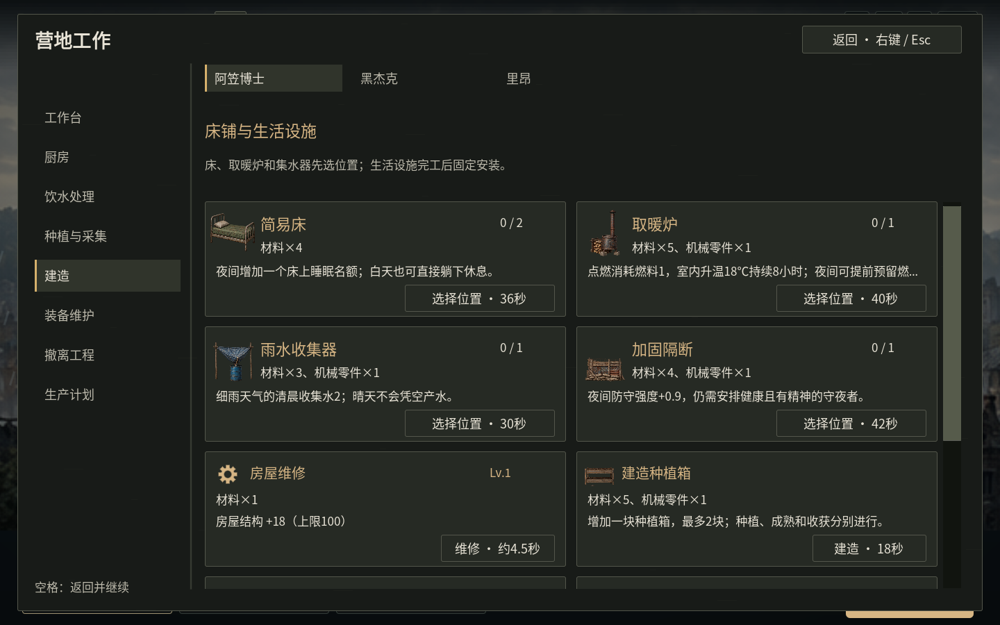
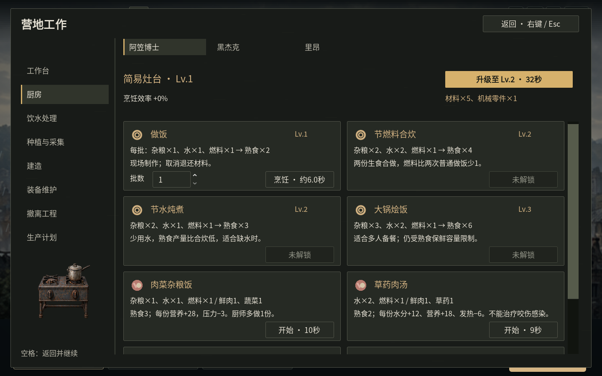

# 营地工作与面板操作（v1.22）

旧界面把普通烹饪放在厨房、肉菜与净水放在营地“生产”，床则藏在另一套狭窄菜单。现在使用同一套分类。

| 入口 | 功能 |
| --- | --- |
| B 建造 | 床、取暖炉、集水器、隔断、房屋维修；种植箱、保鲜柜、捕猎装置、沉淀过滤器、备用发电设备 |
| K → 工作台 | 机械零件、工具、武器、衣物、护甲、弹药；工作台升级和工具保养 |
| K → 厨房 | 普通饭菜、合炊、炖煮、大锅饭，以及肉菜饭、草药肉汤、蔬菜餐、肉干；厨房升级 |
| K → 饮水处理 | 煮沸未净化水、用沉淀过滤器过滤 |
| K → 种植与采集 | 蔬菜、草药、施肥、收获、筛种、检查陷阱 |
| K → 装备维护 / O 装备 | 修理耐用装备 / 按角色分配具体装备 |
| K → 撤离工程 / 底部“撤离” | 战役所需的电台、净水泵、信标等设备 |
| K → 生产计划 | 机械零件、工具包、开锁器的批数、库存目标、暂停和继续 |
| F5 营地 | 局势、库存、健康、关系；“日常工作”链接到同一套工作菜单 |
| H 避难所 | 门窗安防、公共活动、迁居 |

简易床直接排在建造第一页，显示已安排数量与上限；可新增2张。选择配方后面板收起，在场景中选绿色位置；确认位置才扣材料4，人物走过去施工36秒，完成才生效。白天点击床可休息，夜间增加一个床位。缺料、位置已满或达到数量上限会禁用并说明原因。生活生产设施沿用实际工作岗位，完工后安装到固定场景位置。

打开查看自动暂停，关闭恢复打开前状态。若此前手动暂停，仅查看不会擅自开时间；但确认制作、烹饪、施工或继续生产计划会自动收起面板并开始时间。缺料等失败不会自动关闭。仅选择建筑位置保留原来的暂停状态，实际放置后自动开始。

- 右键、Esc、点击窗口外侧：返回，恢复打开前的状态。
- 空格：收起查看面板并继续游戏。
- B/K/O/H/F5/U/Y/Z：可直接切换可用的菜单，关闭旧菜单后再记录暂停状态，避免嵌套造成卡在暂停。
- 搜刮与随身背包：右键也能返回，这次点击不会同时取消人物行动；它们保留夜间原有的时间规则。
- 装备与政策开关保留面板，方便连续配置。夜间分工、清晨报告和确认对话框仍需明确选择，不会自动出发或确认。

生产计划的“暂停”保留控制页；按“继续”则返回游戏并恢复时间。空闲、缺料、健康需求和手动命令的优先级沿用已有生产规则，不会在暂停中偷偷生产，也没有免费完成设施。

本次824项相关逻辑、307项图形操作、6个独立进程的存档检查通过；最终Linux程序的150项分辨率与全屏预检，以及实际键鼠、关闭和重启检查通过。图形施工测试明确补给了测试物资，不用于证明战役平衡。检查结果见[验证记录](camp-workflow-validation.json)。Windows导出与Linux图形检查不等同于Windows真机验收。
