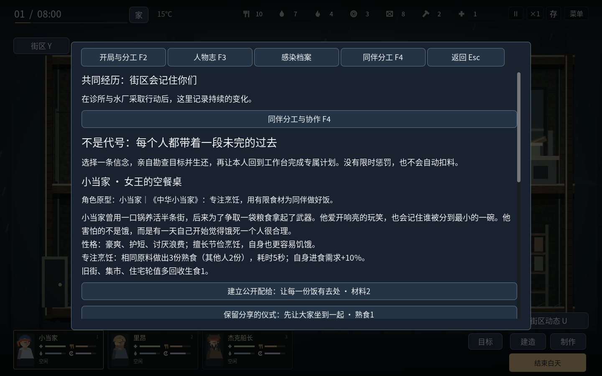

# v1.14.1 · 明确可辨认的角色原型

游戏标题为《封锁区：余生》。本版从普通原创姓名改为直接使用玩家熟悉的角色名，F3人物页明确写出参照来源。世界经历仍发生在本作的感染城中；外观是原创简化二维绘制。

| 游戏角色 | 明确参照 | 实际能力与表现 |
| --- | --- | --- |
| 斯塔克 | 托尼·斯塔克，《钢铁侠》 | 工程制作与修整、工艺成长、前哨施工；短发、胡须和暖红工作服 |
| 白求恩 | 历史人物白求恩 | 前线医疗援助；取消怪力加成，近战0.9倍；医疗帽、短发和浅色工作服 |
| 里昂 | 里昂·S·肯尼迪，《生化危机》 | 近战伤害1.4倍、低脚步声与探索；侧分浅色头发与蓝色外勤服 |
| 小当家 | 《中华小当家》小当家 | 同料基础烹饪3份、5秒完成；近战恢复0.95倍；蓝色头发、红头带和浅色厨师服 |
| 华佗 | 历史人物华佗 | 精细护理额外减少伤势和疾病，照护成长；发髻、长须与素色衣服 |
| 杰克船长 | 杰克·斯派罗，《加勒比海盗》 | 邻里交换额外水和燃料，翻窗、睡眠与小伤恢复；三角帽、头巾和辫须 |

角色介绍、对话和人物计划同步使用新名字。人物的内部身份与任务系统仍共用原有角色记录，新增名字不会额外发放物资。白求恩和小当家取消上一版的怪力与战斗厨师加成，分别恢复医疗和烹饪定位；近战数值直接参与实际伤害计算。

吃饭、饮水和烹饪增加了碗、勺、杯中液面、锅沿与蒸汽的绘制。当前食物数据仍是生食与熟食，肉类、蔬菜、饮料的独立机制尚未完成，不能把这些装饰描述成新的物品类别。

按用户要求，不再为了旧存档限制本次设计。新游戏名使用新的用户存档目录，旧版本存档不会自动载入，建议新开一局。没有删除旧目录中的文件。

## 本轮验证

535项相关逻辑检查及字体覆盖检查通过：人物124、存档74、战术59、协作与动作86、街区89、门碰撞13、居住地90。三个开局的9项图形检查验证实际角色卡、原型说明和有效角色状态。最终Linux导出程序完成原生输入、关闭和重新启动检查；72项运行输入与源码核对。此前版本的完整战役数据属于历史验证，没有作为本轮重新执行的结果。

Windows、Linux和同版Windows验收程序按Godot4.6.3官方模板导出。Windows真机、可闻声音与商业游戏级视听成熟度仍未验证。
