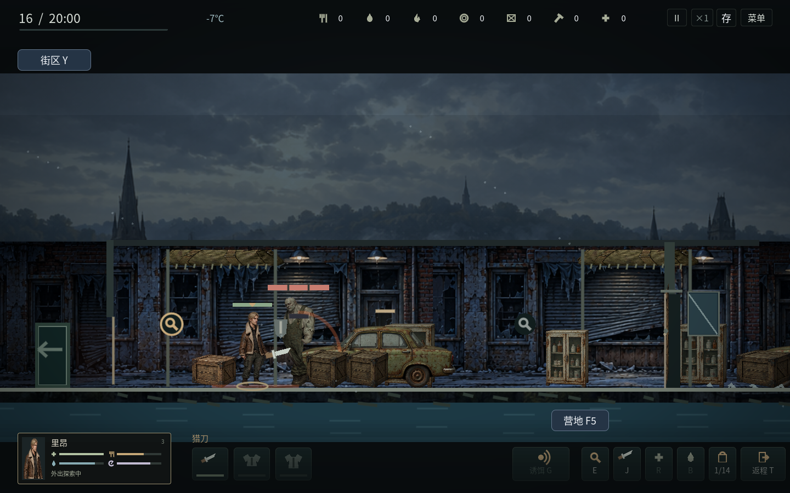
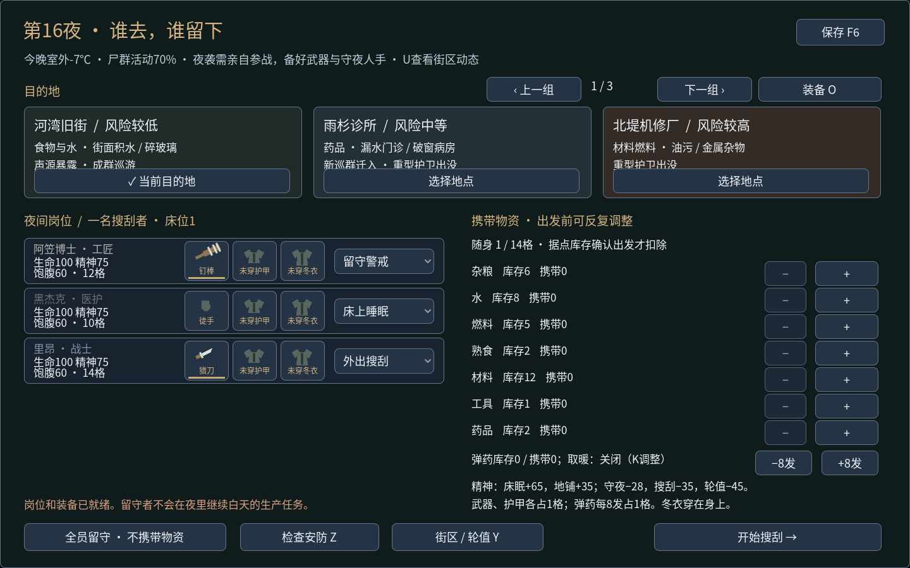

# v1.19：战斗压力与区域巡群

之前每次命中都会清掉敌人的蓄力，形成连续压制；追击恢复阶段还可能走到人物脚下重叠，破坏躲闪的可读性。这一版调整实际攻击和迁入规则，保留三种感染者的基础生命与伤害，新增的压力来自各自的反制方式和组合。

## 战斗中的取舍

普通敌人首次受击可失衡，之后有2.4秒稳身：仍受伤，但不会被连续打断。蓄力最后0.28秒是已承诺的出手阶段，轻击不能在最后一刻救场。金色小环表示稳身，地面攻击距离线与逐渐填满的圆弧表示蓄力。已承诺的攻击动作不会被受击反应盖住；伤害与血迹仍照常显示。攻击结束后仍有恢复时间，可以撤退再反击。

重型尸正面的硬化组织将刀刺伤害降至55%，钉棒保留85%、枪械90%；从背后攻击绕过正面抗性。正面轻击不会打断它的重击，钉棒能造成一次失衡，但稳身期间也无法连续压制。近身攻击范围更大，长蓄力给玩家撤退机会。

迅捷尸追击速度245，快于普通步行190、慢于冲刺275；这是精神充足、未受伤时的基础速度。它从更远处蓄力，最后一段向锁定点扑出，不能跟着玩家转弯或穿过关门。观察预警、提前换边、关门隔开，均有实际作用。感染者保持近身停靠距离，恢复期间不会故意挤进人物脚下。

武器的动作消耗精神：猎刀1.5、钉棒2.8、铁矛2.4、手枪0.8。精神不足、伤势严重会拉长再次出手的间隔；近战动作最初0.28秒移动减慢。强行交换伤害可以更快清除威胁，也会让治疗、护甲和轮换外出者变得重要。

这些规则同时用于外出与亲自参与的基地防守。未被接管的近战守卫会尝试避开蓄力，未持武器的同伴也会后退；楼梯上的同伴须先完成落脚，不会生成半空横移路线。玩家正在接管的人物仍由玩家决定是否撤退。

悬停敌人可查看类型与反制提示，F3的感染档案也提供基础交战说明。图片使用声明过的战斗夹具暴露攻击状态；不作为完整战役中取得装备或击杀的证据。

## 后期不再沿用第一夜的配置

第8、16、24天进入不同巡群阶段。地区噪声达到45会额外提高一档，最多四档；与玩家拿了什么装备无关。普通地图的夜间补入巡群逐渐混合迅捷、重型与额外游荡者，巡群总数有上限。两处持久经营地图的伤亡和物资继续保留，最多每三夜从远端补入一名巡游者。

所有常规巡群都在进入夜间分工时准备，地图第二行显示巡游、声源暴露或新迁入情况。出发后不会因玩家换武器、靠近物资或读取存档而即时增援。营地已有的尸群迁移局势仍有提前预告，并受远处诱饵改道影响。

已建立、状态良好且仍在整治保护期的前哨会阻止新巡群；保护期结束后恢复迁入。前哨需要材料、工具、维护与整治投入，夜间轮值还占用角色和燃料。清剿、经营、换区搜刮和保持低噪声因此有不同收益。

迁入不会把受伤敌人治好，也不会刷新持久地图已耗尽的容器。进入准备画面或存读档不会重复生成一批敌人。补给荒只减少容器中实际存在的杂粮，修复了遇到非食物箱时访问不存在字段的报错。

## 验证

受控对战夹具使用里昂的近战专长、猎刀、相同的正面重型尸，初始生命100、疲劳15；对战过程中没有用药或额外调整敌人状态。站桩连续进攻约4.4秒击倒，剩余生命52；读取蓄力、后退反击并处理掩体，约8.3秒击倒，剩余生命100。两种打法均消耗7次命中、武器耐久14，谨慎打法花费更多时间与移动精力。这是固定夹具的策略对照，不代表玩家必然得到相同结果。

逻辑回归验证实际失衡、护甲方向、钝击、扑击、门、疲劳、区域安全、迁入、存读档及防守路线。图形检查通过真实键鼠走完出发、近战、撤退、扑击躲避、资料界面与基地防守。另有正常行动命令驱动的完整战役与长期生存检查；不发放库存、不传送人物、不修改需求或敌人状态。

通过1651项逻辑检查、158项图形界面检查。经典与医疗开局均在第29天撤离、三人存活；车队开局连续游玩至第62天、三人存活。Linux独立程序完成真实键鼠、搜索、返程、关闭与重启。

详见[本版验证记录](combat-pressure-validation.json)。Windows采用官方模板导出，Windows真机检查仍待完成；Linux独立程序的启动与操作另行验收。
