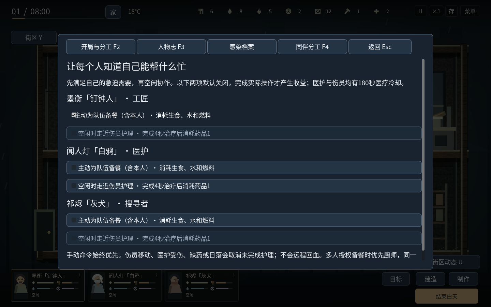
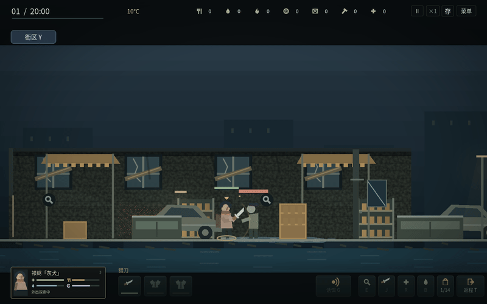

# v1.12 · 同伴会帮忙，动作看得懂

这轮把已识别的行为分层、记忆搜索与动作阶段等研究方向，独立落实到本作。新增数值为本作设计；没有把原作的类型名当作已确认的规则，也没有复制原作素材或源码。[原作静态研究范围](TWOM_BINARY_REFERENCE_20261028.md)。

## F4：有边界的同伴协作

基本吃饭、喝水、休息仍默认开启。新增两项协作需逐人授权，默认关闭，旧档迁移不自动增加燃料或药品支出：

- **共享备餐**：自己不饿也可替饥饿同伴实际做饭。保护手动任务需要的食材、水和燃料，已有锅在做就等候；多人同时授权时优先厨师，同一时刻只准备一锅。基础厨师产出3份，其他人2份，原有制作规则不变。不替别人做完就自己吃。
- **现场医护**：医护空闲、自己的需求不急迫时寻找伤员，实际走近并护理4秒，完成才扣药品1，沿用医护专长、照护经验、关系及双方180秒冷却。同一伤员只安排一人。患者移动、医护受伤、缺药、手动接管、关闭授权或日落都可取消；未完成没有药品消耗或回血。

手动命令优先；迫切缺水先饮水，医护饥饿先吃饭。共享备餐也能解决厨师本人饥饿，不会因自己饿而反复取消做饭。关掉基本自理后，协作也不启动。F4界面在白天可改，其他阶段只读。P页原有本人自理和缺饭时自行做饭开关继续保留；共享备餐是另一个明确的权限。

护理演示只把一名同伴生命设为55作为明确展示夹具；之后的规划、路程、工作进度、治疗和药品支付均由实际系统执行。展示不作为长期平衡证据；GIF按固定步长采样，回放速度不用于测定游戏内动作耗时。

## 敌人调查有记忆，也会放弃

敌人到达最后看见／听见的位置后，会停下转头观察，再沿以记忆位置为中心的有限路线搜索；附近有隔门时可能调查门另一侧。搜索目标在开始时形成，不会根据隐藏玩家的新坐标改写。主动调查预算为6秒，耗尽后返回巡逻；真实的新感知和呼号会取代旧计划。同一位置诱饵被识破、受伤退却、守巢、听声与呼号的既有规则继续保留。

关门继续挡视线、身体和近战；受击后退也使用相同门碰撞，不能被击退穿过关闭的门。调查等待时不再原地播放走路，攻击准备时身体和手臂逐步蓄力。搜索计划、剩余预算与观察阶段会保存，重新启动不会恢复一整份调查时间。

## 用真实动作驱动关节动画

人物使用同一套原创二维关节绘制，避难所、外出和基地防守保持动作语言一致：

| 行为 | 可见表现 |
| --- | --- |
| 行走、奔跑、潜行 | 弯膝迈步、抬脚、身体起伏，奔跑前倾、潜行压低身体 |
| 爬梯、翻窗 | 交替抓握和抬腿，翻越身体弧线跟随实际进度，武器收拢 |
| 搜刮、门窗、制作 | 俯身翻找、伸手旋门、工具作业；只有实际使用工具时才显示对应工具 |
| 日常与协作 | 杯子、进食、搅锅、缠治护理、睡眠呼吸、演奏和受冷姿势 |
| 战斗 | 准备、接触、恢复连续衔接，枪械后坐与换弹，受击后仰和倒地 |

刀、棒、矛、枪有不同的动作幅度与接触姿态。接触姿态在实际判定发生的边界衔接，血迹和倒地由命中／死亡事件触发；挥空、推搡或被挡不会凭空喷血。基地防守也复用敌人的受击、流血与倒地反馈。最后一人死亡导致游戏暂停时直接保持已倒地的终态，避免死后站立。

动画只读取模拟状态，不改变生命、物资、位置或命中结果。暂停冻结动作，离线不播放模拟；加载不重复结算治疗、做饭或攻击。

战斗演示明确设置玩家和一个真实满血敌人的站位，清除其余敌人以隔离画面检查；武器来自普通开局，伤害、命中、磨损、受击与死亡实际发生。它不是完整战役或原作实机录像。

## 存档、长期与验证

schema19兼容1–18，新增协作授权、在途医护、护理进度和敌人调查计划。真实schema18未完成自主饮水档已验证迁移；库存、角色和原有授权不重置，新增协作默认关闭。跨进程验证中，医护能继续走近并只付一次药，敌人继续消耗剩余调查预算。

三个开局分别跑潜行整备、安防投入、授权协作三种路线，九组均在35日窗口内全员撤离；另三组各完成60天无尽生存，原班成员均存活。协作路线中实际记录到4次自主医疗与2次共享备餐完成，没有直接补给、修改生命／需要、传送或直接推进战役。逐日数据见[v22-campaign-balance.json](v22-campaign-balance.json)。

精确检查数量、源文件与运行包哈希、桌面验收结果见[v22-validation.json](v22-validation.json)。当前窗口／全屏检查为Linux，Windows只按官方模板导出；Windows真机、可闻声音及无限时长不作已验证声明。

[完整操作](PLAYING.md) · [Windows验收方法](WINDOWS_ACCEPTANCE.md) · [下载](../downloads/README.md)
