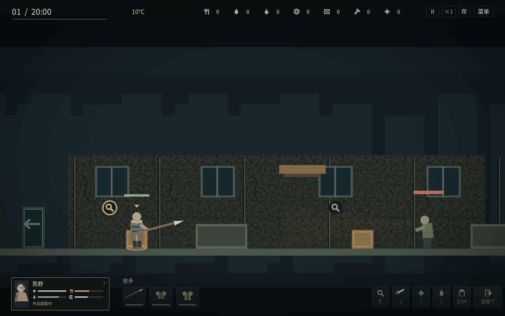
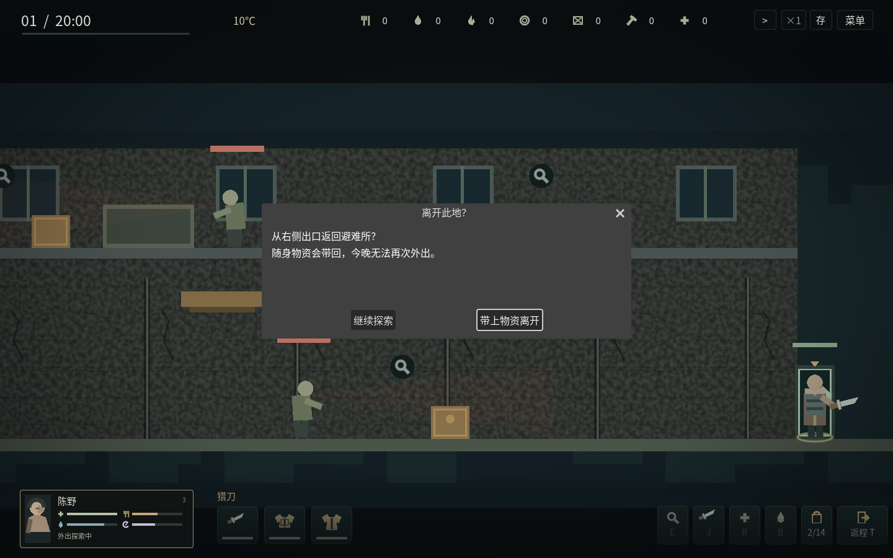

# v1.3.3 离场与夜间装备

地面左侧和右侧都有箭头出口。A/D、方向键或鼠标走到世界最边缘，弹出“离开此地？”；确认才携带物资结束这一夜，取消继续探索。确认时暂停世界，取消恢复之前的暂停状态。一直向外按键不会反复弹窗，走开再回来才重新询问。刚出生在入口旁、走到楼上平台尽头、滚动到屏幕边缘都不会自动离场。

T或右下返程按钮仍可从拾取界面安排实际回程，经过楼梯回到左侧出口，再询问是否离开。在任一出口附近按E或T也会询问；取消不会自动重新行走。06:00之后的强制返程保持实际行走并自动结算，避免可取消弹窗拖住天亮撤离。物资和夜间结果只结算一次。

夜间手持实际装备的猎刀、钉棒、铁矛或手枪，攻击动作随武器改变；背包工具不再冒充武器。夹层护甲、防咬背心和厚冬衣有独立外观。武器名直接显示，三个小图标分别对应武器、护甲、冬衣，下方是耐久条。悬停可看准确耐久，点击暂停并展开详细效果；Enter继续、Esc关闭。装备归零会标记损坏并失去原有效果；未装备武器仍只能徒手推开。制作与换装仍在白天／出发前K页进行。

## 当前地图：9张

| 地点 | 开放条件 |
| --- | --- |
| 河湾旧街、雨杉诊所、北堤机修厂 | 开局开放 |
| 积雪住宅 | 新战役第2天 |
| 废弃集市 | 修复电台 |
| 冻河净水厂 | 完成取暖准备阶段 |
| 北线货运站 | 修复净水泵 |
| 山顶广播站 | 修复净水泵，且第12天起 |
| 南岸撤离码头 | 完成信标，且第28天起 |

以上为现有独立物资、楼梯、掩体和敌人配置的地图数量，本轮没有增加地图。取暖准备要求建成取暖炉、两次温暖的留守夜晚，且第6天起；地图选择分三页。旧存档导入日为这套战役的第1天。

## 验证范围

新增边缘、取消、暂停、持键重弹、两侧地形、旧格式存档、强制回程和装备状态回归，GUI测试通过实际点击与按键检查离场和装备弹窗。详细检查计数、独立运行包哈希及桌面检查结果见 [v133-validation.json](v133-validation.json)。

Windows运行包由官方模板导出；本环境仅能运行Linux，不能宣称Windows真机验收已完成。正常游戏不会自动游玩，单独验收包需要主动运行。
