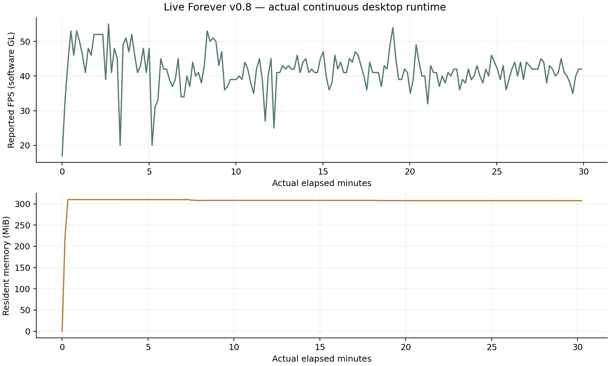

# v1.0 · 新昼夜循环桌面检查

最终独立程序已完成四种实际窗口尺寸、白天／夜间分工布局、全屏返回与5分钟连续运行，共38项通过，随后正常关窗并由普通程序重启恢复同一份昼夜账目。Windows仍待实际设备；详见[本轮证据](CAMPAIGN_V1.md)。

以下均为历史版本记录，不代表v1.0已做30分钟或Windows真机验收。

# v0.9 桌面验收范围

本轮完成四种实际窗口尺寸、场景时钟与治疗按钮布局、全屏返回、系统输入、正常关窗和存档恢复。补齐字体的候选程序经过5分钟实际连续运行；最后一处状态标签调整后的交付程序经过1分钟复查，均30项通过。Windows仍待实际设备检查，详见[本轮结果](EXPERIENCE_V09.md)。

以下为v0.8历史30分钟报告，不等同于v0.9实测时长。

# v0.8 · 桌面与连续运行验收

普通运行程序与独立验收程序都由Godot4.6.3匹配官方模板导出；各自内嵌数据，普通游戏不包含自动验收控制。以下Linux结果来自实际导出的程序和实际经过时间。Windows尚待用户设备执行，不能用Linux通过代替。

| 检查 | Linux结果 | Windows状态 |
| --- | --- | --- |
| 窗口1024×768 | 实际尺寸与完整逻辑画面通过 | 待真机 |
| 窗口1280×720 | 实际尺寸与完整逻辑画面通过 | 待真机 |
| 窗口1440×900 | 实际尺寸与完整逻辑画面通过 | 待真机 |
| 窗口1920×1080 | 实际尺寸与完整逻辑画面通过 | 待真机 |
| 全屏进入／返回窗口 | 实际切换通过 | 待真机 |
| 正常关窗／原程序重启 | 系统消息、退出码与存档核对通过 | 待真机 |
| 冷虚拟显示首次启动退出 | 三个新Xorg会话分别通过 | 不适用；使用原生WM_CLOSE |
| 持续实际运行 | 30.00分钟、74371帧 | 需运行一键脚本 |

## 连续运行内容与资源记录

验收按真实帧推进同一游戏代码，使用正常派工、饮水、行走、攀爬、搜索、攻击、用药和返程，不注入库存、生命、位置或经验，不让暂停画面代替持续游玩。独立槽位与偏好目录隔离正常玩家存档。

完成18项桌面检查；三位初始成员仍存活。最近一次样本记录20次真实返程，模拟时间1790.9秒。

外部进程常驻内存：预热120秒后首样310.1 MiB，末次307.4 MiB，预热后范围307.4—310.1 MiB。全程峰值310.1 MiB。原始首样0.1 MiB采于进程刚启动，尚未完成字体／渲染初始化，不能用它与末次差值直接判定泄漏。原始采样与包含启动阶段的曲线一并提供。

连续阶段最慢单帧0.146秒；Xorg dummy／Mesa llvmpipe为软件渲染，这里的帧率不代表Windows硬件表现。

## 退出异常的修正

旧探针在全新虚拟显示上没有先注册关窗协议，而Godot只查询已有原子，导致首次关闭消息未被识别。现在启动前正确初始化；窗口树搜索还按进程匹配并避免临时窗口销毁竞争。三轮验证均先确认原子不存在，再进行正常系统输入、搜刮、返程、关窗和重启，期限保持15秒。详见[定位证据](EXIT_DIAGNOSIS.md)。

## Windows怎么提供证据

下载单独的Windows验收包，解压后双击windows_acceptance.cmd。脚本默认跑30分钟，再通过原生关窗消息与实际F6键检查恢复。结果在AcceptanceResults目录；另按[人工检查单](WINDOWS_ACCEPTANCE.md)核对声音、可读性、按键与Alt+Tab。无需提供远程桌面或账号密码。

PowerShell脚本已做结构语法检查；尚未实际在Windows执行。只有收到对应设备的实际结果，才能把Windows启动、音频、全屏、分辨率和连续运行标为验收通过。

## 原始结果

[Linux桌面数据](acceptance-data/linux-desktop.json) · [三轮冷启动](acceptance-data/cold-exit.json) · [Windows包校验值／待验状态](acceptance-data/windows-package.json)

```sh
python tools/desktop_acceptance.py builds/linux/LiveForever.x86_64 builds/acceptance-linux/LiveForeverAcceptance.x86_64 --minutes 30 --display :98 --artifacts /tmp/live_forever_desktop
python tools/cold_exit_check.py builds/linux/LiveForever.x86_64 --display :99 --artifacts /tmp/live_forever_cold_exit
```


