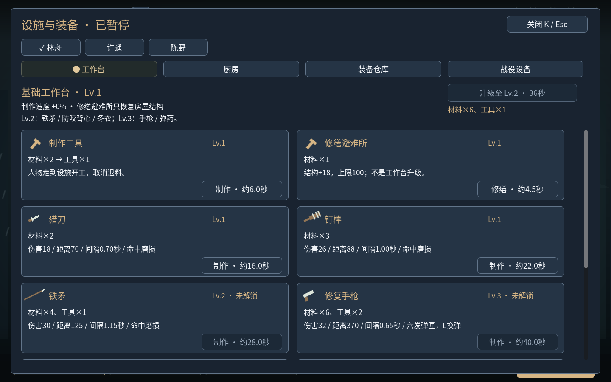
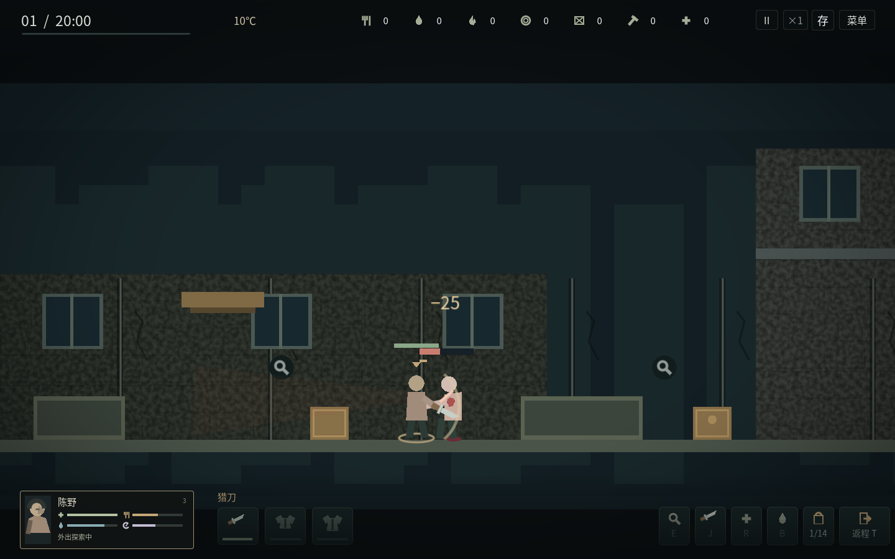
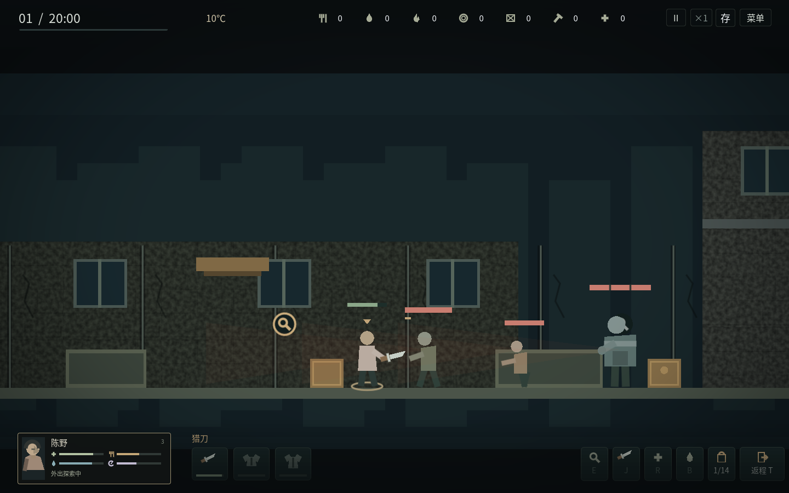

# v1.5 街区动态、面板与战斗反馈

U打开街区动态，场景会暂停。每三天一轮，从巡查、战斗、餐食三个方向任选一项，不接取没有惩罚。共九种目标变体，按轮次和已建成的设施提供。接取前显示具体目标、风险和接应补给；接取后显示已完成和当晚待带回的进度。夜里也能打开查看，接取和领奖需回到营地。

## 升级的收益与风险

| 方向 | 低门槛行动 | 升级后可选的行动 |
| --- | --- | --- |
| 巡查 | 打开指定容器记录现场，返回交回回执 | 轮换旧街、诊所、机修厂；路线、楼层、补给不同 |
| 战斗 | 在旧街新击倒1只僵尸并返回 | 二级工作台：机修厂击倒2只；三级：手枪实际命中3次并返回 |
| 餐食 | 接取后做出4份熟食，再交付4份 | 二级厨房：用高级配方做出并交付4份；三级：大锅饭做出并交付6份 |

提高要求的机会会提供更好的补给，但不会改变现有僵尸的属性。玩家可以继续选择巡查或餐食。日期、天气、噪声、安防、守夜和实际装备仍分别影响原有生存压力；新系统没有按玩家武器等级偷偷增加敌人的血量。

现场进度必须活着返回才计入，死亡丢失当晚的回执／战斗进度。已经死亡的敌人不算新击倒，挥空与空枪不算射击命中。餐食必须在接取后实际制作，不能仅靠旧库存领奖；领奖仍需要交付熟食。一个窗口只能接取一次，放弃也不会返还本轮名额，不能循环领取补给。未完成会过期，已完成而未领取的补给会保留。最后一夜已进入分工时，不再允许接取来不及完成的餐食任务。

巡查目标使用独立小标记；空箱仍保持灰色，旧空容器可以实地打开重新记录。标记不会把没有物资的箱子重新染成有物资的颜色。

夜间分工和U页显示室外温度、尸群出现几率及守夜准备估计。概率沿用实际夜袭规则，准备估计采用同一套守夜、武器与安防计算；它是当前准备情况的估计，不能代替防寒、食物和人员健康管理。

## 面板阅读

统一为深蓝灰底、浅色正文、暖色标题；接应补给为青绿色，风险为暖橙色。正文最小17号、按钮18号，并区分标题、目标、投入和产出。锁定配方保留正常的正文亮度，通过等级说明和禁用按钮表达状态。长文本在限定区域换行或省略，避免挤到相邻卡片。U、K、H、人物／手册和确认窗口使用同一套主题。

普通文字、次级文字、禁用按钮文字、强调文字分别做了对比度检查；禁用文字也达到4.5:1。主场景仍以场景、角色和图标为主，详细信息按需打开。

## 敌人与打击表现

| 类型 | 生命 | 无护甲扑咬伤害 | 追击速度 | 扑咬准备 |
| --- | --- | --- | --- | --- |
| 普通行尸 | 40 | 14 | 105 | 0.8秒 |
| 迅捷尸 | 30 | 10 | 155 | 0.5秒 |
| 重型尸 | 90 | 24 | 75 | 1.1秒 |

这些是原有的实际战斗数值，本轮将其集中到同一数据表供模型与表现读取。速度是游戏世界单位／秒，实际追击还受地图和状态影响。武器伤害、角色武力、潜行突袭、护甲和疾病等规则照常生效，因此击倒所需次数不同。

迅捷尸更瘦小、步频快，重型尸更宽大、动作沉重；悬停敌人可看类型和血量，重型尸血条有分段。普通近战有短促刀光，铁矛有前刺，手枪有枪口闪光和短弹道。

真实掉血才触发后仰、短暂闪色、血粒和地面血迹，空挥和零伤害推搡不冒血。击杀有独立倒地过程，结束后留下尸体与血泊；加载旧现场时保留死亡状态，不重播旧命中。人物被咬时有后退、短暂护身姿势、血迹和短红闪，轻微画面冲击控制在几像素。粒子、地面痕迹和临时反应均有数量或寿命上限，换地点／新外出／读档会清除旧的瞬时表现。

## 存档与验证

格式12自动迁移旧存档，保留原有设施等级、装备、任务、地图消耗和资源，不会赠送已完成委托。验证范围与运行包哈希见[v15-validation.json](v15-validation.json)。Windows包由官方模板导出；本环境只有Linux，未宣称Windows真机或真实音频已经通过。两分钟桌面检查不能代替长期设备测试，新增委托的完整35日自然生存平衡也未作通过声明。
