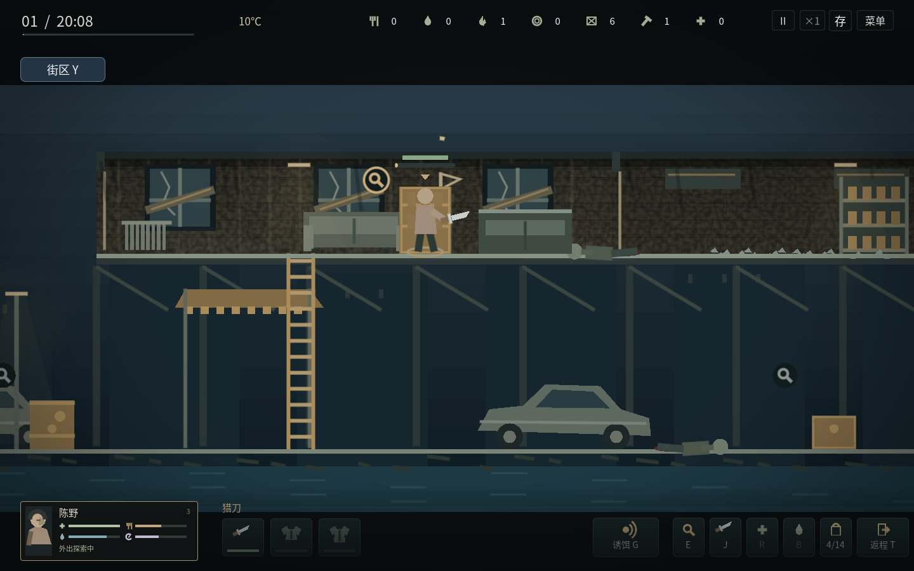
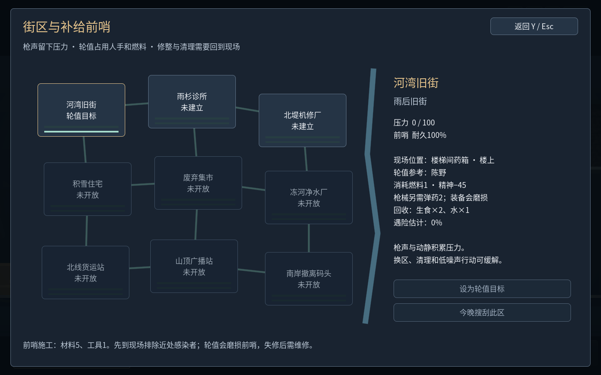

# v1.9：尸群压力、声源诱饵与补给前哨

这一版把外出行动与长期经营接起来：动静影响街区压力，压力影响下一次进入时的敌人组合；建成前哨后，需要派人、付燃料并维护，才能回收物资。它是本作独立的核心循环扩展，不宣称已经达到或超过《这是我的战争》的整体成熟度。

## 在场景中改变局势

**G：发声诱饵。** 背包材料1、燃料1，向前投掷一个持续18秒的声源。最多同时存在3个，投掷有3秒间隔。圆环显示声源及剩余时间。感染者会沿真实通路调查它；看到或听到人物后，仍会追击人物。诱饵不造成伤害、不制造隐身，也不能中止已经开始的扑咬。离场后不退还用掉的材料，未结束声源随本次外出结束清除；途中存档保留剩余时间与敌人记忆。

**尸群压力。** 每个街区单独记录0–100压力。枪声即使命中家具或打空也会留下压力；持续大动静和诱饵同样有代价，实际击倒感染者可以降低压力。下一次出发时，压力45以上会出现更多迅捷尸组合，75以上可能出现重型尸；沿用三类敌人的固定属性，不根据装备强行提高生命。不会在玩家身旁凭空刷敌人。

各区压力在清晨降低2；可以换区休整，或到现场投入材料1、燃料1、7秒工作，降低25压力。高压地区返回可能增加营地的遇袭概率与强度；走到地图另一端离开会减弱带回的尾随压力。安防预报和实际结算使用同一规则，实际安防结果保留在清晨纪要。

## 建立前哨

每图有一处小旗标记的施工位置，Y街区图可以查看确切房间。先走到现场打开容器；附近有活动感染者时不能施工，可以击倒，也可以引开。正在爬向附近平台的感染者同样构成威胁。

- 建立：背包材料5、工具1，工作9秒。
- 修整：背包材料2，工作5秒，恢复55耐久，最多100。
- 整治周边：背包材料1、燃料1，工作7秒，降低25压力。

人物实际留在现场施工，进度显示在场景中。移动、攻击、受伤、失去所需物资或感染者靠近会中止工作，未完成不扣施工用料。暂停和读档可保留未完成工作，不能离线完工。林舟施工速度快20%，工艺成长也会影响效率。建成状态、耐久与压力长期保留，不随容器补货重置。

## 派谁轮值，何时维护

Y打开街区图，选一个已建立的前哨，设为轮值目标。20:00分工时给一人选择“前哨轮值”，每晚最多一人；他不能同时搜刮、守夜或睡觉。搜刮仍只有一人可以亲自控制，轮值和守夜一样在整夜结算。

每夜预留燃料1，轮值消耗精神45。与搜刮携带、夜间取暖合并核对预算，不能使用尚未带回的物资。枪械轮值还要预留弹药2；空枪不能免费提供保护。近战武器磨损2，枪械磨损1。冬衣能保暖，营地炉火不能给在外轮值者供暖。

成功回收以下基础物资。人物能力会改变结果：林舟在机修厂和货运站多回收材料1；许遥、顾苒在诊所多回收药品1；沈禾在旧街、集市、住宅多回收生食1；唐弥多带回水1；陈野轮值引起的压力较小。

| 前哨 | 基础回收 |
| --- | --- |
| 河湾旧街 | 生食2、水1 |
| 雨杉诊所 | 药品1、材料1 |
| 北堤机修厂 | 材料4、燃料1 |
| 积雪住宅 | 生食2、材料2 |
| 废弃集市 | 生食3、水1 |
| 冻河净水厂 | 水5 |
| 北线货运站 | 燃料3、材料1 |
| 山顶广播站 | 工具1、材料2 |
| 南岸撤离码头 | 水2、药品1 |

高压力、失修、伤病和精神不足提高遇险风险，探索技能与武器降低风险。失败会受伤、损耗护甲和前哨，没有回收物资，预留消耗仍然有效。轮值者未能归来时，随身装备遗失，也不会发放补给。

每次轮值损耗前哨耐久14，所有前哨每夜还自然损耗2，失败额外损耗8。低于20不能继续轮值，需要亲自回现场修整。轮值本身也增加街区压力，枪声更多，陈野较少；不能靠反复读档重领，也不能只点菜单永远取得补给。成功轮值保留两夜巡查效果，随后进入时少一名活动巡逻者。

## 从新局验证的一条流程

本轮干净检查从初始资源开始，真实制作两件工具和饭食，实际行走、战斗、搜索旧街容器、拿到材料和燃料，投放诱饵后建成前哨，再沿实际路线返回。次日实际吃饭与休息，下一夜派人轮值并回收物资。没有额外发资源、传送、改生命或改敌人。

完整过程与最终快照见[v19-outpost-journey.json](v19-outpost-journey.json)。这是两夜的可行性验证，不能代替完整35日和多种打法的长期平衡证明。上方图形检查截图使用明确的资源与站位夹具，演示真实界面与行动；自然流程与展示夹具分别记录。

## 存档与操作修复

schema16兼容schema1–15，保留库存、角色、装备、地图通路与敌人AI。迁移不送前哨、诱饵或压力惩罚。施工、声源、压力、预留燃料和弹药、轮值岗位均保存并验证。

本轮也修复了封堵通路小图标改变绘制变换、可能让附近人物偏离实际坐标的问题；意图路线现在沿实际选中的楼梯绘制。

验证范围见[v19-validation.json](v19-validation.json)。Windows包由官方模板导出，尚未完成Windows真机、音频可闻性和完整30分钟设备验收；Linux导出包、图形尺寸、全屏、真实关窗与重启另行记录。
