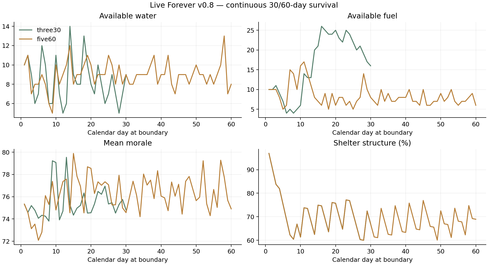

# v0.8 · 30／60天与逆境恢复报告

前两组从新局初始库存连续模拟，不注入生命、物资、坐标或经验。自动策略使用真实派工、饮水、搜索、步行、攀爬、战斗、撤退、升级和付费招募；有余量时支付人物事件费用、建设项目和参加限次互助，否则保留物资；勘查目标通过正常移动和搜索取得。

一天为720秒模拟时间，所有时间推进使用实际游戏相同的1/60秒子步。30天和60天分别从第1天08:00运行到第31天和第61天08:00。存档保留最近30条日记录，测试报告另外收集完整时间线；没有跳日或离线奖励。

| 场景 | 经过天数 | 存活 / 历史人数 | 往返次数 | 饮水 | 修缮 | 结构 | 故事数 |
| --- | ---: | ---: | ---: | ---: | ---: | ---: | ---: |
| 三人30天 | 30.00 | 3 / 3 | 59 | 48 | 5 | 65.1% | 3 |
| 逐步五人60天 | 60.00 | 5 / 5 | 171 | 157 | 12 | 67.1% | 5 |
| 伤亡与低库存恢复 | 15.00 | 5 / 6 | 46 | 33 | 6 | 81.6% | 7 |

## 终点可用库存

| 场景 | 生食 | 水 | 燃料 | 熟食 | 材料 | 工具 | 药品 |
| --- | ---: | ---: | ---: | ---: | ---: | ---: | ---: |
| 三人30天 | 10 | 11 | 18 | 0 | 11 | 6 | 6 |
| 逐步五人60天 | 26 | 10 | 6 | 0 | 13 | 5 | 9 |
| 伤亡与低库存恢复 | 11 | 9 | 14 | 2 | 9 | 2 | 5 |

## 可选目标与互助的实际投入

| 场景 | 通讯 / 救护 / 补给线阶段 | 已付材料 | 已付药品 | 药品互助 / 备件互助次数 |
| --- | --- | ---: | ---: | --- |
| 三人30天 | 1/3 / 3/3 / 2/3 | 14 | 16 | 3 / 1 |
| 逐步五人60天 | 3/3 / 3/3 / 3/3 | 54 | 45 | 16 / 6 |
| 伤亡与低库存恢复 | 1/3 / 3/3 / 1/3 | 8 | 14 | 2 / 1 |

## 与实际v0.7五人60天结果比较

| 版本 | 往返 | 期末材料 | 期末药品 | 期末生食 / 水 / 燃料 |
| --- | ---: | ---: | ---: | --- |
| v0.7 | 192 | 72 | 57 | 17 / 5 / 9 |
| v0.8 | 171 | 13 | 9 | 26 / 10 / 6 |

旧数据直接来自归档v0.7源码包中的实测JSON，原字节和归档SHA-256保存在baseline-v07。新版策略额外规划项目并使用互助，因此结果体现整套玩法变化，不能单独归因于某一个配方。

[v0.7五人原数据](baseline-v07/five60.json) · [原始归档证明](baseline-v07/provenance.json)

## 独立逆境夹具

第三组先实际生存3天、付费接纳沈禾，再明确设置一份压力测试夹具：许遥永久死亡，陈野生命65／伤势45／感染35，结构18%，生食、水、燃料各仅保留1，药品清空。此处主动施加伤亡、伤势和资源损失，不计作自然游玩的成功案例，也没有添加恢复物资。

随后连续推进12个完整模拟日，仅通过正常游戏操作恢复，招募顾苒和唐弥；旧成员的死亡身份保留。该组往返次数从恢复阶段重新计数；日明细包含事故前最近一条日界记录，随后是恢复期间的日界。饮水、修缮、库存、伤亡与故事是世界累计状态。

## 结果的解释范围

这些用例证明当前存在可持续的熟练操作策略，且指定逆境有恢复路径；不代表所有开局、操作水平、随机遭遇或策略均可救回。仍需玩家持续安排物资、维护和照料。

项目建设与共用两日间隔的互助为材料、药品提供了明确用途，所有投入均进入账目。玩家可以保留物资；不参与项目／互助的策略仍可能积累库存。食物受有限保鲜约束，其余库存仍无强制总上限；这些成功案例不等于所有资源、策略和操作水平已经平衡。技能仍每项最多3级、180经验，升级最多3级，敌人生命40、每地点最多5名。

## 原始数据与重现

[三人30天](endurance-data/three30.json) · [五人60天](endurance-data/five60.json) · [逆境恢复](endurance-data/recovery.json) · [完整每日CSV](endurance-daily.csv)

```sh
godot --headless --editor --import --quit
godot --headless --path . --script res://tests/test_endurance.gd -- /tmp/live_forever_endurance
python tools/endurance_report.py /tmp/live_forever_endurance --output /tmp/live_forever_endurance_report
```


