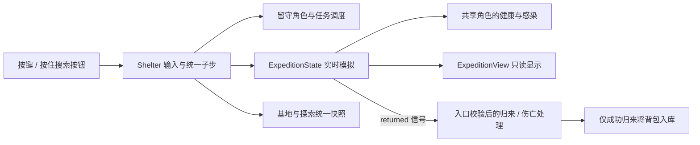

# 实时探索的数据与操作

## 同一个人，两种位置

`Survivor` 继续保存这个人的生命、饥饿、疲劳、伤势、感染和身份。外出时状态为 AWAY，清空基地队列和占用；其 Node2D 基地位置仍是合法的基地坐标，并隐藏。

每处地点有独立的 `ExpeditionState`，保存该地图里的坐标、楼层、攀爬和背包，直接使用同一个 Survivor 更新生命与状态。不是复制一份角色再尝试合并，因此不会出现“外面受伤，回来还是满血”的两份状态。

成功撤退后角色出现在基地入口、物资入库并暂停；遇难则永久死亡、丢失背包并释放外出控制。只有在地面左侧入口才允许撤退，T 在远处只给指路。

## 文件职责

| 文件 | 职责 |
| --- | --- |
| `expedition_state.gd` | 纯数据模拟：移动 / 潜行 / 攀梯、搜索、背包、敌人状态机、攻击 / 急救、地点余量 / 每日标记、探索快照验证 |
| `expedition_view.gd` | 原创场景绘制、跟随横向视野、背包与操作 HUD、鼠标按钮；不推进模拟 |
| `shelter.gd` | 准备界面、携带物资事务、共享时间、输入路由、场景显示切换、归来 / 伤亡结果 |
| `survival_rules.gd` | 三人的统一需求与感染发展，外出者和留守者使用同一规则 |
| `save_system.gd` | 整体快照、外出身份 / 场景一致性、schema 1/2→3 迁移、原子读写 |



外出固定1x；暂停冻结全部。每个子步先推进人物需求和基地任务，再推进探索。留守者会完成离开前安排好的任务；当前版本不能一边外出一边远程重新派工。

## 出发与装备为什么要先校验

先检查人物存活、当前没有其他外出者，以及整份可选装备是否足够。失败就不取消现有工作、不扣部分资源。成功转移装备后，才取消所选角色的基地任务、退回工作用料、释放设施，切换为 AWAY。

准备窗口会暂停世界，取消恢复原暂停状态。装备不是出门费用：未使用的工具 / 药品装在背包里，归来会返库，占用背包空间；遇难则一起丢失。

工具按件消耗，每次成功破锁或击倒花一件，不引入“回基地再出门就恢复耐久”的漏洞。空挥不会消耗工具，但会发出噪声。

## 搜索不是倒计时领奖励

角色必须亲自到达对应楼层、距离容器58以内，按住 E 或搜索按钮。站在旁边、只按一次、离开地点或暂停，都不会自动领物资。移动 / 松开只暂停已开始的搜索，重新按住可继续；换目标、攀爬、整理背包或离开场景会清除当前搜索。

普通箱柜按定义用时；锁柜无工具多4秒，有工具约3秒。潜行搜索进度为正常的80%，搜寻者进度再乘1.2。完成时先算背包空位，按固定资源顺序转移数量，容器同步减去这些数量；未装下的还留着。没有“搜完标成空但物资没拿到”。

背包10格，每份资源一格，丢弃不可拾回。只有回入口，Root 才把正数量的 cargo 入库。完成信号发送前先关闭外出、清空持有背包，重复请求撤退不能二次入库。

## 敌人：可解释的状态变化

```text
patrol 巡逻 → 听到声音 → investigate 调查
看到 / 听到 → suspicion 上升 → chase 追击
接近 → windup 扑咬前摇0.8秒 → 检查距离后命中或落空
被徒手推开 → stunned 失衡1.6秒 → 继续巡逻或追击
工具命中 → dead，清空警觉和动作，不再影响警戒指示
```

正常视距约290，潜行约115；在掩体范围潜行约55。看向另一边时只有贴身约55内仍会察觉，声音可以让它转头。行动噪声对应听觉范围：步行30、奔跑75、潜行8；搜索42、撬锁70、挥击100，听觉距离约噪声×4。搜寻者地面脚步声乘0.8，破锁 / 挥击不因此无声。

追击约105速度，普通人步行190、潜行95、奔跑275，人物需求和重伤会降低移动速度。因此撤退、潜行或使用有限工具都能有实际作用。敌人不会跨楼层攻击，也不会追着玩家爬梯子；但二楼有单独巡逻者。

扑咬命中损失14生命、增加12伤势和8感染，击退约42，并有1.6秒受击保护和敌人动作冷却。没有碰到就按帧扣血，也没有随机秒杀。J 挥击前摇0.2秒；有工具击倒近处一个目标，无工具只能推开。徒手挥击疲劳+1.2，成功推开再+2.8；感染者稳身3.6秒期间不能续推，需利用前摇后退或使用工具。对手离开攻击范围会打空。

AI 目前按楼层、方向、距离和特定掩体判断，没有通用墙体射线或复杂导航。几何场景是可辨认的玩法占位图，非正式美术。

## 地点状态与长期变化

每处地点六个容器；旧街侧重食物 / 水、诊所侧重药品、机修厂侧重燃料 / 材料 / 工具。余量和锁是否已打开会保存。敌人被击倒后同一天保持死亡；反复出入不会重置容器，也不会立即复活它们。

到新的一天，仅在准备下一趟外出时执行一次补给与迁入：两处容器按日期轮换补充，感染者重新布置。每三天有第四名感染者，其余日三名，生命始终40，不线性膨胀。此处是旧街 / 诊所的数量；机修厂基础四名，迁入日五名。此变化在出发前公告并显示当前存活数量，活动中的地图不突然刷新敌人。

三处地点分别保存与轮换，地图选择、天气、维护和事件接入长期循环。当前三处布局与四类事件仍有限，后续内容与长期平衡需要继续游玩验证，见 [长期规则](LONG_TERM.md)。

## 伤势与医疗

咬伤写回共享人物。伤势50起额外降低效率，感染大于0按每模拟秒0.015增长，30预警，60起每秒伤生命0.05。原有饥饿 / 疲劳损害可叠加，治疗和恢复任务自身不受效率拖慢。

途中 R 消耗背包药品，立即恢复生命25、伤势40、感染35，冷却3秒。基地治疗消耗共享药品，完成恢复生命25、伤势50、感染40，医护6秒、其他8秒；取消只退药、不获得治疗收益。餐桌同时用于吃饭和治疗，因此需要安排先后。

## 真正验证了哪些行为

`test_expedition.gd` 测直接移动、搜刮和入口返回，基地并行、装备原子性、背包余量、潜行 / 听觉、上下楼、可躲开的扑咬、工具与徒手差异、死亡损失、治疗和每天只刷新一次。

`test_expedition_saves.gd` 真正写盘恢复搜索 / 攀梯 / 双方攻击前摇 / 背包与入库 / 地点余量，拒绝不一致的外出身份、坐标、容量、敌人状态和控制速度。旧存档样本由归档的 v0.3 代码真实生成，不是照新验证器手写一个“看起来合法”的文件。

`visual_expedition.gd` 通过实际按键按住 / 放开和鼠标事件，跑出发确认、移动 / 潜行 / 奔跑、键鼠搜索、途中保存 / 恢复、上下楼、亲自回入口，之后完成做饭 / 吃饭 / 睡觉。截图来自这条操作路径，非设计稿。独立进程探针还验证关窗保存、重启继续、归来再保存和第三次启动后的资源 / 容器一致性。


## 天气与地点差异

布局、梯子、上下层边界、巡逻数量和容器定义从 `LocationCatalog` 获取，视图和快照验证使用同一份定义。天气取该趟地点刷新日期，雨 / 雾改变实际听觉 / 视距，绘制视锥采用同样系数；贴身55附近仍能察觉，视线不被天气完全取消。准备窗口与探索顶部给出本趟说明。


## v0.6人物后果

搜索按真正装入量给探索经验，净补给归来另有奖励；空容器、取消和自带装备往返不获完成奖励。探索技能最多3级，改善搜索 / 脚步声，背包仍10格。咬伤除原身体后果，还增加压力8、创伤2、降低心境2。

口渴随共享模拟时间增长，B只能消耗本人背包水，不能远程使用基地库存；水被喝掉后不会再返库。出发窗口显示口渴、心境、压力和已授权的留守照料。稳身、人物状态、背包水、冷却全部进入同一快照。
