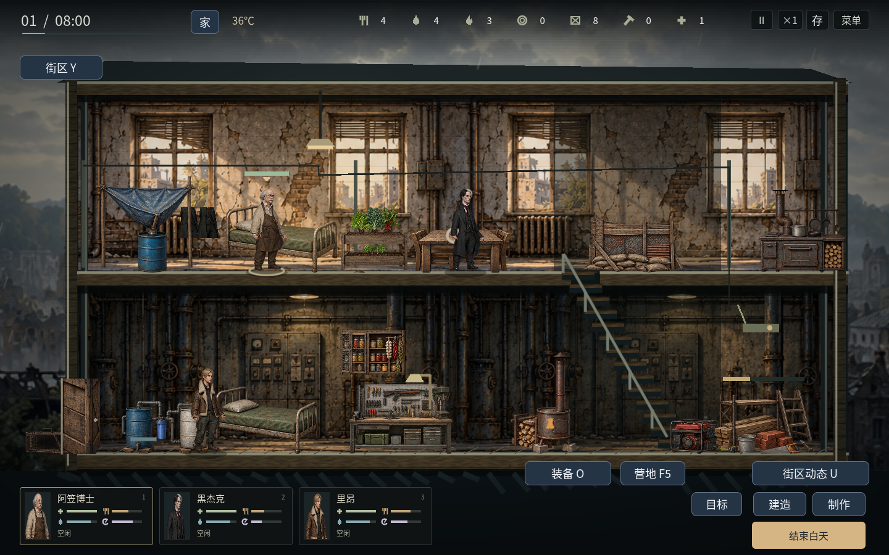
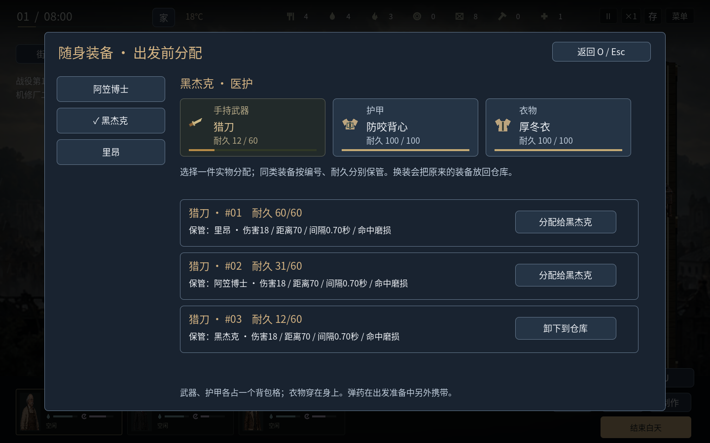
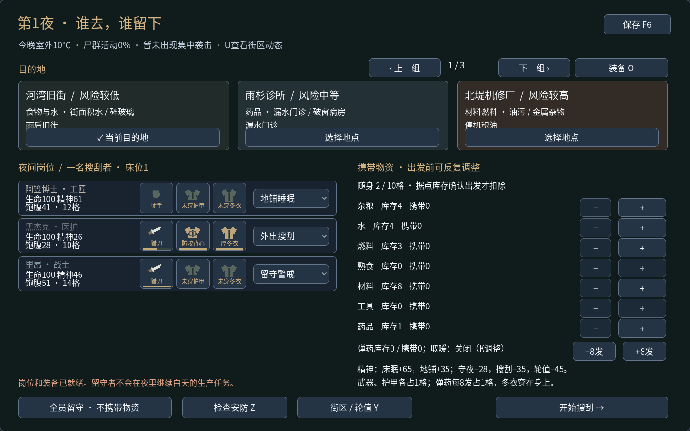

# v1.18：建造设施与独立装备栏

本版保持2D场景。新增一张1536×1024透明图集，约2.7MiB，包含炉具、雨水收集器、加固隔断、陷阱、保鲜柜、发电机、水过滤组件、种植架，以及不同等级的工作台和厨房。新增床位沿用已有床铺素材，施工阶段显示材料堆、脚手架和实际进度，完成后才出现成品及可用床位。

取暖炉只有在燃料燃烧时显示火光；发电机指示灯跟随当天实际供电状态。种植箱从单箱升级为双层种植架，作物随种植、成熟和收获出现或消失。种植作业位置移至楼上相应位置，避免与新增床位重叠。保鲜柜、陷阱、发电机和过滤器有独立外观；净水装置扩大的部分也可点击。场景装饰柜和箱子会让出已占用的建设位置。

这张图为明确设置各项设施的渲染夹具，展示已完成的床、炉具、收集器、隔断和右下角尚未完成的施工材料，不代表一局实玩中已经获得所有设施。付费施工、升级耗时、取消退料与完成后解锁由实际操作回归另外检查。

## 装备怎么分配

白天点击“装备 O”，或按O。左侧选角色，右侧分别选择手持武器、护甲、衣物，再选择一件实物分配。

每把装备显示唯一编号、自己的耐久和保管人。例如三把猎刀分别为#01、#02、#03，可以交给三个角色。转交时仅移动指定那把；目标人物原有的同栏装备回仓库，其他人的武器和身上的护甲、衣物保留。卸下只处理指定物品，不增减材料，也不修复耐久。

旧的K装备仓库也保留，每件装备使用明确的保管人下拉框，可以单独交给某人或放回仓库。制作与维修仍通过实际工作台任务进行。

夜间准备时，每个角色旁都有三个可点击装备栏和耐久条，可以直接打开该角色对应栏位。武器、护甲各占一个背包格，冬衣穿在身上，弹药另行准备；更换装备会立即更新搜刮者的容量预算。

外出后按O，或点击底部装备图标，查看实际出行者携带的武器、护甲和衣物。外出期间只能查看，不能从仓库远程换装。面板打开时暂停，关闭恢复打开前的暂停状态；分工阶段的Enter不会穿透面板直接出发。

## 验证范围

新增逻辑回归覆盖三把同款武器的独立归属、耐久、转交、卸下、衣物独立栏、无效请求、背包预留及存读档。图形回归通过真实鼠标和键盘操作完成多角色分配、夜间换装、出发、外出查看、暂停恢复，并检查1024×768、1280×720、1440×900和1920×1080窗口中的面板。

本版通过1445项逻辑检查、168项图形界面检查，Linux独立运行包完成真实键鼠操作、搜索、返程、关闭与重启。

详细结果与导出校验见 [验证记录](equipment-validation.json)。Windows采用官方模板导出；云环境只具备Linux，Windows真机验收仍待完成。下载入口见[首页](../README.md)。
