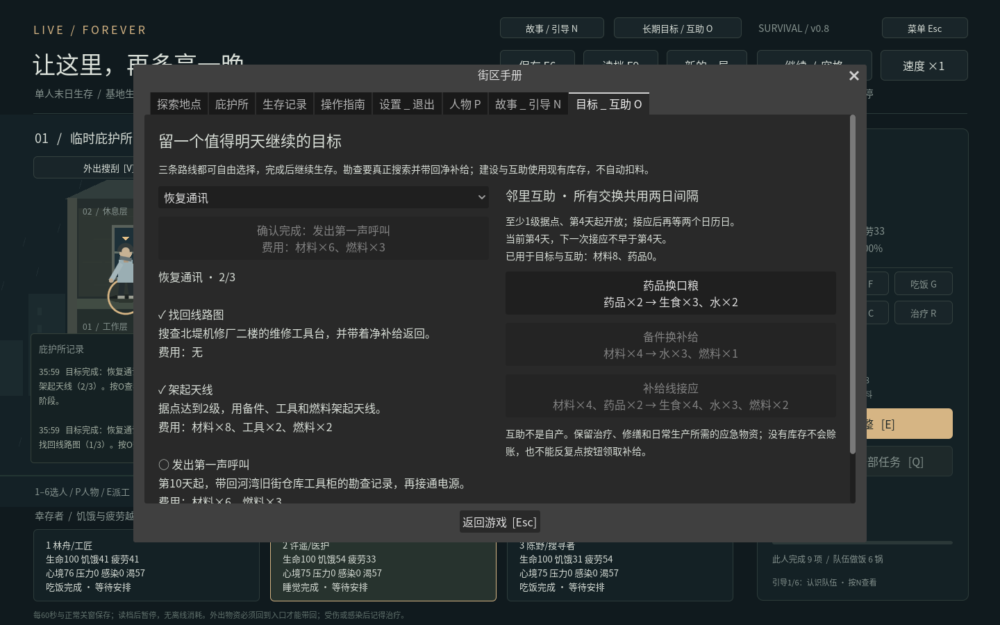
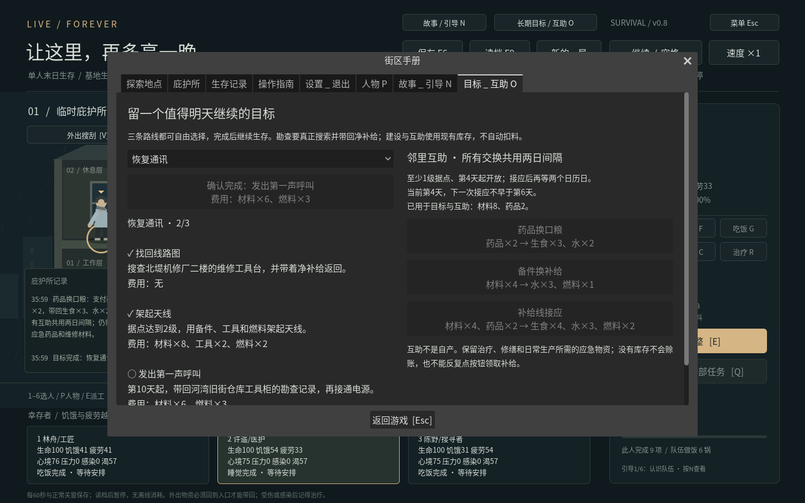

# v0.8 · 长期目标与邻里互助

按O或顶部“长期目标／互助”打开。三个目标各有三阶段，可以自行选择先做哪条；完成后仍能继续生存，没有强制天数结局。下拉框选择的路线会成为新手目标完成后的右下角提示。

## 恢复通讯

1. 搜查北堤机修厂二楼“维修工具台”，带回净补给，确认线路图。
2. 据点达到2级，支付材料8、工具2、燃料2，架起天线。
3. 第10天起，带回河湾旧街“仓库工具柜”的勘查记录，支付材料6、燃料3，发出呼叫。

## 建立救护点

1. 搜查雨杉诊所二楼“处置室药架”，带回净补给；队伍实际完成过至少一次进食、休息或治疗。
2. 据点达到1级，支付材料4、药品4、水2，备好救护角。
3. 第12天起，队伍实际完成过至少三次进食／休息／治疗，支付药品6、生食4，连接邻街救护站。

照料条件不要求故意让健康成员受伤或浪费药品。排队、走路和取消不算完成。

## 连接补给线

1. 从旧街、诊所、机修厂分别带回过净补给。
2. 据点达到2级，支付材料6、工具1、水2，备好接应物资。
3. 第14天起，据点达到3级，且通讯或救护路线已完成，再支付材料6、药品3，约定接应。

完成补给线后解锁第三种付费互助；不会自动产生库存或替你外出。

## 勘查记录如何带回

必须从对应容器实际拿到物资，才会产生随身勘查记录。它不占额外背包格，但只有存活归来且带回净补给才会送达基地。中途死亡，或把全部净补给丢弃后仅携原装备回来，都不能提交记录。空箱搜索不能重复刷记录。

随身记录与搜索、角色、背包一起保存；读档后仍要完成返程。每条记录唯一，每个阶段只确认一次。目标按钮列出完整费用，缺料、日期、据点等级和勘查条件不足会阻止执行。

## 邻里互助

至少1级据点，第4天起开放；三种选择共用一次接应机会，支付后要等两个日历日，读档不跳过间隔。

| 选择 | 完整费用 | 得到的补给 | 条件 |
| --- | --- | --- | --- |
| 药品换口粮 | 药品2 | 生食3、水2 | 基础互助 |
| 备件换补给 | 材料4 | 水3、燃料1 | 基础互助 |
| 补给线接应 | 材料4、药品2 | 生食4、水3、燃料2 | 完成连接补给线 |

所有互助都使用现有库存，不能赊账、循环点取或外出途中远程接收。建设与互助的累计材料、药品等投入都有账目；保留应急治疗、做饭和维修用量仍由玩家判断。

## 存档与实际验证

schema6保存阶段、追踪路线、已带回／随身记录、互助日期、次数和精确投入。整体验证会拒绝未知目标、错误阶段、重复／异地记录、未来日期及与阶段／次数不一致的用料账目。schema1—5顺序迁移，旧故事、人物与库存保留，不凭空补发勘查或建设进度。

逻辑检查覆盖搜刮／归来／死亡／丢弃、阶段费用、资格、间隔、外出限制、保存恢复、非法档案、新局和真实schema5迁移。真实界面用例通过正常生存、移动、攀梯、搜索和返程取得线路图，再点击建设与互助按钮核对费用；没有注入库存或位置。跨进程用例检查重启不会重复物资或跳过接应间隔。

