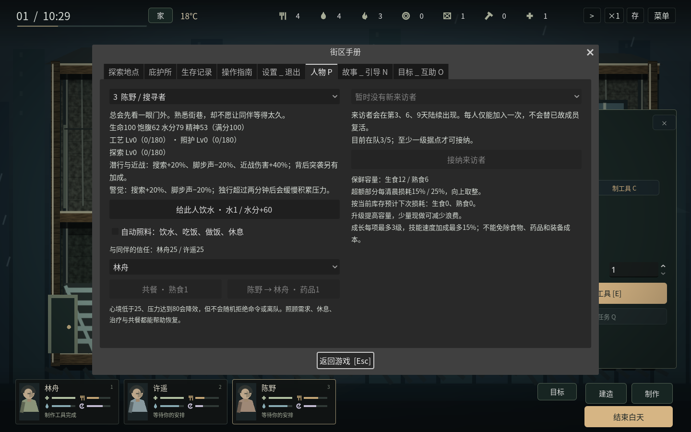
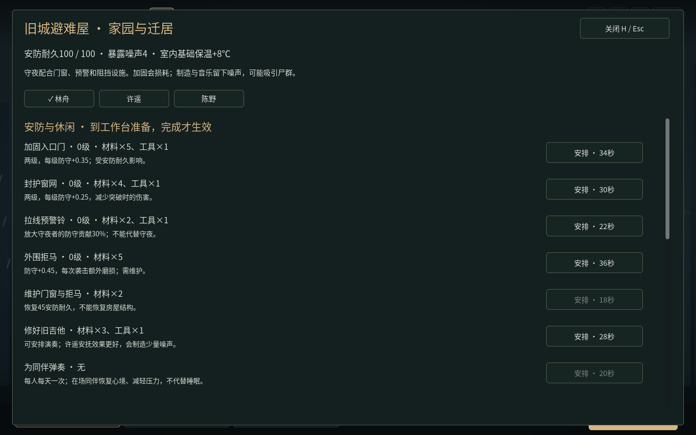
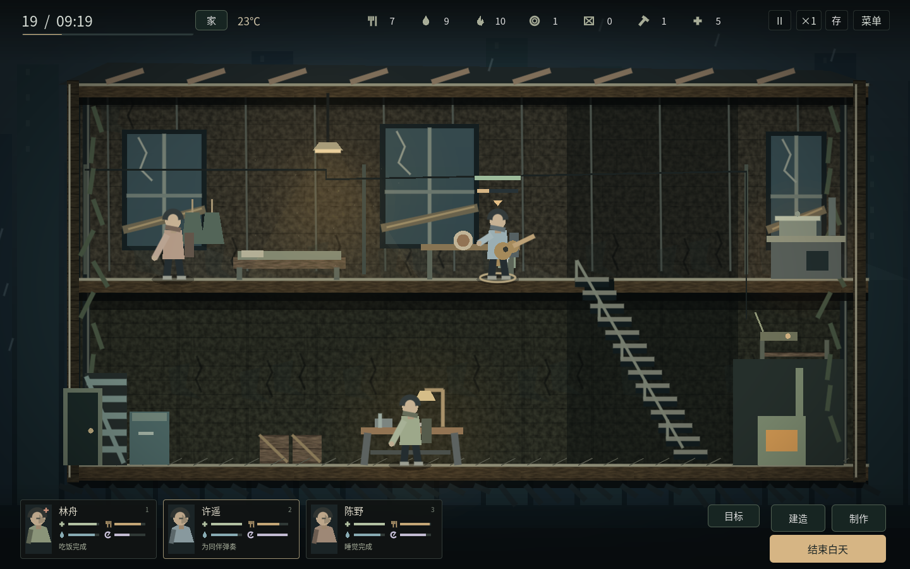

# v1.3 角色专长、安防与迁居

这一版将角色差异落实到食物、声音、战斗、恢复、医疗、演奏和交换，并加入实际消耗资源的安防和迁居流程。保持既有的场景操作、精简HUD、九地图和35日战役。

## 角色差异

| 人物 | 对实际游玩的影响 |
| --- | --- |
| 林舟 | 基础工具制作6秒而非8秒，修整4.5秒而非6秒；工艺经验+20% |
| 许遥 | 治疗更快，援助多恢复10生命；演奏恢复心境与减压的效果+60% |
| 陈野 | 搜索+20%，脚步声−20%，近战伤害+40% |
| 沈禾 | 生食1、水1、燃料1做熟食3，其他人同料做2；5秒一锅，自身食物需求+10% |
| 顾苒 | 用药和援助额外处理15伤势、10疾病，照护经验+20%；非睡眠体力消耗+10% |
| 唐弥 | 睡眠恢复+25%；满足食物与伤病条件时的小伤／生命恢复+50%；邻里互助额外得到水1、燃料1 |

同一把18基础伤害的猎刀，陈野普通命中25，林舟18，对40生命行尸分别需要两下、三下。潜行、低警觉且位于目标背后时，近战突袭另乘1.8；已警觉或失衡目标不能反复触发。枪械伤害不受近战加成影响。判定在真实前摇后发生，命中数字与生命条显示实际伤害。

情绪、创伤、关系和三项有上限的经验成长保留。夜间独行压力已接入正常战役的实际外出时间。当前没有复杂的性格驱动自主决策，也没有新做一套商人NPC；交涉专长作用于现有、有库存成本和两日冷却的邻里交换，界面报价会更新。

## 安防和休闲

H打开家园抽屉；关闭后主场景仍只显示简短时钟、温度、资源图标与人物卡。

| 项目 | 材料成本与效果 |
| --- | --- |
| 入口门 | 每级材料5、工具1；两级，每级防守+0.35 |
| 封窗网 | 每级材料4、工具1；两级，每级防守+0.25并减少突破伤害 |
| 预警铃 | 材料2、工具1；使实际守夜者的贡献提高最多30% |
| 拒马 | 材料5；防守+0.45，袭击中额外损耗 |
| 安防维护 | 材料2，18秒工作；恢复45安防耐久 |
| 吉他 | 材料3、工具1；修好后可安排演奏，每位演奏者每天一次 |

以上均要实际行走和工作，未完成可取消退料；死亡损失未完成投入。门窗、预警与拒马有共用安防耐久，攻击会降低它，保护按剩余耐久折算。原有的结构修缮、升级和加固隔断继续有用。制造、准备家园设施和演奏留下噪声，噪声消散较慢并影响尸群注意；每夜结算时回落。

演奏者到楼上的吉他位置演奏，伴随原创合成拨弦音和简化动作，活着且在家的同伴恢复心境、减轻压力；许遥效果更好。暂停、结束演奏或关闭声音会停止播放，不以音乐代替睡眠和饮食。自动检查验证了音频节点播放／停止，实际可闻性仍需真实设备核对。

## 有成本、有风险的迁居

初始旧屋之外有内巷排屋与货场值守楼。三处共用两层可行走结构，但材料、色调、外观装饰与基础温度／防守／暴露不同，不是任意生成或自由扩建的房屋。

| 住处 | 基础室内保温 | 特点 |
| --- | --- | --- |
| 旧城避难屋 | 室外+8℃ | 初始地点 |
| 内巷排屋 | 室外+12℃ | 袭击概率−10个百分点，天然防守+0.15 |
| 货场值守楼 | 室外+4℃ | 袭击概率+10个百分点，原有围墙防守+0.5 |

迁居需要：

1. 在住宅的储藏室或货运站的调度室实际搜索，点击勘察；必须带着记录从入口返回。
2. 在H准备清理工具，消耗材料与工具并完成工作。再赴新址，清除附近上下两层的感染者，确认清理并带回记录。准备工具不会在菜单里远程杀怪。
3. 最早第5天、货场第12天，支付运输用熟食5、水10、燃料2、工具1，完成48秒打包。生命至少25、精神至少30、疾病低于75；严重伤病或出发前精神不足会阻止行军。
4. 结束白天，全员用一夜转移。不能同时搜刮、睡眠或生产；角色消耗精神、受冷，护送力量不足会受伤。出发前可取消，补给只退一次。
5. 清晨入住新家。固定床、炉、收集器和隔断回收半数材料；安防按耐久折算回收，工具不返还。新家等级和安防重新建设，库存、装备、吉他和战役设备随队转移，净水泵需重新开启。
6. 迁居后至少休整5天。回旧屋同样要准备运输，不能免费切换来重置状态；地图消耗、人物与战役进度保留。

迁居和夜袭目前仍在清晨统一结算，没有可操控护送地图，也没有避难所内即时守城战。不能自由拆墙、增建楼层、拖动已建家具。功能范围不等于《这是我的战争》的整体成熟度。

## 存档和回归

schema9保存家园、勘察／清理工具、随身记录、车队、迁居历史、安防、噪声和演奏冷却，旧schema1–8可迁移，保留原有生存状态、装备、在途物资和换弹。保留原用户目录及备份，不要求重开。

跨进程检查修复了两处既有序列化问题：多材料配方按逐项数值核对，进行中的建造／制作状态先规范为整数再判定。这样实际JSON读回后，在制项目不再因数字类型不同而被误拒。加载同时关闭上次打开的设施抽屉，避免无关文字自动铺到场景上。

完整回归结果、最终导出哈希和桌面验收范围见[v13-validation.json](v13-validation.json)。

自然流程的独立记录：

- [迁居实测](v13-home-journey.json)：从新局正常搜集、战斗、勘察与清理，第10天迁入排屋，第19天建成新门，三人存活，逐日存档有效。
- [战役实测](v13-campaign-journey.json)：独立新局第29天三人撤离成功，共28次真实往返。

这两个模拟使用测试策略操作正常游戏接口，没有注入物资、生命、坐标或进度；它们验证可达性，不代替人类手感评估或Windows硬件实测。Windows／Linux运行包和Windows独立验收工具均见[下载](../downloads/README.md)。
