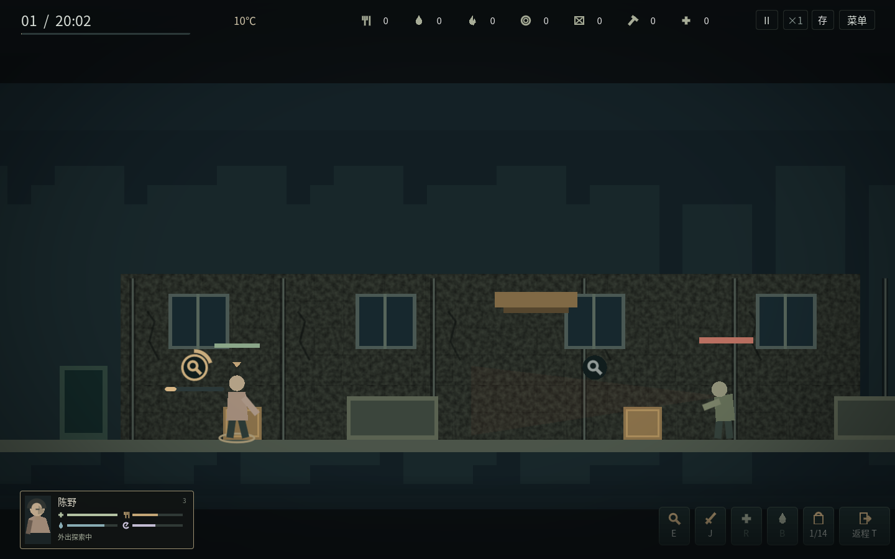
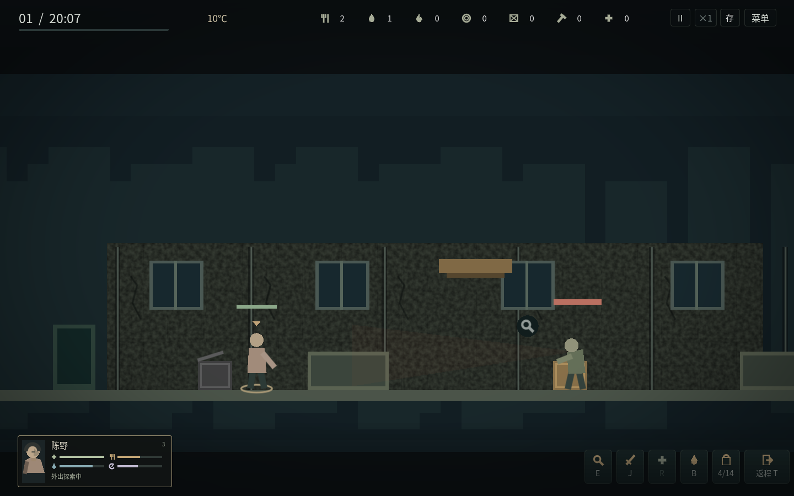
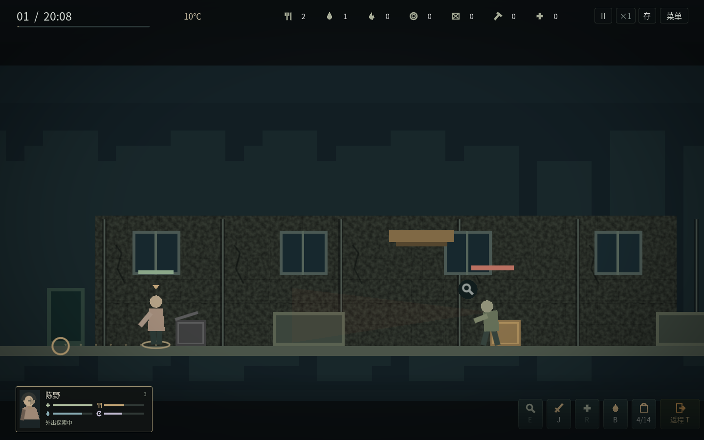

# v1.3.1 搜索、空箱与返程修复

按玩家反馈修复实际交互问题，不给场景增加“可交互”“已搜空”文字。

## 搜索与范围

原来的搜索条位于屏幕底边，只有3像素高；现在对象旁有明显的进度环与进度条，放在人物侧面避免被身体遮住。暂停或中断不会假装完成；未完搜索能保存和恢复。

统一鼠标目标范围与悬停轮廓，搜索就绪小图标使用实际同层搜索范围。选中远处对象会显示行走目标和沿实际楼层／梯子的路径点，走近后才开始工作。跨层、攀爬时不误显示就绪；白天设施和人物同样用轮廓、选择圈、目标标识及进度反馈，减少悬停文字。

## 空箱着色

空箱根据实时容器物资判定，不依赖旧的选中状态或任务状态。全部普通物资拿走后，箱体与边框立即变为中性灰色，并绘制打开的箱盖；仅取完食物但还有水时仍属于有货。放回物资会立即恢复有货颜色，存档读回也一致。

另外调整了绘制顺序，装饰与地标先画，真实容器随后绘制，避免空箱被后绘制的有色装饰覆盖。如果还有独立任务交互，只保留小菱形标记，不把整个空箱染成有货外观；已经携带的任务物不再显示待拿取标记。

## 返程

旧操作只在入口附近生效，失败原因被精简HUD隐藏；拾取窗口还会吞掉T键。现在键盘T、右下角返程按钮、拾取窗口中的返程按钮统一使用同一条指令：

- 在地图内安排实际回程，经过梯子返回入口，到达后才入库，不瞬移。
- 拾取窗口中也能按T；按钮不会因为主动暂停而失去响应，暂停时只安排，恢复时间后再走。
- T再次按下、右键或另点目标可取消可选回程；人在入口且时间运行时，T直接完成撤退。
- 天亮仍按原规则强制撤离并计算迟归代价，不允许靠可选返程规避。
- 未完搜索、空箱内容和返程安排均可保存／恢复，重复读档不重复入库或结算。

schema10兼容旧schema1–9。验证范围和最终构建哈希见[v131-validation.json](v131-validation.json)。Windows真实设备及实际声音可闻性仍待验收，Linux检查不能代替Windows结果。
