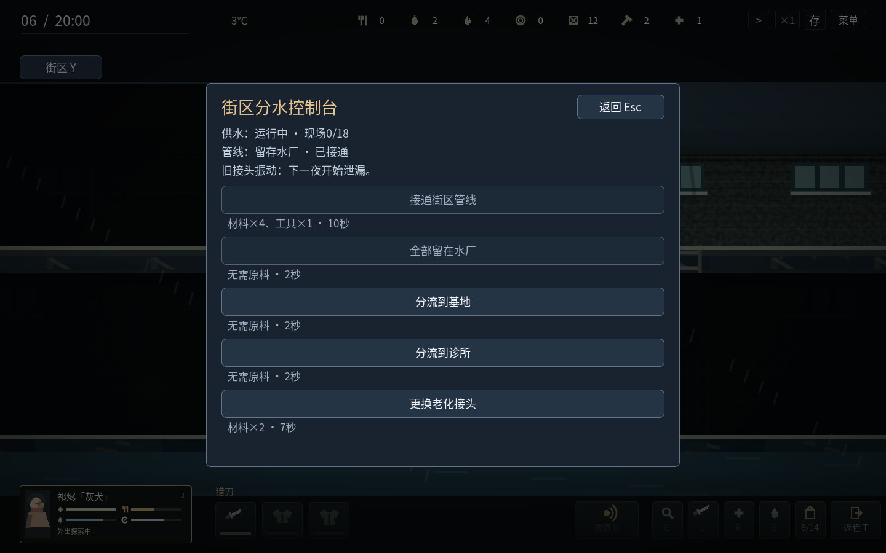

# v1.13 · 街区会记住你们

这一轮完成第一片持续变化的街区：雨杉诊所、供水站与基地。两处地点有专门安排的隔门、楼层分工、普通楼梯与可清理的第二通路；设备、伤员与操作标记位于真实场景中。仍是简化的两层横版画面，没有把九张地图都描述成已经完成这套改造。

## 进入场景操作

点击设备会先沿实际路线走近，进入范围后打开小型选择卡；靠近也可按E。图标、轮廓和环形进度表示范围与施工，主画面不铺任务文字。卡片显示费用、名义耗时，悬停查看持续后果及不能操作的原因。键盘与鼠标调用相同的项目规则。

选择项目后关闭卡片，在场景里花时间操作。移动、右键取消、T返程、攻击、受伤、缺料、离开范围或天亮会中止未完成项目；没有提前扣料或提前发奖励。暂停冻结项目进度。保存中途项目会记录进度，读档暂停，完成只付一次费用。

拆除需要先查看会永久失去什么，再次点击才动工。离开卡片取消本次确认。确认后开工也能在完工前中断；一旦拆完无法恢复，回收物必须有背包空间并活着带回。

## 诊所：保全、拆取与再利用

| 项目 | 实际支出 | 持续结果 |
| --- | --- | --- |
| 恢复冷链 | 背包材料4、工具1、燃料2；12秒 | 燃料存在楼下发电机。运行的每夜耗1，保全原药2，药品留在楼上冷藏柜 |
| 补充燃料 | 背包燃料3；4秒 | 现场最多存6；原药耗尽后不再烧油 |
| 取已保全药品 | 2秒 | 按实际背包余量取药，不能远程入基地库存 |
| 拆走设备 | 10秒 | 材料6、工具1；未修复时可拆出残余油料2，修复后只回收实际剩余现场燃料。永久失去剩余原药与处置台 |
| 配制护理用品 | 背包水2、材料1、燃料1；8秒 | 修复处置台且水厂经完好管线分流诊所后，制作药品1 |

冷藏原药总共8份，永不再生。从第一次进入诊所开始提示三个夜晚的抢救期，包括发现当晚；停电至第三次清晨检查时，尚未保全的原药失效。普通柜子里的药不受此倒计时影响。保持供油可继续抢救剩余原药；后续护理用品靠新的真实原料制作。

发电机只在消耗燃料抢救原药的清晨增加诊所压力2。保全与拆取有不同的长期机会和短期回收，不给予隐藏的敌人生命加成。

## 水厂：持续供给应减少重复劳动

| 项目 | 实际支出 | 结果 |
| --- | --- | --- |
| 修复重力供水 | 背包材料5、工具1；14秒 | 恢复高位水池与过滤阀，每夜清水6；现场上限18，无需持续燃料 |
| 拆取阀组 | 12秒 | 背包取得材料8、工具2，永久失去此处生产和分流能力 |
| 接通街区管线 | 背包材料4、工具1；10秒 | 开放分流，切换方向需亲自到楼上控制台操作2秒 |
| 更换老接头 | 背包材料2；7秒 | 可在预警时提前完成；这项隐患永久消除 |

同一时间选择一种供水方式：

- **留存水厂**：清水6进入现场水池，需亲自装取。
- **分流基地**：清水3进入基地、3留水厂，减少找水负担。
- **分流诊所**：清水2用于维持处置台、4留水厂；放弃这条管线的基地直供，换取现场制作护理用品的条件。每批护理用品仍需表内背包原料。

连续运行第三夜出现接头振动预警；若未处理，下一夜起产水降至3，基地直供降至1，诊所制作暂停。更换一次后恢复产出，不循环制造同一项维修账单。水池满了的溢水不累积成无限库存。

恢复诊所处置台、修好水厂、接通管线并解决接头隐患，会记入可选长期目标；不替代原有35日撤离，也不强迫扩张。

## 清理有意义，箱子保持空

仅诊所和水厂启用新规则：普通容器搜空后保持空；伤口、死亡、门窗和通路跨夜保留，不在重新进入时给所有敌人回血或整批复活。其他七图暂保留原补给规则，后续逐区改造。

两处地区压力达到35且距上次迁入至少三天时，再次出发可能有一只感染者从远端入口迁入，使用一个空出的敌人席位。没有空位便不添加，不在战斗中凭空围住玩家。Y街区页可看压力和迁入提示。低噪声清理后的安全期可以维持。

迁入日期与地点观察日期分别保存；天气变化不再强制重置敌人。自动回程处理路线中最近的关闭隔门，修复了从地图右侧穿过多扇门时可能卡住的问题。未知房间里的容器也不能隔着视野直接点击搜刮。

## 救援与共同经历

诊所右侧伤员使用现有原创人物：纪无咎自第6天出现；开局已有纪无咎时改为尚未加入的陆行舟，自第9天出现。不复制已有成员、不复活已故成员，基地仍最多五名活人。

现场包扎8秒消耗背包药1、水2；背负占2格，移动速度降低20%，场景和背包都显示伤员。这里是背负救援，不宣称伤员具有独立跟随或战斗AI。只有载人者活着从实际出口离开才入队；死亡使救援失败。

获救者以伤病与额外生活需求加入，救援关系初始55。人物志F3记下谁在何日做了什么。获得F4医护授权后，获救医护在伤情分数接近时优先照护救援者；生命25以下的急重伤仍优先。新成员不会自动获得额外用药权限。当前是明确的一种经历影响行为，没有宣称已经完成复杂社会关系模拟。

## 验证与边界

[本版验证记录](v23-validation.json)区分逻辑检查、图形检查、跨进程存档、普通操作战役与导出程序验收。图中使用声明的物资、站位和清除敌人夹具，随后施工、扣料与绘制使用真实系统；图片不能当作无注入长期平衡证据。

旧版schema1–19迁移至20，保留物资、队伍、地图及未完成任务；不会迁移后发放项目奖励。原版商业游戏只提供设计参考，未使用其素材、代码或私有配置。

后续仍需扩展其余地图的补给来源和空间选择、更多人物经历的实际后果、不同住处的布局，以及更多种子与真人试玩。Windows真机、声音听感和任意长期策略都不能由Linux自动检查代替。
