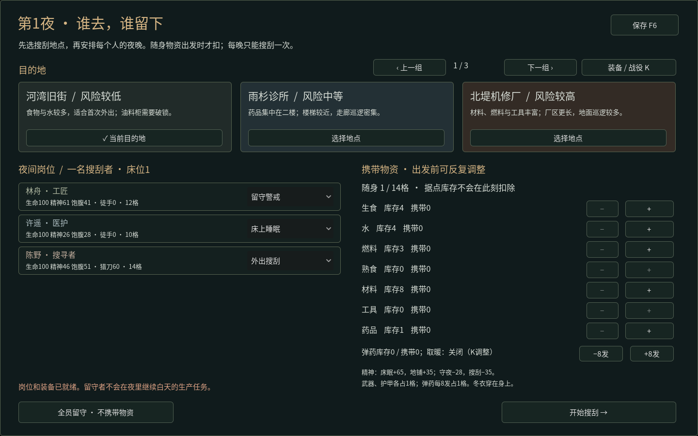
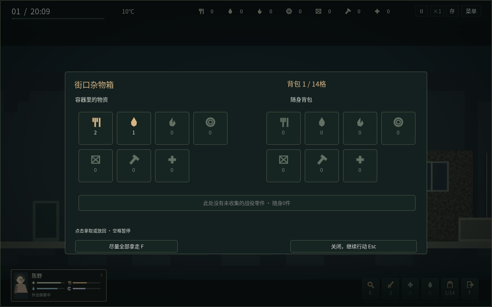
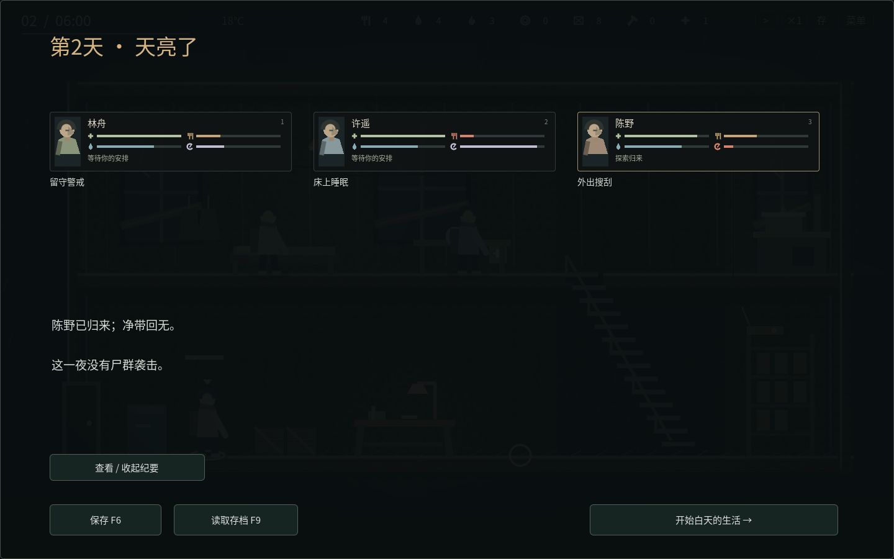

# 正常游戏：白天生活，夜间分工，清晨结算

[下载Windows游戏](https://github.com/hypetia/live_forever/raw/refs/heads/downloads-v1.3.2/live_forever_v13_2_windows_x64.zip) · [全部下载](../downloads/README.md)

解压整个文件夹，双击LiveForever.exe。游戏离线运行，不需要Godot、Python、账号或服务器。验收包是另一个工具，只有主动运行windows_acceptance.cmd才会自动控制人物测试。

## 四项越满越好

生命、饱腹、水分、精神统一为0–100，100最佳。头像小卡的四个图标依次对应这些状态；悬停查看准确数值与伤病，双击进入人物详情。吃饭、喝水、睡觉会填充对应状态条；旧档原有状态不变，不用重开。

主画面不再常驻操作说明、人物数字段落和任务纪要。悬停设施显示提示，B建设、K装备／战役、P人物、H家园／迁居。拾取界面点击图标拿取／放回一份，悬停看物品名；清晨的详细纪要需要主动展开。

## 先照顾人，再结束白天

点击人物卡选人；白天和夜间均支持A/D或方向键左右移动，Shift奔跑。白天到楼梯口按W/S上下楼。也可左键地面行走、双击奔跑。跨层会走楼梯；右键取消行动，楼梯途中会先走到最近平台。

点床位直接休息、点餐桌直接吃饭。水桶要走过去才会消耗水1。点灶台选择做饭与批数，确认后人物去现场生产。一次做饭消耗生食1、水1、燃料1，沈禾完成获得熟食3，其他人获得熟食2；再让需要的人吃饭。不要把做饭→吃饭→睡眠当作自动排好的连串工作：新命令默认替换，按住Shift才追加。

R让选中者自行用药。医护帮助同伴需要P页分别选择施治者与接受者。饱腹不足先吃饭，药品不会替代食物恢复生命；伤势、感染和疾病仍能用药处理。

B选择建设，再点击绿色位置。初始只有一张床，建成额外床会增加夜间床眠名额，白天也能实际使用。雨水收集器与加固隔断分别改变收水与防守；取暖炉需要另行点燃，不会免费供暖。材料扣除、走到现场、施工和完成是不同步骤；未完工取消退料。

首日08:00开局，后续06:00开始。20:00结束白天；提前结束需要确认，未完成工作退料，跳过的时段不会免费完成生产。

## 安排一夜

夜间界面先选地点，为每个人分配搜刮、守夜、床眠或地铺。每晚最多一名搜刮者；床眠不能超过实际床位。可全员留守，但仍会消耗一夜并结算防守与需求。

逐份选择携带物资。调整草案不扣库存，确认出发才扣；没有数量为负、免费装备或重复确认的第二次扣除。搜寻者14格、工匠／厨师12格、医护10格，每份物资占一格，武器与护甲各占1格，弹药每8发占1格，冬衣穿在身上不占格。

夜里点击地面走动，双击奔跑；点击容器会走过去搜索。A/D移动、W/S爬梯仍可使用。整理界面左边是容器、右边是随身背包，可逐份拿取和放回；F尽量全部拿走，Esc关闭。物资仍真实留在原容器或背包中，没有远程入库。整理时场景继续，空格可暂停。

K制作、分配和修理装备，人物要走到工作台花时间制作。点击僵尸会靠近并攻击一次，J也可攻击；红色生命条与金色警觉不同。猎刀、钉棒、铁矛、手枪有不同伤害与距离，需要多次命中；工具只用于破锁和制作。徒手推开显示0伤害，L给手枪换弹，空枪也耗弹。夜间人物会按实际装备显示武器、护甲和冬衣；人物卡右侧三个装备图标有耐久条，武器名直接可见，悬停看数值或点击暂停查看全部装备。护甲减伤，冬衣保暖，耐久归零会失效并显示损坏。R用背包药品，B用背包水，I展开背包。

按T或点击右下角返程按钮，角色会沿实际路线经过梯子返回最左入口，到达后弹出确认，确认后才带回物资；拾取窗口中也可以按T或点击返程。再次按T、右键或点击其他目标可以取消可选返程。暂停时仍能安排回程，恢复时间后才行走。也可自己走到地图地面的左侧或右侧最边缘，出现离场确认。确认时暂停时间；取消留在原地，持续按住移动键不会重复弹窗，离开边缘再走回来会再次询问。楼上平台边缘不能离场。提前回来也直接进入清晨，不会给你同一晚第二次搜刮。06:00以后自动沿实际路线撤离，迟归增加疲劳与压力；只有到达入口才能带回物资。

## 温度、战役与清晨

前期温和，随后转冷，第13–27天最冷。寒冷积累后会生病，疾病与感染分开计算。吃饱并在温暖环境休息有助恢复，药品可治病；重病会降低效率并损伤生命。K界面点燃取暖炉：燃料1烧8游戏小时、室内+18℃；可提前预留夜间燃料，出发前扣除。

九地图分三页显示，按战役开放：机修厂取继电器修电台；建炉、度过两次温暖寒夜；水厂取滤芯修净水泵；货运站取电池、广播站取组件组装信标；第28天去码头取航路。零件需在打开的容器中单独拿取，活着回入口才入库。每位活人准备熟食1、水2，另加燃料2可撤离。第35夜后未撤离会结束战役窗口；成功或错过都能选择继续无尽生存。

## 清晨与长期

床眠精神+65，地铺+35；守夜−28、搜刮−35，途中额外消耗另计。第3夜起可能遭袭，健康、精神、装备、守夜人数、隔断与门窗安防共同影响结果。报告说明净收获、需求变化与损失，读档不会重新结算。

开始新白天后，优先处理归来者的饱腹、水分、精神、伤势与感染。N查看故事与六项实际行动引导，O查看长期建设目标与邻里互助，M查看地点／据点／记录，P查看人物与照料授权。自动照料默认关闭，授权后会真实消耗基础物资，不自动用药或花工具。

F6保存、F9读档、F11全屏、Esc菜单；正常关窗先保存，再启动保持暂停。离线不消耗资源。Alt+Tab会暂停，返回后按空格继续。

v0.9旧档可迁移，无须重开；旧档正在外出时先完成该次外出，其他状态按当前时间接入新昼夜循环，转入分工时退回未完成白天任务的用料。首次迁移保存保留旧原件备份。旧版导入当天作为新增35日战役的第1天，原有物资、人物和地图消耗不重置。

## v1.3 角色专长

| 人物 | 实际差异 |
| --- | --- |
| 林舟 | 基础制作与修整更快，工艺经验+20% |
| 许遥 | 医疗援助多恢复10生命，吉他演奏安抚效果+60% |
| 陈野 | 搜索+20%、脚步声−20%、近战伤害+40% |
| 沈禾 | 同样生食1、水1、燃料1做熟食3，其他人2；自身食物需求+10% |
| 顾苒 | 用药额外处理15伤势、10疾病，照护经验+20% |
| 唐弥 | 睡眠精神恢复+25%，合适休息的小伤与生命恢复+50%；邻里互助额外水1、燃料1 |

例：同一把猎刀，陈野正常命中25，林舟18；对40生命行尸分别需要两下、三下。潜行到低警觉敌人背后，近战突袭另乘1.8；连续攻击已警觉或失衡目标不能反复触发。枪械伤害由枪械决定。P页可查看各人效果。

H修好吉他后安排演奏，人物会走到楼上演奏并播放原创合成拨弦音，在场同伴恢复心境、减轻压力。每位演奏者每天一次；音乐不能代替睡眠或食物，也会留下少量噪声。

## H家园：安防与迁居

入口门、封窗网各可加固两级，预警铃和拒马各一套；在工作台备料并花时间施工，完成才生效。预警铃加强实际守夜者，拒马帮助阻挡尸群。安防耐久随袭击下降，损坏后的保护变弱；材料2并施工维护可恢复45耐久。房屋结构需要另行修缮。制造和音乐留下噪声，增加尸群注意，停止制造后缓慢消散。

新增两处可迁居住处，加上原址共三个选择：内巷排屋基础保温+12℃、更隐蔽；货场值守楼基础保温+4℃、自带围墙防守、更容易遭袭；旧屋+8℃。楼层导航仍是两层，不能任意拆墙扩建。

1. 搜索“积雪住宅／储藏室”或“北线货运站／调度室”，在拾取界面点击勘察，活着返回入口。H页也会列出准确位置。
2. H准备对应清理工具，再赴地图；清除新址附近上下两层感染者，搜索目标容器并点击确认清理，带回记录。工作台准备工具不会远程杀死怪物。
3. 最早第5天（货场第12天）打包，支付整队运输补给：熟食5、水10、燃料2、工具1，并实际完成48秒准备。成员须生命至少25、精神至少30、疾病低于75。
4. 结束白天，全员整夜转移；不能同时搜刮、睡觉或生产。出发时有人精神低于20或严重伤病会阻止出发；可在H取消，未出发的运输补给只退一次。
5. 行军消耗精神并受冷，护送力量不足会受伤，清晨到达新家。固定床／炉／收集器／隔断拆解回收半数材料，旧安防按剩余耐久折算回收；工具不返还。新家据点等级与安防归零，物资、装备、吉他和战役设备带走，净水泵需重新开启。
6. 两次迁居至少相隔5天，不能来回切换免费刷新状态。地图容器消耗和战役进度不会重置。

迁居和夜袭在清晨结算，目前没有可操控的护送地图或避难所内即时守城战。

## v1.3.1 交互反馈

场景中的交互使用颜色、轮廓、小图标和脚下路径，搜索时在箱子旁显示进度环与进度条；不增加“可交互”“已搜空”文字。小标识的就绪颜色与实际同层搜索范围一致，楼层不同或攀爬中不会误亮。白天设施和人物也有悬停与行走目标反馈。

普通物资全部取完后，箱体立刻变为中性灰色并显示打开的盖子；放回物资则恢复有货外观，读档后也保持一致。任务零件或住处勘察如果仍可处理，只显示独立的小菱形，不会把空箱体重新染成有货颜色。地图按原规则补充实际物资时，箱体会相应恢复颜色。

返程会保留背包并实际走路，不会远程入库或传送；途中仍有危险，天亮后的强制撤离无法取消。F6保存也会保存未完成搜索和返程安排，读取后保持暂停；搜索可按住E或再点箱子继续，返程在恢复时间后继续。

## v1.3.2 白天键盘移动

修复了白天避难所没有接入A/D的问题。选中人物后，A/D或左右方向键移动，Shift奔跑；松键停止。到楼梯口按W/S或上下方向键上下楼，途中会沿真实楼梯完成落脚，不穿墙或跨楼板。

键盘直接控制会打断该人的当前行动，未完成生产、建设和工作台任务按原规则只退一次用料。暂停、全屏菜单、制作／家园窗口和文本输入框不会让人物在背后移动。保存不记录“还按着移动键”的临时状态，读档并松键后不会继续漂移。

夜间同样保留A/D移动，直接移动优先于未完成的鼠标攻击、搜索与可选返程；拾取窗口仍须Esc关闭，暂停仍需空格继续。J是夜间攻击键。
