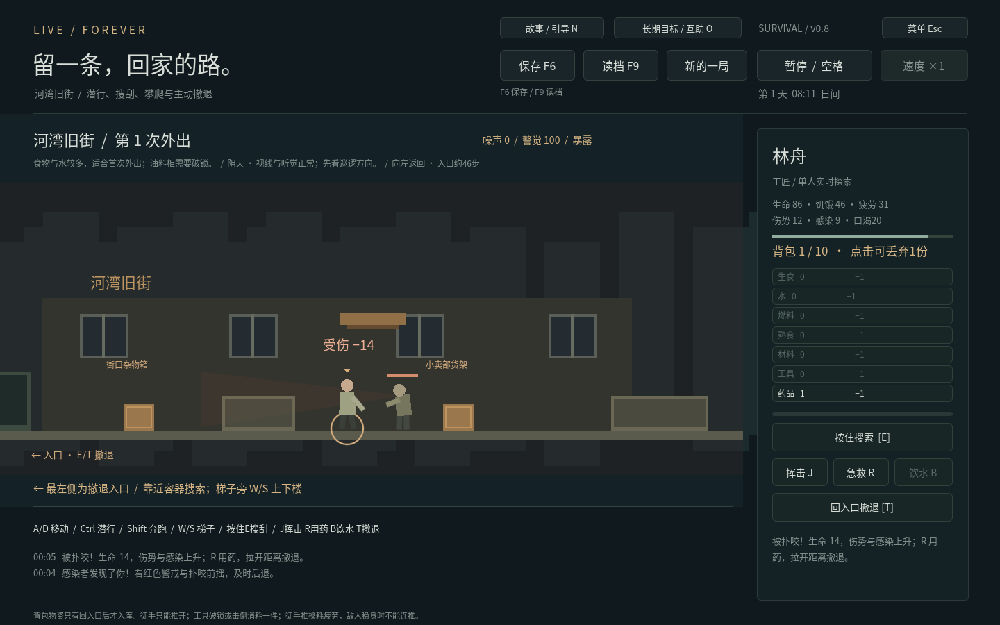

# 正常游戏应该怎样运行

普通Windows运行包解压后，双击LiveForever.exe即可；不需要Godot、Python、服务器、账号或持续联网。windows_acceptance.cmd属于单独验收工具，只有主动运行才会自动测试，普通游戏不会自动控制角色外出或替你建设。

## 第一次游玩

开局是三名幸存者和有限补给。按P逐人查看状态，决定是否开启自动照料；默认关闭。也可以手动F做饭、G吃饭、H睡觉，照料会真实消耗库存。

按3选择陈野，再按V去河湾旧街。A／D移动，到街口箱子旁按住E搜索；第一趟不用深入，走回最左入口按T带回补给。背包里的东西在归来前不会远程入库。

归来会暂停，检查饥饿、口渴、疲劳、伤势与感染，再安排下一步。水既用于做饭也用于饮水；基地P页可喝水，外出B用背包水。按N随时重看六项实际行动目标。

## 窗口与保存

- 窗口可缩放，画面保持比例；F11或设置中的复选框切换全屏。
- 切到其他应用会暂停；返回后按空格继续，搜索／移动不会因为原按键卡住而一直执行。
- F6手动保存，正常关窗先保存再退出；重新启动后从暂停状态继续。
- 离线期间不消耗食物、不推进敌人或事件，不需要全天挂机。
- 受伤会显示生命变化、短暂受击色彩及生命条；远离入口时撤退会提示距离，楼上会提示先下楼。

## 长期玩什么

三处地点独立保留物资与敌人状态，日期推进后在下一次出发前仅部分补充。需要持续带回食物、水、燃料、工具和药品，维护据点，并照顾最多五位存活成员。

N页有八章同伴故事，选择的费用和后果提前说明；可以延后，没有自动扣料或倒计时惩罚。O页提供恢复通讯、建立救护点和连接补给线，共九个阶段。建设和限次互助为后期材料／药品提供用途；目标可选，完成后继续生存。

## 提供Windows验收结果

这次不需要提供远程桌面或电脑密码。下载单独的Windows验收包，解压后双击windows_acceptance.cmd，保持桌面会话可用，等待约30分钟。随后提供新生成的AcceptanceResults目录中的acceptance-result.json、desktop-report.json和日志，并按[Windows人工检查单](WINDOWS_ACCEPTANCE.md)记录声音、可读性和Alt+Tab表现。自动结果会记录Windows版本、显卡／驱动、实际分辨率及程序校验值，正常玩家存档不会被读取。

Linux已完成的检查不能代替这台Windows设备的真机结果；拿到实际结果后才能把对应设备标为验收通过。

