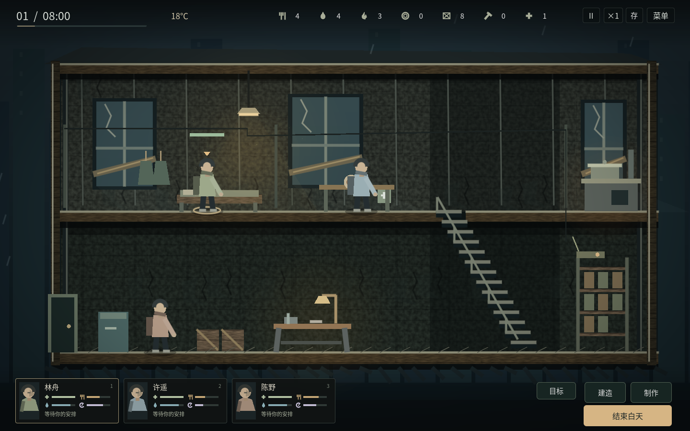
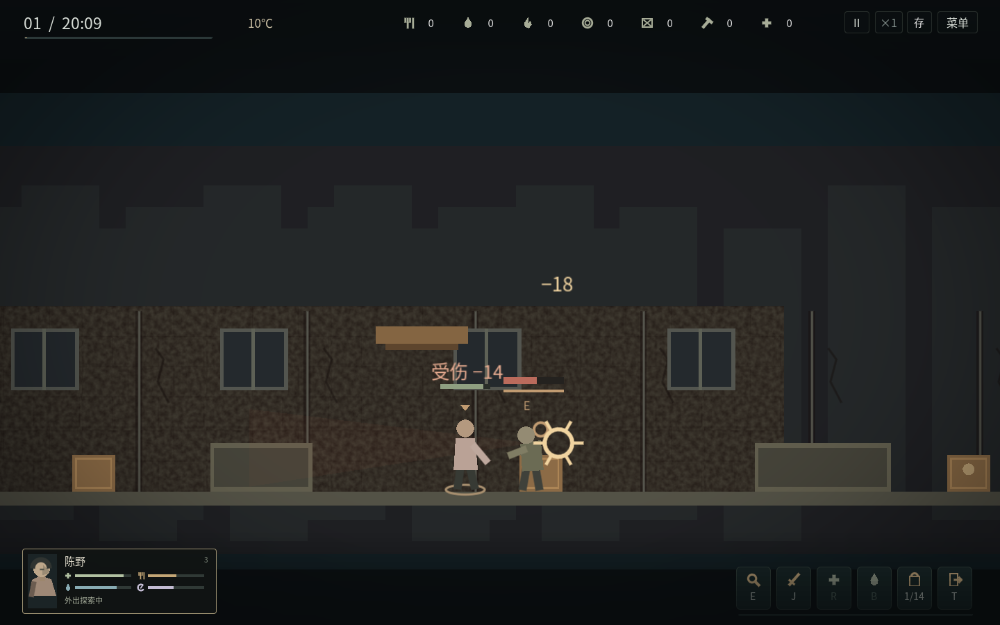

# v1.2 正向状态与场景优先界面

四项核心状态统一为生命、饱腹、水分、精神，均为0–100，100最佳。吃饭提高饱腹、喝水提高水分、休息提高精神；不存在一项越低越好、另一项越高越好的混用。人物卡、悬停详情、夜间分工、医疗提示、招募说明和清晨报告使用同一方向。

## 主画面

保留细时钟／时间条、温度、七个资源图标与人物小卡。常驻的操作说明、教程、库存文字串、任务纪要、人物大段数字和场景标牌已收起。设施在悬停或使用中显示提示，卡片悬停显示准确数值和伤病，双击打开人物详情；重要失败或危险提示短暂出现，不形成滚动字幕。

房屋重新绘制为有材质和层次的剖面：灰泥与木板表面、裂缝、水渍、破窗、暗梁、局部灯光、光束、浮尘、雨幕和景深层次。使用材质中的颗粒和轻量暗角，避免全屏颗粒后处理的额外拷贝；人物选择标记变为贴地椭圆。导航、人物、设施和鼠标共用同一坐标变换，视觉扩展不改变实际行走路线。

## 夜间与阶段界面

夜间使用同一套人物状态小卡与简短动作图标。保留敌人生命、警觉和命中伤害；枪械弹匣、换弹和背包格数仍可直接看到，武器耐久与按键说明放在悬停提示。取消旧的地图介绍、路程说明、操作段落和人物数值串。

拾取为左右图标格子，点击逐份拿取／放回、悬停看名称，F全部拿取、Esc关闭。整理仍消耗夜间时间，空格可明确暂停。清晨先显示每个人的状态卡与岗位，收获／袭击简报；完整纪要通过按钮展开。

## 存档与边界

正向数值由统一的显示模块计算，实际饥饿、缺水和疲劳状态、恢复量、消耗、死亡阈值及schema8存档保留。没有把旧档的数值写反、重置或迁移两次。新增检查覆盖0／25／50／75／100边界、真实吃喝睡恢复、界面刷新不改变存档，以及真实v7旧档导入后的数值对应。

这是本项目原创的场景与界面实现。未运行原作实机，不声称已完成《这是我的战争》的逐项复刻。模型仍然简化；Windows真实设备和音频检查仍需使用独立验收包。

## 验证结果（2026-10-26）

完整干净项目回归：1005项逻辑检查、286项真实GUI检查、23个跨进程存档检查通过。其后对界面缓存和轻量特效修改，单独复跑昼夜、装备、状态方向及三组相关GUI检查，全部通过；包含吃喝睡恢复、真实v7旧档、实际鼠标移动、逐份双向拾取、清晨与存读档。

最终独立Linux包：四种分辨率、全屏切换、人物小卡、制作窗口、地图页、五分钟实际连续游玩，以及真实关窗／普通包重启均通过。冷启动X服务器后的实际键盘搜刮、回入口、保存与重启也通过；导出的Windows／Linux二进制与当前核心代码哈希一致。Windows真实设备及声音仍待实测。

界面只在需要时重新排版长文案，头像不再来回生成旧的文字卡片，样式复用。软件渲染环境下，固定墙面材质取代昂贵的全屏颗粒路径；这些结果不代表Windows硬件帧率。暂停时静态画面可能不再提交新帧，截图工具改为明确请求绘制；原生搜索检查也等待实际搜索完成，避免把软件渲染的墙钟延迟误当成未搜索。

[结构化验证与构建哈希](v12-validation.json)。旧存档保留原始历史纪要，当前状态及新产生的报告使用正向显示。
