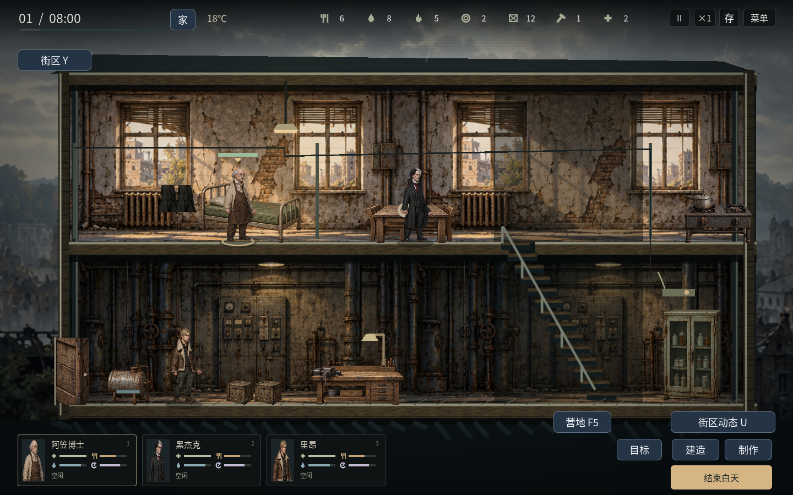
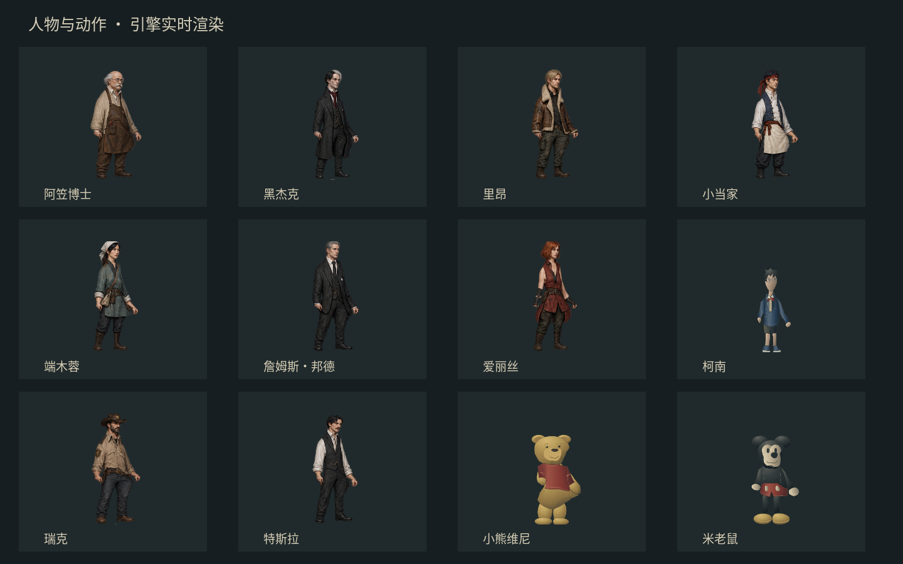
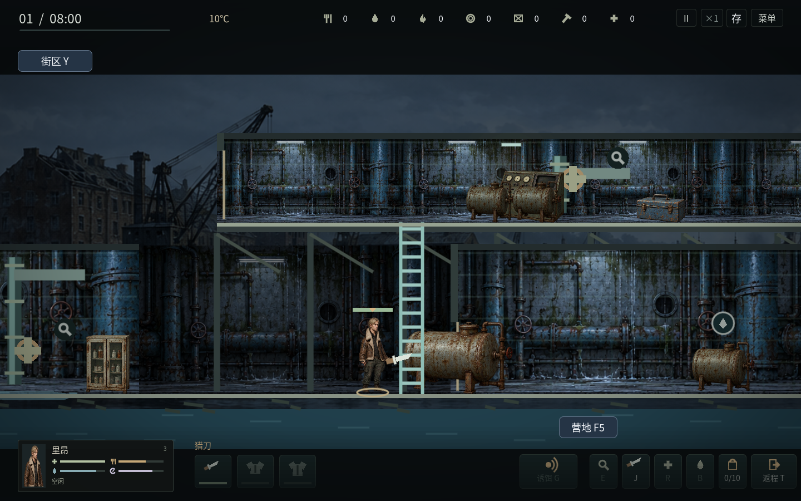

# v1.17：人物与环境的2D美术升级

这一批把工作区积累的营地玩法、协作与动画改动一起纳入 v1.17.0。下载入口与发布状态见仓库首页。

## 看得到的变化

十二名角色在场景与人物卡中采用各自的脸、发型、服装和体型。成年人使用有皮革、布料与旧衣细节的绘制图集；柯南、小熊维尼和米老鼠采用独立的材质渐变SVG，保留少年与玩偶的比例。三类敌人也有不同衣着与体形；受击、攻击、爬梯和倒地由实际战斗状态驱动。

同一套人物纹理随关节变形，继续支持行走、奔跑、潜伏、搜刮、吃喝、烹饪、护理、制作、近战、射击、换弹、攀爬、翻窗、睡眠与倒地。工具、武器、护甲和外套独立绘制；工作接触点仍对准实际的灶台、箱子和门窗。

三处可居住避难所与九张外出地图具有不同的建筑材质。公寓使用裂纹墙皮、砖墙和旧窗；诊所有绿瓷砖和药柜；机修厂有锈蚀钢管与控制设备；水厂有水渍、管道和储水罐；居民区、集市、铁路、广播站和码头各有相应的环境纹理。城市、工业区、河港作为远景，以较慢速度移动。避难所的生活层与生产层也有不同的墙面。

床、工作台、炉具、餐桌、药柜、冰箱、木箱、工具箱、油桶、种植箱、水罐、控制台、汽车和车厢复用16件道具图集。箱盖与柜门继续随实际操作进度打开，空容器采用真正去饱和的灰色材质；范围、悬停和搜索进度保留独立的简洁反馈。

## 体积与运行方式

美术为静态图集和SVG，四张位图最长边均不超过1536像素。角色共用纹理，图集不会在每一帧重新裁切，也不为每个动作复制一套图片。网格缓存有固定上限；局部关节动画为30帧，静止呼吸为15帧，人物实际位置与输入沿用原来的更新频率。

素材位于 `assets/art`；三名特殊角色可用 `python tools/build_companion_art.py` 重新生成。生成的人物、场景和道具图集均为本任务制作的素材，相关分区与骨骼绑定保存在 `realism_assets.gd`、`actor_visual.gd`。导出清单同时校验这些素材与代码。

## 画面与验收

下图是引擎实际渲染。人物总览使用专门的展示场景；地图预览用已声明的视角夹具展示各地点，不作为解锁、战斗或长期平衡的证据。实际操作另行检查。

本版通过1410项逻辑检查、100项图形界面检查；Linux独立程序完成真实键鼠、搜索、返程确认、冷启动、关闭和重启。界面检查覆盖1024×768、1280×720、1440×900、1920×1080。Windows游戏压缩包约44MB，Linux约35MB。

自动回归、实际图形界面、渲染耗时、本地导出和Linux独立程序操作记录见 [验证记录](realism-validation.json)。Windows使用官方模板导出，Windows真机验收仍待完成。本轮视觉重点是人物辨识、场景材质和交互清晰度；局部布料仍采用轻量网格变形，角色之间尚无完整遮挡排序或高精度布料模拟。
