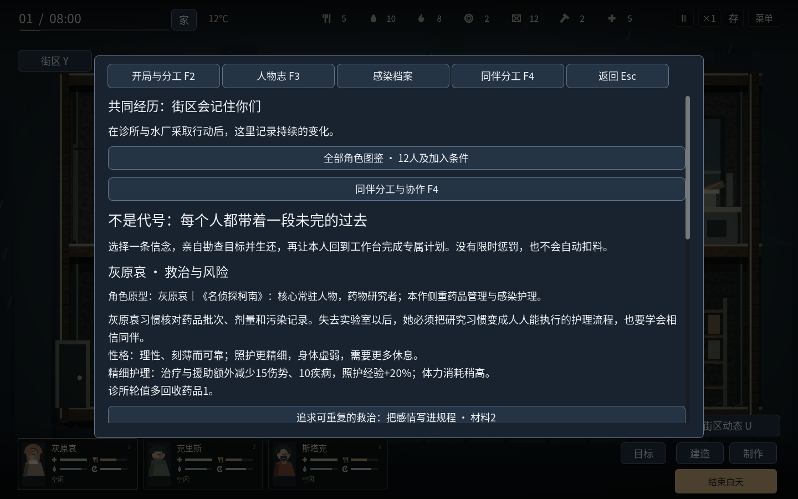

# v1.15.1 · 十二人角色池

本版保留12人角色池并重做六位新人，每局仍以三个开局之一的3人起步，最多5名活人在队。以知名作品的核心主角、招牌人物为选择标准；没有把未核实的人气名次写成排名。F3人物志新增“全部角色图鉴”，第一天即可查看每个人的作品来源、实际专长、背包和到访条件。

| 人物 | 参照作品 | 实际分工 | 背包格 | 最早到访日（非开局成员） |
| --- | --- | --- | --- | --- |
| 斯塔克 | 《钢铁侠》托尼·斯塔克 | 工匠、工艺成长、前哨施工 | 12 | 3 |
| 克里斯 | 《生化危机》克里斯·雷德菲尔德 | 战地急救额外恢复10生命、近战+25% | 10 | 3 |
| 里昂 | 《生化危机》里昂·S·肯尼迪 | 搜索+20%、脚步声−20%、近战+40% | 14 | 3 |
| 小当家 | 《中华小当家》 | 同料基础烹饪3份、5秒完成，自身更容易饿 | 12 | 3 |
| 灰原哀 | 《名侦探柯南》 | 药学护理额外处理伤势15、疾病10，照护成长更快；体能较弱 | 10 | 6 |
| 杰克船长 | 《加勒比海盗》杰克·斯派罗 | 交易、门窗、睡眠与小伤恢复 | 14 | 9 |
| 孙悟空 | 《龙珠》孙悟空 | 近战伤害+50%、睡眠恢复+20%、合适休息时恢复+20%；饥饿增长+20%。 | 14 | 3 |
| 柯南 | 《名侦探柯南》江户川柯南 | 搜索+20%；搜寻者基础上脚步声再−25%；门窗效率+30%；近战伤害−35%，背包10格。 | 10 | 6 |
| 蝙蝠侠 | 《蝙蝠侠》布鲁斯·韦恩 | 工匠基础上制作效率再+10%；近战伤害+25%、门窗效率+30%、脚步声−10%；疲劳增长+10%。 | 14 | 9 |
| 福尔摩斯 | 《神探夏洛克》夏洛克·福尔摩斯 | 搜索+20%、基础脚步声−20%；门窗效率+35%、演奏安抚+60%；近战伤害−15%，睡眠恢复−10%。 | 12 | 12 |
| 哈利·波特 | 《哈利·波特》 | 搜索+20%、基础脚步声−20%；共餐安慰的心境和信任收益+30%；合适休息时恢复+10%。 | 12 | 15 |
| 尼奥 | 《黑客帝国》尼奥 | 工匠基础上制作效率再+20%；门窗效率+20%、近战伤害+10%；脚步声+10%。 | 12 | 18 |

灰原哀定位是药物研究与感染护理，克里斯定位是反生化队员的战地急救和护卫。这些是本游戏的求生规则，故事发生在本作感染城中。人物借鉴的是气质与求生专长，仍使用本作的武器、生存和资源规则。孙悟空的战斗与恢复能力伴随20%额外饥饿增长；蝙蝠侠的多项行动专长伴随10%额外疲劳增长。哈利的共餐特长实际增加心境与信任收益，照常消耗熟食并遵守冷却。外观为原创简化二维绘制，新增角色有不同发型、胡须、头饰或衣领细节；不使用其他游戏的模型素材。

到访不会自动入队。白天至少一级据点，支付生食2、水2、药品1后接纳；每人仅一次，已故者不会复活，救援失败的成员不会再次来访。三个开局的初始队伍保持各3人。总身份历史可记录12人，已故者留在人物志与伤亡记录；主画面人物卡、设备选人、夜间岗位和清晨概览仅排布活人，避免长期游玩后被历史成员挤出屏幕。

## 六位新人的个人计划

每人可选两种信念，实地勘查指定地点并生还，再由本人回工作台完成12秒项目。选择不直接发能力；完成才扣专属配方、取得相应加成。可取消，不设置限时失败。

| 人物 | 勘查地图 | 完成项目 | 两条成长方向 |
| --- | --- | --- | --- |
| 孙悟空 | 集市 | 训练与配给计划 | 克制训练／补给与恢复 |
| 柯南 | 诊所 | 现场与撤离笔记 | 安静开路／分享观察 |
| 蝙蝠侠 | 机修厂 | 装备检查与撤离预案 | 设备维护／接应与休整 |
| 福尔摩斯 | 旧街 | 安全通路与值夜笔记 | 现场路线／音乐与睡眠 |
| 哈利·波特 | 住宅区 | 互助与轮休名单 | 共餐倾听／持续轮休 |
| 尼奥 | 广播站 | 手动操作与备用通路 | 工程开路／战斗撤离 |

[机器可读验证记录](v26-validation.json)

## 本轮验证与边界

787项相关逻辑检查通过：既有人物124、存档74、战术59、协作与动作86、街区89、门碰撞13、居住地90，加上角色池252。新检查覆盖六位新人到访、接纳、重复加入保护、夜间背包、实际出发和回程、存档恢复、两种个人计划的付费完成、福尔摩斯实际演奏收益、哈利付费共餐收益、孙悟空饥饿与蝙蝠侠疲劳代价，以及含7名阵亡者的12人身份历史与5人可见夜间岗位。个人计划的结项测试显式设置勘查完成夹具；原有战术检查继续验证实地搜索与回程链路，没有把结项夹具冒充十二条全程实玩。

字体覆盖1224个运行文本汉字。13项图形检查覆盖三个开局人物卡、参照来源、图鉴内容及实际鼠标接纳操作。Linux最终导出程序完成真实系统输入、关闭和重启检查。导出输入哈希与本版源码核对，Windows、Linux及单独的Windows验收程序均使用Godot4.6.3官方模板。

Windows真机未验收；没有把Linux结果当作Windows通过。本轮没有重新跑完整长期战役，既有长期验证仍属于历史记录。食物仍为生食与熟食，肉类、蔬菜、饮料独立机制未在本轮实现。建议新开战役体验新角色，不为旧存档限制本次设计。
