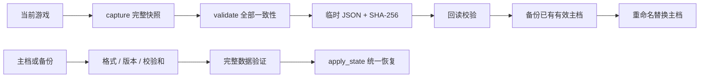

> v1.0已改为独立昼夜循环、手动整理物资与schema7。本文保留底层模型或历史说明，当前玩家操作和新规则以[新版玩法](PLAYING.md)及[机制记录](CAMPAIGN_V1.md)为准。

# 为什么存档不能只保存库存

如果正在做饭的人已经扣过一份燃料，读档后却被当成“刚准备开始”，就会再扣一次；反过来，若只恢复到完成状态但忘了产出已经发生，就可能多给一锅饭。

外出也有同样的问题：已经从箱子取走、尚未带回基地的物资，不能读档后同时留在箱子和背包，更不能远程给基地入库。本版把基地与探索保存成同一个完整快照，所有关联状态验证后一起恢复。

## 模块与入口

`SaveSystem` 负责纯数据捕获、验证、读写和恢复；`Shelter` 负责按键、确认弹窗、自动保存时机和提示。保存不会执行存档中的代码，不读取资源路径，也不使用对象反序列化。

## 保存了什么

- 时间、暂停、速度、当前选人 / 任务、楼梯连通状态。
- 七种资源的可用数量和最近 32 笔交易，包括新增药品。
- 每人位置、路径、任务状态、三项队列、进度、耗时、当前已扣用料、分类完成次数。
- 饥饿、疲劳、生命、伤势、感染、四种预警标记、朝向 / 行走动画时间和反馈。
- 四处设施的使用者、等待顺序、完成次数；最近四条操作记录。
- 外出是否活动、出发者、返回时速度、尝试次数，独立探索坐标 / 楼层 / 攀梯进度、朝向 / 移动模式、背包、搜索目标 / 进度 / 工具使用、攻击前摇 / 冷却、受击保护和急救冷却。
- 当前目的地与其他两处完整探索世界：各自六处容器余量 / 锁状态、敌人的位置 / 方向 / 模式 / 警觉 / 调查目标 / 前摇 / 冷却 / 生命、每日标记。
- 庇护所结构 / 等级、真实修缮次数、事件编号 / 原日期 / 处理次数、净补给统计、出发携带账目和最近16条据点记录。

人物名称、专长、固定房间布局和配方属于当前版本的定义，不从存档任意替换。

## 为什么同时保存队列和占用

角色 A 的状态是 WORKING，表示工作中的人必须同时是对应设施的占用者；不能出现设施显示空闲却有人继续产出。MOVING / WAITING 的当前任务必须有且只有一个对应设施的等待登记；不能让同一人在两张队列里。

`validate()` 在修改任何运行中数据前检查这些关系：

- 版本、字段、数量、数值范围、整数库存、有限浮点数；拒绝负库存 / NaN / Infinity。
- 只有当前已知的任务与资源；角色 ID 必须完整且不重复。
- 位置在两条走道或楼梯上，路段不能斜穿房间。
- 工作进度必须小于定义耗时；耗时读取同一份 `TaskCatalog` 规则，不能由坏数据缩成一秒。
- WORKING 的用料必须等于当前任务配方；未开工者不得持有已扣用料或工作进度。
- 设施占用、等待、角色状态、任务设施严格一致；完成数量能互相核对。
- DEAD 必须生命为零，且没有任务、路径和已扣用料。
- 地点必须是定义中的三处之一，其余地点集合必须完整、不能活动，各自按原地图定义校验。
- 活动探索只能有一名 AWAY，必须是当前选中者且速度为 1x；AWAY 不得持有基地任务或设施登记，非活动探索不能遗留 AWAY。
- 背包整数非负且总量不超过10；容器只含定义资源、余量不超过原容量；探索坐标与楼层 / 攀梯一致，搜索目标和进度 / 耗时合理。
- 敌人状态、数量、坐标、生命、前摇与冷却有界；每日补给标记不得晚于游戏日期。探索专用约束交给 `ExpeditionState.validate_snapshot()`，身份和基地关联仍由整体校验器检查。

恢复时先通过整个验证，再更新同一线程内的状态，中途不 `await`。没有任何等待可让下一帧看到半恢复的场景。

## JSON 数字的坑

Godot 的 JSON 解析把数值读成浮点数。原本的状态编号 `1` 会变成 `1.0`，而某些数组成员检查区分它们。首次测试实际抓到了“移动中快照写不下来”，原因就是等待队列校验使用了未转换的编号。

因此先验证数值确为整数并在范围内，再转成 `int` 检查和恢复。库存、计数、设施中的角色编号同样显式转换。不能直接假定 JSON 的数字类型和内存中一样。

JSON 十进制解析还可能带来约 1e-14 的浮点末位差异。回归对库存 / 队列 / 枚举 / 文本保持严格一致，对连续数值使用 1e-6 误差范围；不会把正常的数字表示误差当作游戏进度丢失。

## 防止重复扣料、重复产出和退料

`held_cost` 保存当前已经扣掉的用料。工作中恢复时保留它和现有进度，继续推进，不重新调用开工扣料。完成才清空并产出；完成任务不留在队列里，因此恢复已完成场景不会再产出一次。

取消时先清空 `held_cost`，再退回复制出来的原用料；第二次取消没有可退的东西。吃饭 / 治疗中途取消不恢复状态，睡眠则只保留此前实际获得的休息。死亡清空任务但不退用料，读档也不会复活死人。

探索完成搜索时，容器扣除量与背包装入量相同，未装下的仍留容器。撤退信号发出前先关闭活动状态、清空背包，再交给入口入库；第二次请求无法再次结算。外出死亡清空背包而不入库。保存包含结算前后的整份世界状态，活动中读档只恢复，绝不额外触发一次归来或每日补给。

## 文件结构与失败处理

外层 JSON 包含 `version`、`data_json`、`sha256`。数据串的完整内容计算校验和，避免再次 JSON 编码时数字格式差异影响校验。限制文件为 2 MiB，超限直接拒绝。

写入 `.tmp` → flush / close → 回读并验证 → 有效主档复制到 `.bak.tmp` 后重命名为 `.bak` → 临时主档重命名替换。任何阶段失败都会返回明确错误，不先删掉原主档。校验和用于发现损坏，不用于对抗玩家编辑。

主档失败则尝试备份。坏主档不会被复制覆盖好备份；两份都无效时，保留当前场景，停用自动保存，以免反复覆盖。手动保存或新游戏仍由用户明确选择。关窗保存失败时显示确认框，让玩家选择回去重试或仍然退出。

## v0.3 → v0.4 迁移

v0.4 内部格式为 **schema 2**，文件路径继续使用 `user://shelter_v1.json`，保证升级后仍能找到原来的存档。M01 / M02 没有存档功能，v0.3 使用 schema 1。

先按旧文件原始 `data_json` 验证校验和，再解析并严格验证旧版字段形状。迁移新增药品库存0、伤势0 / 感染0、治疗完成计数0和感染预警 false，并创建尚未出发的初始探索世界。其余人物、库存、交易、设施、已扣用料、队列、进度和时间保留；不会按照新版新游戏配置赠送一份药品。

迁移结果还要通过 schema 2 全体验证，成功后才应用；下一次保存写入新格式，同时将原有效 v1 文件保留为备份。恢复提示明确显示“旧存档已迁移”；如果实际读取的是旧版备份，则显示“旧备份已迁移恢复”。未知更高版本仍拒绝，主档 / 备份保护策略不变。

`tests/fixtures/v1_working.json` 是用归档 v0.3 代码真实生成的做饭中途存档，保留已扣用料，生成来源见同目录 README。兼容测试检查迁移后继续做饭只产出一次，随后保存升级且备份保留原字节。

## 实际验证方式

`tests/test_saves.gd` 覆盖初始场景、楼梯中途、两处设施并行与排队、吃饭 / 睡眠中断、完成后不重复产出、取消退料、备份损坏恢复、校验和 / 版本错误、无效数据不改变现有场景、自动保存、启动恢复、死亡保存和显式重开。

`tests/persistence_process.gd` 用两个独立 Godot 进程验证：第一个走真实关窗通知处理函数保存一项已扣料的做饭任务；第二个通过正常启动恢复流程读取并继续，检查只产出一次。图形测试另外验证 F6、F9、读档确认和取消新游戏。

`tests/test_expedition_saves.gd` 增加真正写盘的搜索 / 攀梯 / 双方攻击中途恢复、背包结算 / 死亡 / 地点消耗、旧版迁移与升级备份、治疗中断、无效探索快照拒绝且保持当前状态不变。

`tests/persistence_expedition_process.gd` 使用三个独立进程：第一趟携带真实药品，行走并搜索到一半，经正常关窗处理保存；第二次正常启动恢复到暂停中的半程搜索，完成取物、步行返回入口并保存；第三次启动核对基地物资与容器消耗仍只计算一次。两套图形测试通过真实按键 / 鼠标操作验证存读档入口；外出读档会恢复完整场景与健康，而非只重建画面。

## v0.5：schema 3 与三处地点

当前格式为schema 3，路径保持不变。v1先补齐到v2，再走v2→v3；先校验原始文件SHA-256，再迁移，最终通过全体验证才恢复。损坏旧版字段（例如队列变成数字）返回读档失败，不执行无效类型上的方法。

当前探索原样归入河湾旧街，另外创建独立的初始诊所和机修厂；新增 `destination`、`other_regions` 和 `upkeep`。结构82%、等级0，历史维修 / 净补给统计0；维护日期初始化为当前日期，避免升级时补算离线事件。已有外出背包中的至多一份工具 / 药品保守视为原携带账目，只影响新版净补给统计，不扣除或增加实际物资。

旧版免费修整若已经WORKING，新增 `legacy_repair=true`，保留无已扣材料的原工作语义：结束不加新结构、取消不退新材料，再清除标记。只有确实正在执行修整且没有用料时可带该标记；其他新修整必须持有材料1，后续队列按新配方执行。

`v2_expedition.json` 和 `v2_repair.json` 都由归档v0.4程序真实生成。分别验证旧版半程搜索 / 携带药品 / 归来，以及旧版免费修整完成与取消；升级备份保留原文件字节。

三处地图和据点数据作为一个快照原子恢复，未知地点、漏地图、非当前地图活动、容量 / 坐标异常、事件 / 维护日期超前均拒绝，当前场景不变。偏好设置另存 `preferences.cfg`，不参与游戏备份与版本迁移。

`persistence_long_term_process.gd` 再以三个独立进程验证机修厂真正搜刮、攀梯中途关窗、正常恢复 / 返回、制作工具 / 升级 / 第二天事件与再次启动后的精确资源守恒。

## 真实窗口关闭

Godot4主窗口的 `close_requested` 信号直接连接到场景保存退出处理；关闭默认自动退出，先完成校验 / 备份 / 写盘，再结束进程。保存失败弹出选择，取消保留原暂停状态；重复关闭不会叠加对话框。退出菜单使用同一信号。

持久化进程探针发射窗口信号，外部 `native_release_smoke.py` 另启动已导出的Linux程序，通过X11真实按键完成搜刮 / 返回，再发送 `WM_DELETE_WINDOW`，检查正常退出和再次启动。它能发现仅直接调用私有处理函数时覆盖不到的窗口事件连接问题。

## v0.6：schema4与动态身份

仍使用原文件路径，schema1→2→3→4顺序迁移。schema4保存每人完整人物档案、自动照料授权、共餐 / 援助时间、口渴预警；保存队伍关系、伤亡、饮水 / 损耗与每日库存，还保存每个感染者的稳身剩余时间。

角色数量由固定3扩展为3—6条记录、最多5位存活者。前三位身份固定，新成员只能是目录内未出现过的人；来访日期、加入日期、有限经验、情绪数值和冷却均验证。设施占用 / 等待和外出身份根据实际角色数验证，耗时按人物专长，不再假定只有编号0是工匠、编号1是医护。

队友关系必须恰好覆盖所有两两组合，伤亡表必须恰好对应死亡身份；已故成员不得保留自动照料授权。每日记录日期递增且不超前，库存、饮水和损耗计数均有界。未知角色、重复身份、超人数、伪造关系、未来冷却或异常稳身状态会整体验证失败，保留当前运行状态。

旧档按真实完成记录折算有上限的工艺 / 照护经验，无法按人确定的探索历史不伪造。初始化心境60、压力 / 创伤0、口渴20、照料关闭；旧伤亡录入账目，不追扣一遍悲伤。维护时钟从当前日期开始，不补算旧天数的食物损耗。旧敌人稳身时间初始化0；现有坐标、警觉、前摇、背包、用料和容器不变。

`tests/fixtures/v3_factory.json` 由归档v0.5程序真实生成，保存机修厂实得物资与攀梯中途。与真实schema1 / 2样本一起回归迁移和原文件备份。

`persistence_people_process.gd` 另用三个进程：先实际生存三天、付费接纳第四位成员，再由此人外出行走并关窗；第二次启动重建身份 / 队列并恢复控制，步行回入口；第三次核对精确物资、经验、关系、日历和照料授权，装备空往返不产生新成长。

## v0.7：schema5、故事与引导

新增根级story状态：故事时钟、待选择章节及两位参与者、一次性结果账目、六项行动目标、引导显示偏好。章节只接受目录中的八个ID，不保存任意脚本路径。参与者必须是实际队伍身份，不能相同；个人事件身份须匹配，日期不能早于该角色加入，重复结果和未来日期均拒绝。所有检验仍在修改世界前完成。

迁移链为schema1→2→3→4→5。schema4沿用真实四人队伍、探索途中、有限成长、情绪、授权和库存；只添加空白故事账目，从实际吃饭、饮水、睡眠、维护和净补给记录推导已完成引导，不送物资或经验。未知版本继续拒绝。

新样本tests/fixtures/v4_people.json由归档v0.6运行程序实际生存三天、付费接纳沈禾、让第四人外出后生成；原文件迁移后仍按字节保留为备份。故事另有三个进程检查待处理选择→重启结算→再重启不重复。

## v0.8：schema6与长期项目

新增goals根字段，保存三条路线阶段、追踪目标、随身／已送达勘查、共用互助日期、次数与精确材料投入。勘查记录的携带地点需与当前外出一致；在基地不能存在随身记录。输入只接受固定ID、有限阶段与范围内日期；重复记录、异地记录、未知目标、未来日期及与阶段／互助次数不一致的用料账目均在修改世界前拒绝。

schema1—5按原链顺序迁移，再添加空白项目；旧人物、工作、地点、库存、故事与引导都保留，不替用户支付、不赠送新勘查。tests/fixtures/v5_story.json由归档v0.7程序实际生存两天并保存待处理林舟故事生成。三个新进程验证真实工厂勘查、付费互助和共享日期在正常关闭／两次重启后不重复。
