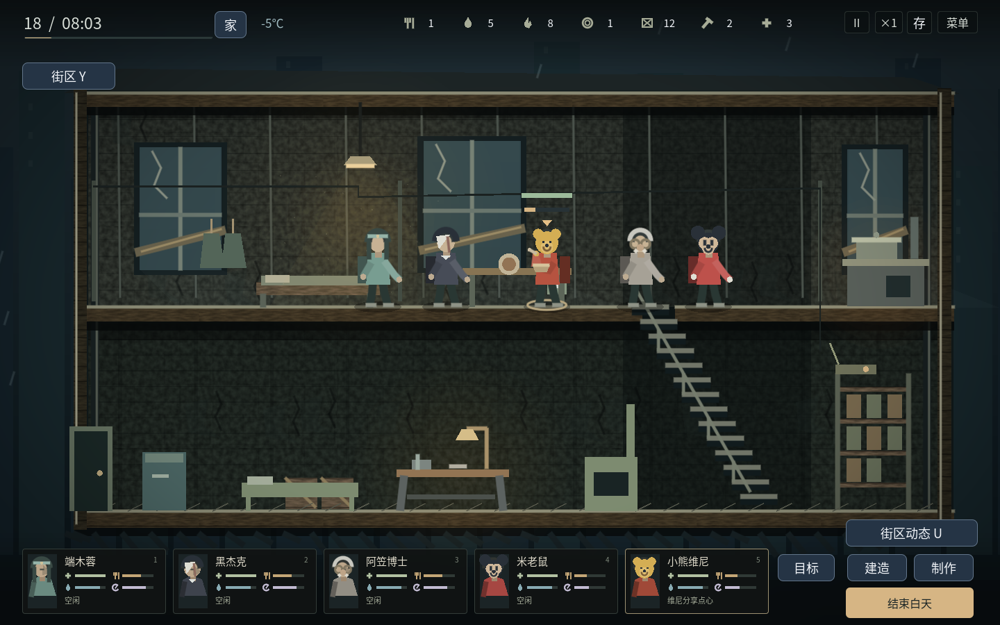

# v1.16.0 · 玩家选定的十二人

三名战斗、两名侦察、两名工程、两名医护、一名厨师和两名后勤。每局3人开局，最多5名活人在队；其余角色分批到访。F3全部角色图鉴可提前比较身份、作品来源、专长、背包和加入条件。

| 人物 | 参照 | 实际专长 | 背包 | 到访日 |
| --- | --- | --- | --- | --- |
| 阿笠博士 | 阿笠博士｜《名侦探柯南》 | 工具与修整更快；工艺经验+20%，门窗作业+25%。 | 12 | 3 |
| 黑杰克 | 黑杰克｜《怪医黑杰克》 | 治疗更快；医疗援助额外恢复10生命；重视同伴伤情。 | 10 | 3 |
| 里昂 | 里昂·S·肯尼迪｜《生化危机》 | 近战伤害+40%，背袭另有加成；侦察训练保留搜索+20%、脚步声−20%。 | 14 | 3 |
| 小当家 | 小当家｜《中华小当家》 | 基础烹饪5秒，同料熟食3份；自身饥饿增长+10%。 | 12 | 3 |
| 端木蓉 | 端木蓉｜《秦时明月》 | 照护经验+20%；护理额外减少伤势15、疾病10；活动疲劳增长+10%。 | 10 | 6 |
| 詹姆斯·邦德 | 詹姆斯·邦德｜《007》 | 背包16格；睡眠恢复+25%、休息恢复+50%；互助额外水1、燃料1。 | 16 | 9 |
| 爱丽丝 | 爱丽丝｜《生化危机》电影系列 | 近战伤害+55%，合适休息时恢复+20%；饥饿增长+15%。 | 12 | 3 |
| 柯南 | 柯南｜《名侦探柯南》 | 搜索+20%；搜寻者基础上脚步声再−25%；门窗效率+30%；近战−35%，背包10格。 | 10 | 6 |
| 瑞克 | 瑞克·格莱姆斯｜《行尸走肉》 | 枪械命中伤害+25%；近战+5%；脚步声+10%，背包12格。 | 12 | 9 |
| 特斯拉 | 尼古拉·特斯拉｜历史人物 | 制作与设施工程效率额外+25%；活动疲劳增长+10%；背包12格。 | 12 | 12 |
| 小熊维尼 | 小熊维尼｜《小熊维尼》 | 共餐心境与信任收益+40%，安慰减压及缓解创伤+50%；可准备每日分享点心；自身更易饿。 | 10 | 15 |
| 米老鼠 | 米老鼠｜迪士尼《米老鼠》系列 | 邻里互助额外得到水2、燃料1；共餐心境与信任+20%；保留两天互助冷却和原料成本。 | 12 | 18 |

三个开局分别为阿笠博士／黑杰克／里昂，小当家／里昂／邦德，端木蓉／黑杰克／阿笠博士。开局中的成员第一天已在队，表中日期用于非开局成员。新成员需要一级据点和生食2、水2、药品1；已故成员不会再次加入。身份历史最多12人，主画面和夜间岗位只排布活人。

## 米老鼠：谈判有实际收益

选中米老鼠做现有邻里互助，报价与实际到账均额外获得水2、燃料1。完整输入成本、项目解锁要求和全队共用的两天交易冷却保持有效。切换人物、交易种类或读档不能重复领取。邦德保留较小的副专长收益，米老鼠的报价更好。

## 小熊维尼：给朋友留一点

共餐安慰仍消耗熟食1，双方180秒冷却。由维尼发起时，心境与信任收益增加40%，压力和创伤缓解增加50%；更容易饿、近战较弱。学会倾听与分享是实际专长。

F3人物志或H家园页可安排“维尼分享点心”。维尼实际走到餐桌，准备8秒，保留吃饭动作和进度；消耗熟食1、水1。完成后，同层、横向220范围内的活人各获得心境5、减压8、缓解创伤2，并减少饥饿和口渴各6。远处、其他楼层、外出与已故成员不受影响。小份分享不代替正餐、用药和睡眠；当前食物数据仍是生食、熟食，没有声称新增蜂蜜物品。

与厨师公共餐桌共享每日一次，准备期间不能再举办公共餐桌。玩家移动、取消或日落可结束准备并退回未完成用料；完成后的每日次数随存档保存。其他成员的工作不会被自动打断，可由玩家把想参加的人带到餐桌附近。

## 其他分工

里昂保留近战技巧与警员侦察训练；瑞克枪械对敌命中伤害增加25%，同时用于外出和亲自守家，照常消耗子弹、耐久并产生枪声。爱丽丝偏强攻，较高食物需求形成代价。柯南擅长安静进入、近战和负重较弱；邦德背包16格。阿笠博士偏工具与维护，特斯拉制作和设施工程更快，但活动时更容易累。黑杰克偏外科急救，端木蓉偏细致护理与调养，小当家提高基础烹饪产出。

十二人均有两种个人信念、实际勘查目标和需要本人完成的付费项目。角色姓名、介绍、对话和简化外观同步更新。米老鼠和维尼有不同耳形、面部与手部绘制，继续使用本作关节动作。

展示截图设置了日期、站位与情绪夹具；实际行走、准备、扣料和效果使用正式游戏规则。

## 验证范围

1013项相关逻辑检查、19项图形检查和1149字字体覆盖检查通过；Linux最终运行包完成实际系统输入、关闭与重启检查。验证结果见[v27-validation.json](v27-validation.json)。覆盖现有人物、存档、战术、协作、街区、门碰撞和居住地，以及12人历史、六位新人出发回程和个人计划结项。新增检查验证真实交易报价与到账、冷却保护、维尼安慰、点心付费准备和范围、取消退料、每日次数、准备中存档恢复、特斯拉实际制作效率及瑞克实际射击。

个人计划结项测试显式设置勘查完成夹具；实地搜索与回程链路继续由原有战术检查验证。本轮未重新跑完整长期战役；历史长期结果不作为本轮重跑证据。Windows按Godot4.6.3官方模板导出，Windows真机与可闻声音仍待验收。建议新开战役体验当前名单。
