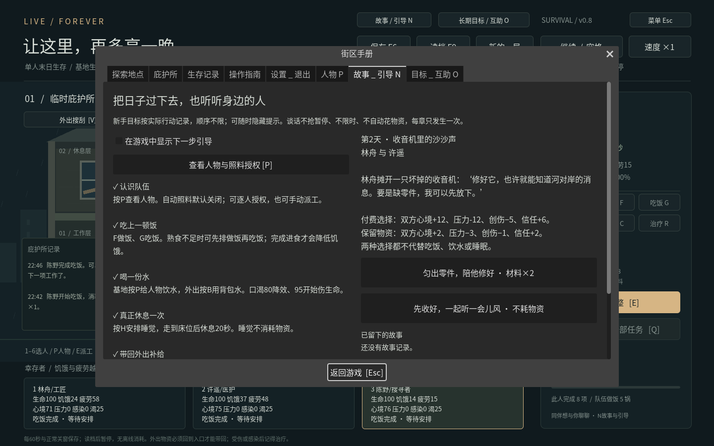
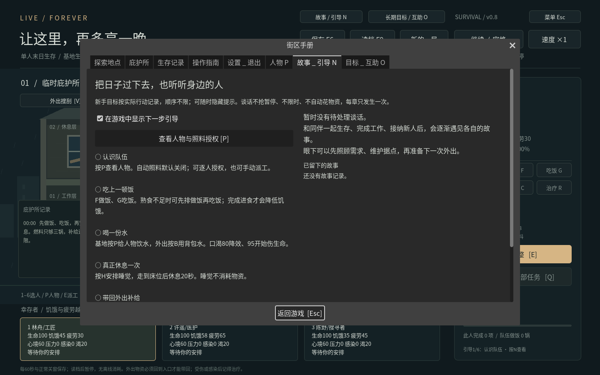
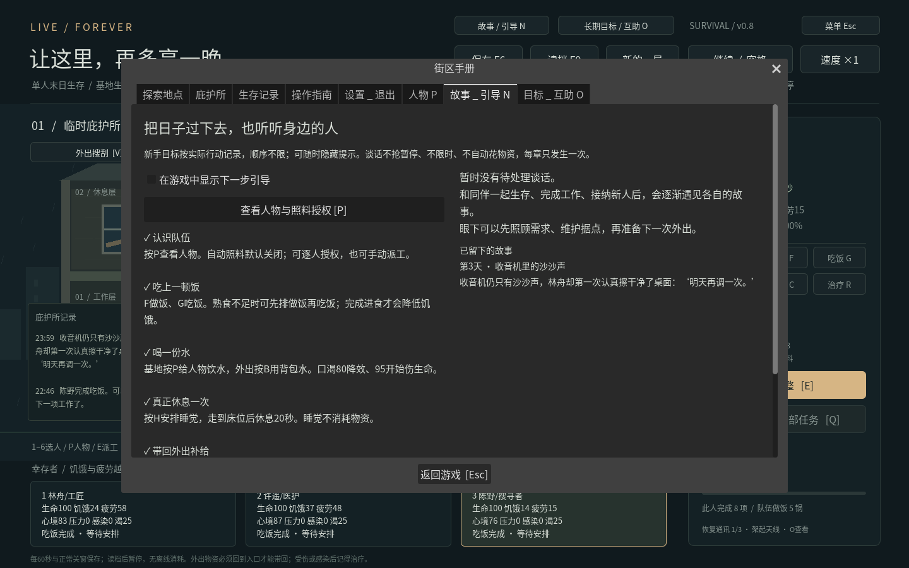

# v0.7 · 同伴故事与新手引导

按N或顶部“故事／引导”按钮打开。手册打开时世界暂停，关闭后恢复原先暂停状态；事件出现本身不会打断操作。页面可滚动，左侧是实际行动目标，右侧是谈话和已完成记录。

## 六项新手目标

| 目标 | 如何真正完成 |
| --- | --- |
| 认识队伍 | 打开P人物页，或从引导点击“查看人物与照料授权” |
| 吃上一顿饭 | 有成员实际完成吃饭；派工、走路或做饭本身不算 |
| 喝一份水 | 基地人物页或外出B实际消耗一份水；做饭用水不算 |
| 真正休息一次 | 完成一轮睡眠；排队或中途取消不算完成 |
| 带回外出补给 | 实际走回入口撤退并获得净补给；只带原装备往返不算 |
| 照看庇护所 | 实际完成付费修缮或进行据点升级 |

目标不要求固定顺序，不送物资，不额外增加人物属性。右下角显示下一项；可在N页取消“在游戏中显示下一步引导”，随时重开。隐藏新手提示后，仍会提醒待处理谈话。旧档仅从已有工作、饮水和净补给记录推导已完成目标，不猜测曾经看过哪一页。

## 八章同伴事件

| 事件 | 出现条件 | 付费选择 |
| --- | --- | --- |
| 林舟：收音机里的沙沙声 | 第2天起，林舟实际完成过制作或修缮 | 材料2 |
| 许遥：药盒上的名字 | 第3天起 | 熟食1 |
| 陈野：给归来的人留灯 | 第4天起，队伍有过净补给归来 | 燃料1 |
| 沈禾：多出来的饭盒 | 第4天起，加入至少一天后 | 熟食2 |
| 顾苒：重新贴好的标签 | 第7天起，加入至少一天后 | 材料1 |
| 唐弥：沿河的旧路线 | 第10天起，加入至少一天后 | 熟食1 |
| 最后一张床位表 | 第4天起，一对活着的同伴信任≤20且至少一人压力≥30 | 熟食1 |
| 桌边空下的位置 | 第2天起，有过成员死亡，至少两名同伴存活 | 熟食1 |

个人故事要求本人和另一名同伴在世。每次最多一段待处理谈话，新谈话最早间隔两个日历日；按固定顺序查找符合条件且未出现的章节。候选人物未加入时不会提前出现其故事。已故人物不会说话、被复活或重新发放章节奖励。

谈话开出后不自动过期、不因拖延额外扣属性；不会在外出途中突然弹窗。你可以先补给、维护和照料，之后再回来处理。

## 明确选择与后果

每章有两条写好的结果。付费选择使用真实库存，页面列出成本和双方心境、压力、创伤、信任变化；缺料会显示原因并禁用付费按钮。保留物资的选择不耗库存，双方心境+2、压力−3、创伤−1、信任+2。付费选择的收益按章节不同，所有数值遵守原有上限。

两种选择都不改变饥饿、口渴、疲劳、生命、伤势或感染，也不替代真正的吃饭、饮水、睡觉或用药。选择不会提升技能或提供永久生产加成；每章仅结算一次，不能反复刷取收益。

外出时可以阅读，但必须先带外出者回到基地才能选择。若待谈话的成员死亡，下一次世界推进会将谈话记为未完成，不扣物资、不奖励属性，记录仍然保留。

## 保存与兼容

schema5保存待处理章节、双方身份索引、出现日期、结果记录、故事时钟、六项引导进度及提示偏好。数据不保存脚本路径或任意可执行内容。加载前验证整个世界；未知章节、错误身份、重复结果、未来日期与重复目标均拒绝，不能部分修改当前世界。

v0.6的schema4以及更早版本顺序迁移，不补发故事奖励、不改变库存、不自动开启照料。新的存档写入保留旧版原文件作为备份。新游戏同时清除本轮故事、选择与引导进度。

## 验证方式

逻辑检查覆盖真实目标、付费／免费分支、缺料原子拒绝、延后、暂停、外出、死亡、六人章节资格、冲突／纪念、重复点击、非法档案、旧版真实四人外出存档迁移与新局重置。

图形检查从真实鼠标／键盘进入N页、切换提示、点击人物跳转，再通过两天实际派工和搜刮取得林舟事件，点击付费选择并检查物资和结果。截图不注入库存或坐标。另有三个独立进程验证待选择、重启选择、再次重启后的结果与库存不重复。

