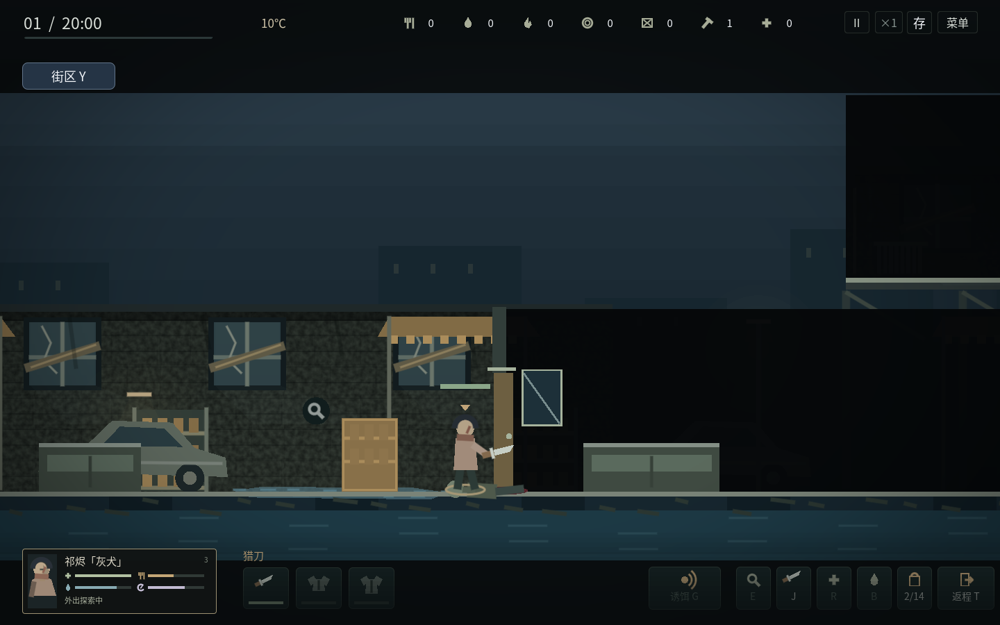
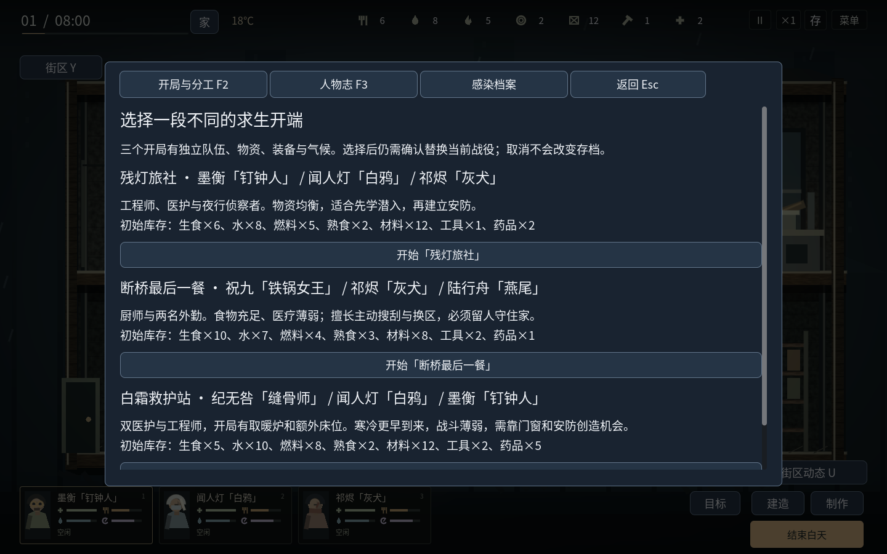
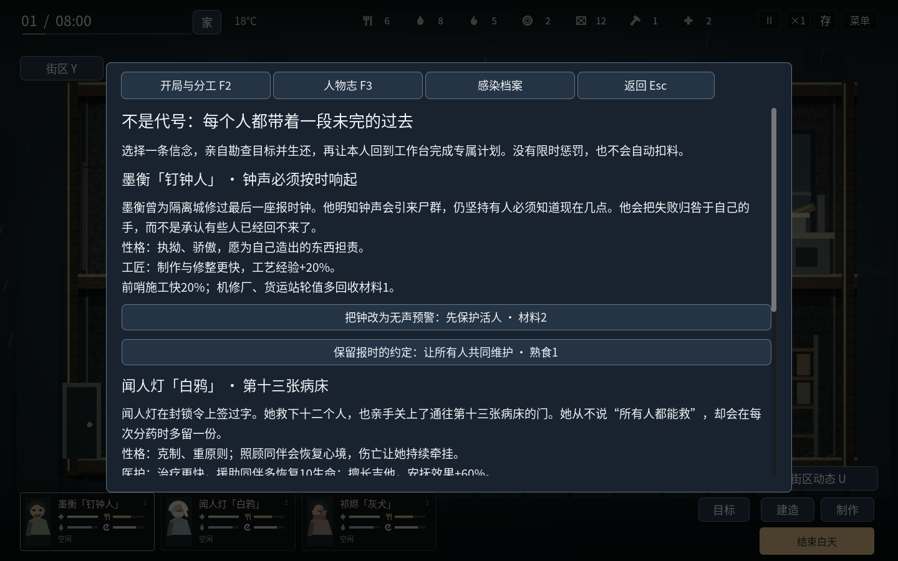
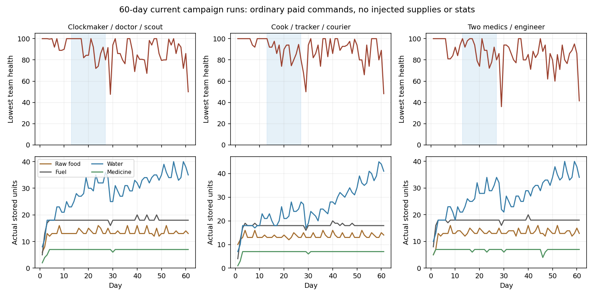

# v1.11 · 门后的生活

本版增加真实房间门窗潜入、能接管人物的基地防守、三个不同开局，以及有经历、行为偏好和可完成个人线的六名原创角色。角色借鉴冒险故事常见的工匠、负罪追踪者、冷面医者等类型，外观和经历为原创；没有使用其他游戏的人物、文本或素材。

## 房间与门窗

九张原有地图现在各有不同分区数量。未知房间遮蔽，已经观察过的房间保持轮廓；失去视线后不会继续显示里面敌人的实时位置。靠门Alt窥视相邻有限范围，E开关门，X拆窗，Shift+X砸窗，再X翻越；也支持点击真实门窗。门窗有现场进度、附近高亮和损坏表现。静拆完成才扣工具1；砸窗保留工具，发出强噪声并留下玻璃。翻越逐步移动，受伤时在就近一侧中断。

关闭的门挡身体、近战与视线；开窗可看见和射击，但身体仍需翻窗。追击／调查中的感染者会逐渐破门，闲逛者不会无故拆掉整栋楼。关门降低传声，但不让玩家完全无声。地图清障、第二梯子和地面材质保留。老档迁移时门默认打开，以免把原本可走的路线突然封住；新开局门默认关闭。

## 自己守住家

从第3夜起，按已有噪声与风险触发袭击；并非每天必打。先暂停准备，再从门与二层窗进入分批尸群。可点击任一家中活人的卡片接管；外派前哨的人不参与，搬家车队沿用其既有风险结算。守夜人沿真实路线协战，其余人近身自卫。

A/D与W/S或鼠标移动，J攻击，E开关入口门，X开关二层窗，V现场修补，医护F救同伴，R自己用药。门窗要走近；修补、急救都耗时，移动或受伤会取消，完成才付料。子弹真实扣除，武器和护甲真实磨损。抬手攻击有准备时间，落下时重新检查方向、距离与门窗；可以离开范围或绕到背后避开。徒手只能推开，楼梯途中不会被横向推出楼梯。

升级门增加耐久并提供射击口，窗网强化上层入口，拒马先伤害进入者，预警铃额外给4秒准备。破坏储藏区会损失实际物资；不再用抽象损伤表重复结算。180秒后不再增援，仍活着的感染者会沿路撤走；必须真正离场才结束。防守减少当晚可用于床眠／地铺恢复的时间，读档保持同一批敌人、门窗损坏和未完成工作。

## 三个开局

| 开局 | 队伍 | 取舍 |
| --- | --- | --- |
| 残灯旅社 | 墨衡、闻人灯、祁烬 | 均衡物资，猎刀与钉棒，适合熟悉系统 |
| 断桥最后一餐 | 祝九、祁烬、陆行舟 | 食物与外勤较强，医疗薄弱，气温−3℃ |
| 白霜救护站 | 纪无咎、闻人灯、墨衡 | 医药多，开局额外床与炉，气温−6℃，需先改善战力 |

F2的卡片公布准确库存。确认才重新开始；取消保留当前状态。旧档不自动改开局、不补初始物资、不重置地图。

## 六个人的取舍

| 人物 | 性格与原有专长 | 专属线 |
| --- | --- | --- |
| 墨衡「钉钟人」 | 执拗、骄傲的报时匠，制作熟练、门窗更快 | 机修厂勘查，重制预警齿轮；选择效率／安静，或合作与恢复 |
| 闻人灯「白鸦」 | 克制、有负疚的医生，擅长援助与演奏 | 诊所记录、夜战救护规程；强化急救，或兼顾恢复 |
| 祁烬「灰犬」 | 寡言的前追踪者，潜伏、背袭强，巨响增加压力 | 广播站暗号；选择反猎杀，或守家与恢复 |
| 祝九「铁锅女王」 | 豪爽护短，烹饪节省，自身更易饿 | 集市配给记录，公共餐桌；完成后可每日用熟食2安抚全队 |
| 纪无咎「缝骨师」 | 理性刻薄的法医，精细护理强但体弱 | 水厂污染记录、护理台账；选择医疗效率，或医疗与恢复 |
| 陆行舟「燕尾」 | 爱逞强的走私向导，翻窗、交涉与恢复强；久不外出烦躁 | 码头名单、全员备用退路；选择安静翻越，或翻越与睡眠 |

F3中每条线有两种信念、真实搜索目标、付料与12秒本人工作，三阶段完成，才给对应数值能力。不是仅改名字；已有心境、压力、关系、创伤、技能与基本自理继续生效。没有强迫随机拒令、跨地图人类对话NPC或无限生成的剧情。实际无注资战役中，工程师、厨师、法医三条线均通过搜刮→生还→付料工程完整完成；其余线共享机制并有阶段、身份与存档检查。

## 感染者留下的往事

伏猎者等待观察；听风者视觉较弱、听觉较强，会停下来转头倾听；呼号者发现玩家后让附近同类调查呼号位置，不会广播玩家的隐藏坐标；守巢者回到旧岗位。非重型敌人重伤时会尝试退向同伴。诱饵调查记忆有有限持续时间，识破同一声源位置后可换位置或依靠真正的动静改变局面。

每张地图的第三个现场记录解锁当地命名感染者的过去：巡更人、护士长、焊面人、敲门的父亲、红围裙、阀门看守、搬运队长、播音员、摆渡人。其文本描述对应实际听声、守位、呼号、退却或沿梯调查行为；感染者没有恢复人类语言，也不具有通用推理能力。

## 长期循环与验证边界

食物和水继续按人头消耗；冬衣、取暖与医疗应对寒潮；近战武器和护甲需要维修，枪械持续消耗弹药，门窗和拒马需要维护。战役零件不复制，地图每天仅有限补货。夜袭人数与普通／迅捷／重型组合随日程变化，生命值不随玩家装备无上限膨胀。不同开局的冷偏移也用于夜间寒冷结算。

当前战役检查使用普通命令移动、搜刮、建设、制作、装备、治疗和防守；不补库存、不改生命／需求、不传送、不直接设置任务或战役进度。三开局×两路线均在35日窗口内全员撤离，且逐日校验实际存档。两路线为潜行并持续整备装备，以及在此基础上投资门窗、拒马与预警。未充分整备的初次策略曾在第19／23天全灭，保留为诊断证据；不会把它们计作通过。

三个开局的安防路线随后均维持全员存活至第61天开始，分别实际参与42、43、44场基地防守。逐日数据见[v21-campaign-balance.json](v21-campaign-balance.json)。

最终精确检查数量、运行包哈希与桌面范围见[v21-validation.json](v21-validation.json)。这些是可复现策略的验证，不表示任意策略都能活下来，也不等于无限时长与所有硬件已验证。Windows为官方模板导出，真机和可闻声音仍待确认。

历史核心场景的三人固定策略在旧版就有长期失败记录，保留在v20报告；它不是目前的可玩战役。默认检查现改为完整当前战役矩阵，历史策略可显式加`--legacy-prototype-long-runs`复现，未删除失败测试或把失败当通过。

复验：`python tests/run_checks.py --graphics --extended-balance --artifacts /tmp/live-forever-checks`，需要Godot4.6.3及有效图形DISPLAY。完整操作见[PLAYING.md](PLAYING.md)。
