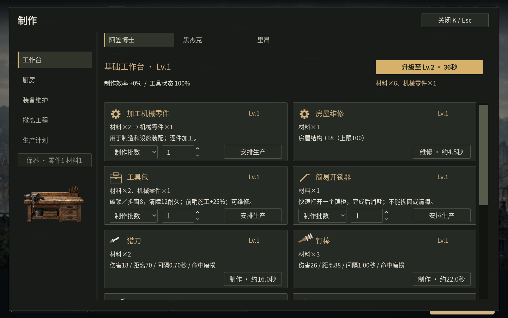
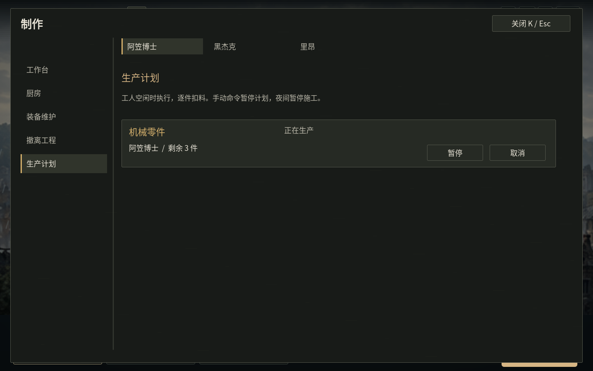
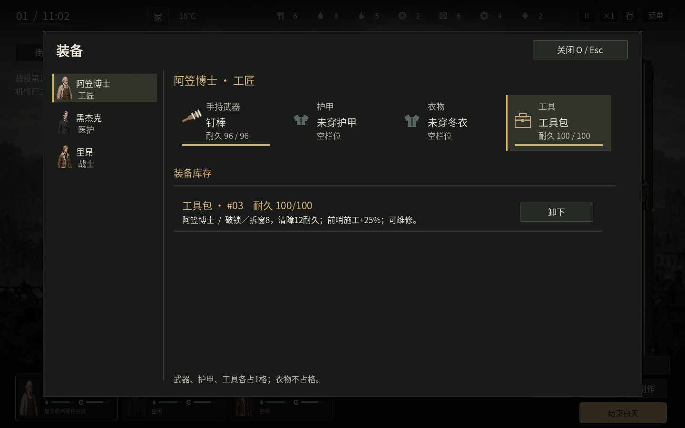

# v1.21 工具、机械零件与生产计划

原来名为“工具”的通用配方耗材已明确改为“机械零件”。耐用工具另有使用和维修规则，制造不再把整套锤子、扳手当作一次性用料扣掉。

| 类型 | 获取与用途 | 消耗方式 |
| --- | --- | --- |
| 机械零件 | 材料2加工1件，也能搜刮、完成委托或前哨轮值获取；用于装配、升级和工程 | 按配方扣数量；每格最多4件 |
| 工作台配套工具 | 工作台自带，初始状态100；基地制造共用 | 完成作业后磨损，可保养，不会每次消失 |
| 外出工具包 | 每个开局仓库有1套；材料2、机械零件1制造，或从固定现场回收 | 100耐久，反复使用；损坏后可维修 |
| 简易开锁器 | 材料1制造，工具栏装备 | 快速打开一个锁柜后消耗，不能静拆窗或清障 |

## 制作与补库存

按 **K → 工作台**。机械零件、工具包、开锁器三种配方可以选择：

- **制作批数**：完成指定件数后停止；范围1–20件。
- **库存补到**：只生产库存缺口，达到目标后待命。零件按仓库数量计算；工具包和开锁器按未装备且可用的备用数量计算。

安排计划时不提前扣整批材料。工人实际到场开工后逐件消耗，完成才获得产物；已有同类制作计入预计库存，避免重复补产。缺料时保留计划等待，获得材料后继续；材料不足也能先安排计划。

生产会等待工人空闲，生命不高于30、饱腹或水分不高于35、精神不高于30时不会强迫开工。自理和其他正在执行的行动优先。手动下达命令会暂停该工人的生产计划，需要在计划页按“继续”；Shift追加普通任务时会先完成并计入当前零件，再执行手动任务，取消计划也会保留追加任务；日落取消未完成施工并退回用料，保留剩余目标，下一天有空且状态合适时继续。

按 **K → 生产计划** 查看工人、剩余数量或备用库存，以及缺料、等待、生产、暂停状态。暂停和取消通过原有任务退款路径处理，不重复退料，也不会把未完成件计为产物。重新安排同一物品会替换它的原计划。

## 工具维护

工作台工具完成零件加工、弹药制造、普通修理时磨损2；已接入的其他工作台装备制造、升级和工程磨损4。未完成取消不计完成磨损。状态不高于20时，常规工作台制造速度降为85%；完全损坏时降为65%，仍能加工基础零件，避免无法制造维修材料的死循环。

工作台页的“保养”消耗材料1、机械零件1，基础工时12秒，恢复状态60，上限100。保养本身不受工具损坏减速影响。界面显示状态和实际工具效率；工匠专长、人物状况和工作台等级仍影响工时。

## 外出装备与操作

按 **O → 工具** 分配具体工具包或开锁器。武器、护甲、衣物和工具是四个独立栏目；同名工具包分别保存编号、所属人物和耐久。武器、护甲、工具各占背包1格，衣物不占格。夜间准备也可点击各人的第四个装备入口。

- 工具包快速破锁磨损8，静拆窗口磨损8，清障磨损12；工具包令前哨施工、修整效率提高25%，完成时分别磨损6、4。
- 未完成的破锁、静拆和清障不扣对应完成磨损；反复打开同一个已搜过的箱子不再收费。
- **X静拆窗口**需要可用工具包；没有工具包时明确提示，**Shift+X**仍可砸窗。徒手清障和慢速强开锁柜仍保留，其时间和噪声代价更高。
- 工具包损坏后保留原件。回基地的装备维护页消耗材料2、基础工时18秒恢复60耐久；开锁器不能通过维修再生。
- 外出期间O仅检查随身装备，不从基地远程取工具。

机修厂、净水厂和货运站各有一处可回收工具包。打开实际容器后点击工具格拿取，占1格，可放回原处；生还到出口才入库，分别保留70、65、55耐久。死亡会损失所携带工具，原缓存不会再次复制。工具是容器最后一件物品时也计入有物资状态；全部取走后容器变灰。

## 本轮检查

28组逻辑检查共2383项、8组图形操作共314项通过。新增生产流程覆盖批数、库存目标、工人需要、手动优先、缺料等待、退款、日落、中途存档、工具磨损、一次性开锁器、缓存容量和死亡丢失。最终Linux验收程序的150项分辨率、全屏及界面预检通过（预检模式不包含默认30分钟连续验收）。新生产跨进程写入→完成→再次读取通过；清障与门窗、夜袭的相关跨进程检查也通过。

旧城旅社和临时救护站均在第29天完成撤离；断桥车队完成撤离并持续到第62天，均保留3名幸存者。测试策略通过正常指令进行搜刮、装备、制造、维修及防守，未注入库存、血量、位置或任务进度。这些是指定策略的结果，不代表所有玩法已穷尽。

一并修复了夜间营地快捷按钮遮挡地面点击的问题，九张地图的鼠标清障和上下楼已回归。1024×768至1920×1080布局和Linux全屏已检查。Windows包已导出，Windows真机验收仍待完成。

[结构化验证记录](tools-production-validation.json) · [下载](../downloads/README.md)
