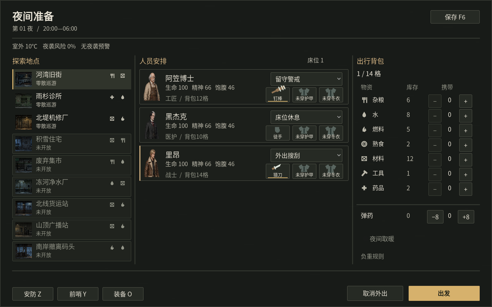
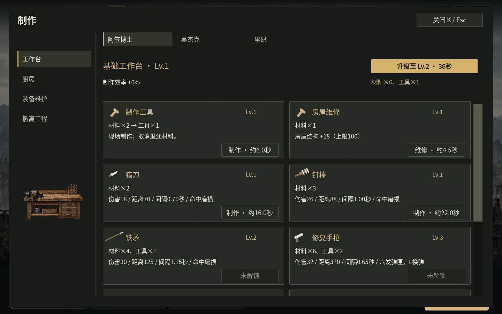
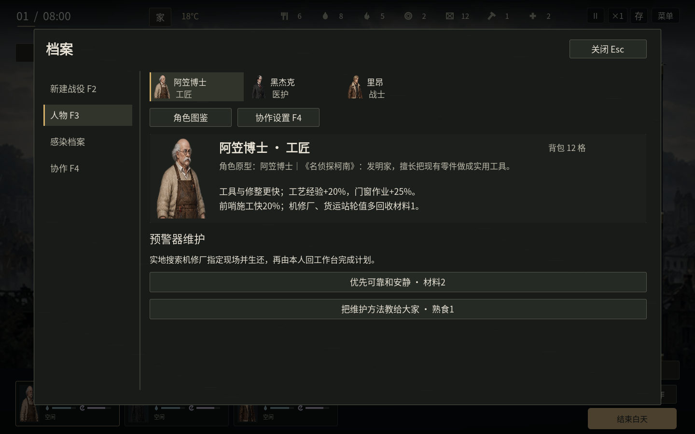

# v1.20 界面调整

这一版把常用菜单按实际操作顺序重新排版，减少占屏说明和含糊标题。角色、物品、配方、地图、技能和战斗数值沿用上一版。

| 原界面 | 当前界面 |
| --- | --- |
| 第×夜·谁去，谁留下 | 夜间准备 |
| 天亮了、开始白天的生活 | 行动报告、进入白天 |
| 每次切换三张地图、重复“选择地点”按钮 | 九个地点同列，点击整行选择 |
| 人物背景和个人任务全部连续堆叠 | 肖像选择一人，显示专长与当前计划 |
| 岗位、携带和装备规则长期占屏 | 主要操作常驻，详细规则悬停查看 |

## 夜间准备

左栏为地点缩略图、主要资源图标与巡群情况；未开放地点置灰。中栏每人显示肖像、状态、岗位和三个独立装备入口。右栏明确区分仓库库存与携带数量，保留弹药、负重与夜间取暖。选中地点和搜刮者使用侧边标记，主操作使用琥珀色。

“取消外出”撤销搜刮人选及携带草案；仍需点击“留守过夜”才开始结算。物资仍在确认出发时统一扣除。岗位的休息效果、装备耐久、地点解锁条件可悬停查看。

## 制作与管理

制作页面固定工作台、厨房、装备维护和撤离工程导航，配方卡优先显示物品、材料和操作。升级与房屋维修分别命名。装备页、营地页、人物档案沿用同一套边栏、标题、选中标记及关闭按钮；原配方、独立装备实例和分配限制保留。

配色统一为炭灰、米白与琥珀色，降低普通面板边框的存在感，增加标题与正文层级。详细效果、人物背景和规则放在悬停说明，错误与不足材料仍在对应操作附近提示。

## 人物与清晨

人物页用肖像切换，不改变当前操控角色。保留玩家指定的十二名角色、专长和两条个人选择；背景与性格可悬停查看。个人计划改用实际用途命名，例如“预警器维护”“设备检修”“射击训练”。

清晨默认显示简要行动记录，略去重复教学与无变化的零值条目；“完整记录”仍可展开原始事件，不删除结算事实。

## 检查范围

检查覆盖制作、厨房、装备分配、营地健康与生产、人物切换、地点选择、物资草案、留守结算、报告展开、安防和返程。三人正常开局与五人上限展示夹具均检查布局；五人夹具用于验证排版，不代表本轮完成招募流程。1024×768、1280×720、1440×900和1920×1080已检查窗口适配，Linux图形环境检查全屏切换。

23组逻辑回归1651项、白天夜晚单元检查85项、12组图形操作335项均通过。[结构化验证记录](ui-validation.json)。Linux导出程序已完成真实系统输入、搜刮、返程、关闭及重启检查。Windows导出成功，Windows真机验收仍待完成；本轮未重新进行长期战役通关，上一版的长期结果不计作本轮重测。
